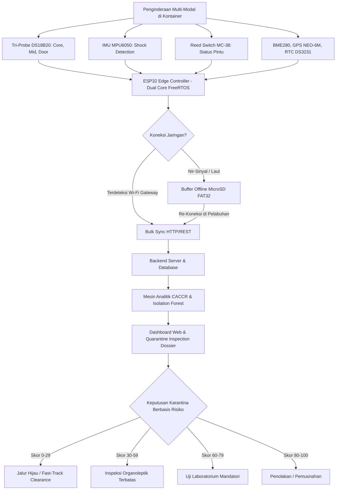

<!-- 
PETUNJUK FORMAT CETAK / EXPORT KE .DOCX:
1. Ukuran Kertas: A4 (Portrait)
2. Margin: Kiri 3 cm, Kanan 3 cm, Atas 3 cm, Bawah 3 cm
3. Jenis Huruf: Times New Roman
4. Ukuran Font: Judul 14pt (Bold, Title Case, Maksimal 18 Kata); Teks Isi 12pt; Abstrak 10pt (Spasi Tunggal); Keterangan Gambar/Tabel 10pt
5. Spasi Paragraf: 1.15 Spasi, Justify (Rata Kiri-Kanan), Indent Baris Pertama 1 cm
6. Sistem Sitasi: American Psychological Association (APA) 7th Edition
7. Kode Dokumen: [FP-xxx] → ganti di header halaman
-->

---

# HALAMAN JUDUL

## **Q-GUARD: CONTINUITY-AWARE COLD-CHAIN RISK MONITORING BERBASIS IOT DAN MULTIVARIATE AI UNTUK SMART QUARANTINE KOMODITAS BEKU**

 

**KARYA TULIS ILMIAH INOVASI KARANTINA**  
**QUARANTINE INNOVATION CHALLENGE (QIC) 2026**

 

**SUBTEMA:**  
*Smart Border & AI-Quarantine: AI, IoT, portable biosensors, dan digital inspection untuk mendukung pengawasan karantina.*

  

**Diusulkan Oleh:**

| Nama Lengkap | NIM / NPM | Peran / Bidang Keahlian |
| :--- | :---: | :--- |
| **[Nama Ketua Tim]** | [NIM Ketua] | Ketua Tim / Embedded Systems & IoT Firmware |
| **[Nama Anggota 1]** | [NIM Anggota 1] | Anggota 1 / AI & Machine Learning Modeling |
| **[Nama Anggota 2]** | [NIM Anggota 2] | Anggota 2 / Cloud Backend & Quarantine Systems |

 

**Dosen Pendamping:**  
**[Nama Dosen Pendamping, Lengkap dengan Gelar Akademik]**  
NIP / NIDN: [Nomor Induk Dosen]

 

**[PROGRAM STUDI]**  
**[FAKULTAS]**  
**[NAMA PERGURUAN TINGGI]**  
**[KOTA]**  
**2026**

---

\newpage

<!-- ============================================================ -->
<!-- MULAI TEKS INTI (8–10 HALAMAN) — TANPA IDENTITAS PENULIS     -->
<!-- ============================================================ -->

## **Q-GUARD: CONTINUITY-AWARE COLD-CHAIN RISK MONITORING BERBASIS IOT DAN MULTIVARIATE AI UNTUK SMART QUARANTINE KOMODITAS BEKU**

## ABSTRAK

Distribusi komoditas hayati beku di Indonesia menghadapi kesenjangan informasi distribusi (*distribution information gap*), yaitu hilangnya ketertelusuran kondisi fisik komoditas antara titik sertifikasi awal hingga pelabuhan pengeluaran. Insiden pemusnahan 14,5 ton daging ayam beku di Nabire akibat kegagalan pendingin selama pelayaran menegaskan kelemahan metode penyegelan statis. Karya tulis ini mengusulkan Q-GUARD, instrumen inspeksi digital portabel berbasis IoT dan *Edge-AI* yang menerapkan kerangka *Continuity-Aware Cold-Chain Risk* (CACCR). Prototipe mengintegrasikan ESP32 dengan sensor suhu spasial tri-probe DS18B20, sensor lingkungan BME280, akselerometer MPU6050, saklar magnetik MC-38, GPS NEO-6M, dan RTC DS3231. Arsitektur *offline-first store-and-forward* menjamin keutuhan data saat melewati zona tanpa sinyal. Evaluasi risiko menggabungkan kinetika *Mean Kinetic Temperature* (MKT) Arrhenius dan model *Isolation Forest* untuk menghasilkan Skor Risiko Komposit serta *Quarantine Inspection Dossier* digital, mentransformasi inspeksi konvensional menjadi *Risk-Based Digital Inspection*.

**Kata Kunci:** *IoT, Smart Quarantine, AI Anomaly Detection, Cold Chain, Digital Inspection*

---

## **Q-GUARD: CONTINUITY-AWARE COLD-CHAIN RISK MONITORING BASED ON IOT AND MULTIVARIATE AI FOR SMART QUARANTINE OF FROZEN COMMODITIES**

## ABSTRACT

*The distribution of frozen biological commodities in Indonesia faces a persistent distribution information gap—a complete lack of physical integrity tracking between initial certification and port-of-export clearance. The destruction of 14.5 tons of spoiled frozen poultry in Nabire due to refrigeration failure during maritime transit underscores the limitations of static physical sealing methods. This paper introduces Q-GUARD, a portable digital inspection instrument leveraging IoT and Edge-AI driven by the Continuity-Aware Cold-Chain Risk (CACCR) framework. The prototype integrates an ESP32 microcontroller with a spatial tri-probe DS18B20 temperature array, BME280 environmental sensor, MPU6050 accelerometer, MC-38 magnetic reed switch, NEO-6M GPS, and DS3231 RTC. An offline-first store-and-forward architecture ensures zero data loss during maritime communication blackouts. The risk evaluation engine combines Arrhenius-based Mean Kinetic Temperature (MKT) thermodynamics with an Isolation Forest model to compute a Composite Risk Score and generate an automated Quarantine Inspection Dossier, shifting the quarantine paradigm from invasive random sampling to non-destructive, risk-based digital inspection.*

**Keywords:** *IoT, Smart Quarantine, AI Anomaly Detection, Cold Chain, Digital Inspection*

---

\newpage

# BAB I
# PENDAHULUAN

## 1.1 Latar Belakang

Perdagangan internasional komoditas hayati beku—khususnya produk perikanan seperti *Frozen Yellowfin Tuna Loin* (*Thunnus albacares*), udang vaname (*Litopenaeus vannamei*), serta daging unggas dan ruminansia—merupakan pilar strategis devisa nasional Indonesia. Ketertelusuran (*traceability*) sepanjang rantai pasok menjadi prasyarat keamanan pangan global (Aung & Chang, 2014). Karakteristik biologis komoditas beku mensyaratkan integritas rantai dingin (*cold chain*) yang tidak boleh terputus: suhu wajib dipertahankan pada ≤ −18°C sesuai standar *Codex Alimentarius* CAC/RCP 52-2003 (Codex Alimentarius Commission, 2020) dengan toleransi fluktuasi maksimal 3°C hanya pada kondisi operasional mendesak, serta kepatuhan terhadap sistem manajemen keamanan pangan ISO 22000:2018 (International Organization for Standardization, 2018).

Berdasarkan UU No. 21 Tahun 2019, Badan Karantina Indonesia (Barantin) memegang mandat ganda: sebagai otoritas biosekuriti perbatasan guna mencegah masuk dan keluarnya Hama dan Penyakit Hewan Karantina (HPHK) serta Hama dan Penyakit Ikan Karantina (HPIK), sekaligus fasilitator perdagangan yang menjamin komoditas ekspor memenuhi standar keamanan pangan negara mitra (Republik Indonesia, 2019). Namun, realitas logistik kepulauan (*archipelagic logistics*) Indonesia menimbulkan tantangan fundamental: komoditas dari sentra produksi terpencil (Maluku, Papua, Sulawesi) menempuh transit multimoda 3–14 hari melibatkan *reefer truck* dan *reefer container* sebelum tiba di pelabuhan ekspor utama seperti Tanjung Priok, Tanjung Perak, atau Belawan.

Selama rentang transit tersebut, terjadi **kesenjangan informasi distribusi (*distribution information gap*)** di mana otoritas karantina kehilangan keterlacakan kondisi fisik kargo setelah segel dipasang (Badia-Melis et al., 2018). Kegagalan kompresor pendingin, kehabisan bahan bakar genset, kerusakan insulasi kontainer, atau pembukaan pintu palka tanpa izin menyebabkan kenaikan suhu (*temperature abuse*) yang tidak terdeteksi. Berdasarkan kinetika reaksi biokimia (Mercer, 2014), kenaikan suhu pada komoditas beku memicu percepatan autolisis enzimatis, peningkatan TVB-N (*Total Volatile Basic Nitrogen*), pembentukan kristal es sekunder yang merusak membran sel daging, serta akumulasi histamin pada ikan *scombroid* yang membahayakan kesehatan konsumen (Ndraha et al., 2018; Food and Drug Administration, 2022).

## 1.2 State-of-the-Art dan Research Gap

Da Costa et al. (2023) meninjau teknologi IoT untuk rantai pasok pangan dan mencatat bahwa sebagian besar solusi komersial hanya memvisualisasikan metrik tunggal tanpa analisis risiko berbasis kinetika degradasi mutu biologis. Singha et al. (2023) melalui *IntelliStore* menerapkan pemantauan IoT dan AI, namun dirancang untuk gudang statis dengan koneksi internet tetap, sehingga tidak aplikatif untuk logistik bergerak antarpulau. Loisel et al. (2022) mendemonstrasikan *machine learning* untuk estimasi suhu palet pangan, namun belum mengintegrasikannya ke dalam kerangka regulasi sertifikasi karantina pemerintah.

*Research gap* yang dijawab Q-GUARD mencakup tiga dimensi kebaruan: (1) **Penginderaan Spasial Tiga Titik** — menggantikan paradigma sensor titik tunggal dengan konfigurasi probe kedalaman kargo (*core, mid-pack, door boundary*), memungkinkan deteksi dini perambatan panas sebelum massa inti komoditas mengalami pencairan; (2) **Model Risiko Termodinamika & AI** — mengintegrasikan formulasi kinetika MKT Arrhenius standar USP/FDA dengan deteksi anomali multivariat *Isolation Forest*; dan (3) **Keluaran Regulasi Karantina** — mengonversi data telemetri mentah menjadi *Quarantine Inspection Dossier* digital yang terikat pada nomor pengapalan, memungkinkan keputusan *Fast-Track Clearance* atau *Conditional Laboratory Inspection* secara non-destruktif di pelabuhan perbatasan.

## 1.3 Permasalahan Karantina

Pada 7 Agustus 2026, Barantin Satuan Pelayanan Nabire melakukan pemusnahan 14,5 ton daging ayam beku yang membusuk akibat matinya mesin pendingin kontainer selama pelayaran laut (Badan Karantina Indonesia, 2026a). Di sisi lain, pengiriman 26 ton tuna loin beku asal Maluku senilai Rp3,39 miliar ke Vietnam menuntut kepatuhan sanitasi tanpa kompromi (Badan Karantina Indonesia, 2026c). Metode *datalogger* USB konvensional tidak memadai karena: (a) bersifat titik tunggal (*single-point ambient*) tanpa kemampuan membaca gradien termal di dalam massa kargo; (b) tanpa kecerdasan komputasi untuk peringatan dini; (c) tanpa sensor pembukaan pintu atau guncangan mekanis; dan (d) memerlukan unduh manual satu per satu yang memperpanjang *dwelling time* pelabuhan.

## 1.4 Urgensi Inovasi

Cetak biru **Smart Quarantine Barantin 2026** menekankan digitalisasi pengawasan perbatasan melalui automasi, keterpaduan data, dan pengambilan keputusan berbasis risiko (Badan Karantina Indonesia, 2026b). Sistem STELINA (Sistem Ketertelusuran Perikanan) milik KKP juga tengah dikembangkan untuk menjamin *traceability* rantai pasok perikanan nasional (Kementerian Kelautan dan Perikanan, 2026). Tanpa instrumen pemantau kontinu yang cerdas, kargo yang pernah mengalami pencairan parsial (*partial thawing*) dapat lolos inspeksi dan ditolak di pelabuhan negara tujuan, memicu sanksi notifikasi SPS hingga pencabutan izin ekspor unit pengolahan—merugikan reputasi dan perekonomian nasional secara signifikan.

## 1.5 Tujuan

1. Mengembangkan instrumen *portable edge-sensing* Q-GUARD berbasis ESP32 dengan sensor suhu tri-probe DS18B20, IMU MPU6050, *reed switch* MC-38, GPS NEO-6M, dan RTC DS3231.
2. Mengimplementasikan protokol *offline-first store-and-forward* yang menjamin keutuhan data 100% (*zero data loss*) saat melewati zona tanpa sinyal seluler laut lepas.
3. Merumuskan mesin analitik risiko CACCR berbasis MKT Arrhenius dan *Isolation Forest* yang menghasilkan Skor Risiko Komposit (0–100) serta *Quarantine Inspection Dossier* digital bagi pejabat karantina.

---

\newpage

# BAB II
# METODE/PENDEKATAN KAJIAN

## 2.1 Alur Kerja

Kerangka konseptual Q-GUARD dinamakan **CACCR (*Continuity-Aware Cold-Chain Risk*)**. Model ini dibangun atas premis bahwa integritas produk beku bukan sekadar fungsi biner "suhu saat diperiksa", melainkan fungsi integral dari riwayat termodinamika, integritas mekanis, dan keutuhan segel fisik selama masa transit. Sistem bekerja dalam empat tahap: (1) akuisisi sensor multi-modal di kontainer; (2) penyimpanan deterministik ke MicroSD (*offline-first*); (3) sinkronisasi otomatis ke *backend* saat mendeteksi *gateway* Wi-Fi pelabuhan; dan (4) kalkulasi risiko komposit dan penerbitan dokumen inspeksi digital.

Perangkat keras Q-GUARD dikemas dalam wadah polimer termoplastik tahan suhu beku dan *splash-proof*, mengintegrasikan ESP32-WROOM-32 (*dual-core* Tensilica Xtensa 240 MHz, FreeRTOS) dengan: tiga probe suhu DS18B20 berpelindung baja tahan karat pada konfigurasi spasial—**Probe T1** (*Core Cargo*: tengah massa kargo terdalam), **Probe T2** (*Mid-Pack*: antara lapisan karton tengah), **Probe T3** (*Door Boundary*: dekat pintu palka, titik paling awal mengalami intrusi termal); sensor BME280 (suhu ambien dan kelembapan relatif); akselerometer MEMS MPU6050 3-sumbu ($\pm 4g$); saklar magnetik MC-38 pada pintu palka (interupsi perangkat keras GPIO); modul GPS NEO-6M; dan RTC presisi DS3231 (akurasi $\pm 2$ ppm). Core 1 menangani pembacaan sensor dan tampilan layar TFT ILI9341 2,8 inci setiap 1000 ms, sementara Core 0 mengelola penulisan MicroSD via SPI dan komunikasi jaringan. Antarmuka lokal dilengkapi *buzzer* alarm, LED RGB status, dan *Captive Portal* yang memungkinkan konfigurasi via QR Code tanpa aplikasi khusus. Gambar 2.1 menyajikan diagram alur kerangka kerja konseptual sistem.

*Gambar 2.1 Alur Kerangka Kerja Konseptual Sistem Q-GUARD. Sumber: olahan penulis.*

## 2.2 Teknik Perolehan Data

Setiap 5 detik, firmware membentuk *record* terstruktur memuat: `timestamp`, `shipment_id`, `temp_core`, `temp_mid`, `temp_door`, `ambient_temp`, `humidity`, `shock_g`, `door_status`, `latitude`, `longitude`. Data ditulis ke MicroSD dalam format CSV di bawah direktori `/logs/data_{shipment_id}.csv`. ESP32 menyimpan posisi *byte* terakhir yang berhasil ditransmisikan ke EEPROM non-volatil; saat Wi-Fi *gateway* pelabuhan terdeteksi, *record* yang belum tersinkronisasi dikirim dalam paket *batch* (maks 50 *record* per HTTP POST). Peladen backend memvalidasi integritas *checksum* setiap paket; hanya setelah respons HTTP 200 diterima, penanda *byte* di EEPROM diperbarui. Mekanisme *handshake* dua arah ini menjamin *zero data loss* tanpa duplikasi rekaman.

Deteksi guncangan menggunakan magnitudo vektor akselerasi: $g_{\text{net}} = \sqrt{a_x^2 + a_y^2 + a_z^2}$, dengan ambang peringatan pada $g_{\text{net}} > 2.0g$. Saklar MC-38 terhubung ke interupsi perangkat keras GPIO 34, mencatat stempel waktu presisi (resolusi milidetik via DS3231) setiap pembukaan/penutupan pintu palka.

## 2.3 Model Analisis

**Mean Kinetic Temperature (MKT).** Evaluasi paparan panas tidak dapat diwakili oleh rata-rata aritmatika sederhana; kenaikan suhu beberapa derajat menggandakan laju reaksi enzimatis sesuai hukum Arrhenius. Q-GUARD menerapkan formulasi MKT standar USP/FDA (Haynes, 1971; World Health Organization, 2019):

$$T_{\text{mkt}} = \frac{\Delta H / R}{-\ln\left( \frac{1}{n} \sum_{i=1}^{n} \exp\left( -\frac{\Delta H}{R \cdot T_i} \right) \right)}$$

dengan $\Delta H = 83.14$ kJ/mol (energi aktivasi oksidasi lipid dan denaturasi protein), $R = 8.314 \times 10^{-3}$ kJ/(mol·K), dan $T_i$ dalam Kelvin. Melalui pembobotan eksponensial, pembacaan suhu tinggi pada insiden lonjakan singkat memberikan kontribusi dominan, merefleksikan stres biologis aktual yang dialami komoditas.

**Skor Risiko Komposit CACCR.** Skor total ($S_{\text{total}}$) dinormalisasi 0–100 dari tiga vektor fisik independen:

$$S_{\text{total}} = 0.60 \cdot S_{\text{thermal}} + 0.25 \cdot S_{\text{shock}} + 0.15 \cdot S_{\text{integrity}}$$

Vektor termal ($S_{\text{thermal}}$): bernilai 0 bila $T_{\text{core}}$ tetap di bawah −18°C; meningkat proporsional terhadap rasio dan frekuensi pelanggaran suhu pada zona moderat (−18°C hingga −13°C); dan mencapai nilai tinggi (50–90) pada pelanggaran kritis ($T_{\text{core}} > -13$°C). Vektor guncangan ($S_{\text{shock}}$): bernilai 0 untuk $g_{\text{net}} \le 2.0g$, 40 untuk guncangan moderat ($2.0g < g_{\text{net}} \le 3.0g$), dan 70 untuk benturan kritis ($g_{\text{net}} > 3.0g$). Vektor integritas ($S_{\text{integrity}}$): bernilai 0 bila tidak ada insiden buka pintu; 20 untuk 1–5 insiden buka pintu singkat (< 2 menit); dan 50 untuk pembukaan berulang atau berkepanjangan (indikasi kebocoran segel).

**Isolation Forest (Tingkat Dua).** Pada *backend*, algoritma *unsupervised* Isolation Forest (Liu et al., 2012) mendeteksi korelasi multivariat antara laju perubahan suhu inti ($\Delta T_{\text{core}}/\Delta t$), gradien spasial ($T_{\text{door}} - T_{\text{core}}$), fluktuasi kelembapan, dan profil guncangan. Keunggulan utama: model mampu membedakan siklus *defrost* normal pendingin (suhu dinding palka naik sementara suhu inti stabil di bawah −18°C) dari kegagalan total kompresor, menekan angka alarm palsu (*false alarm rate*) secara signifikan dibandingkan *rule engine* statis.

---

\newpage

# BAB III
# HASIL DAN PEMBAHASAN

## 3.1 Konsep Inovasi

Q-GUARD mendefinisikan ulang pengawasan rantai dingin karantina melalui konsep *Continuity-Aware*: integritas produk beku bukan fungsi suhu sesaat saat diperiksa, melainkan fungsi integral dari seluruh riwayat termodinamika, mekanis, dan fisik selama transit. Konfigurasi tri-probe memungkinkan deteksi dini: probe pintu ($T_3$) merespons kenaikan suhu jauh lebih awal dibanding probe inti ($T_1$), memberikan jendela waktu peringatan dini sebelum massa kargo mencair. Antarmuka pengguna lokal berupa layar TFT 2,8 inci menampilkan grafik tren suhu tri-probe, status risiko (*NORMAL*, *CAUTION*, *CRITICAL*), koordinat GPS, dan indikator memori secara *real-time* di bodi kontainer. Petugas lapangan cukup memindai QR Code pada layar untuk mengakses *Captive Portal* konfigurasi via peramban ponsel tanpa instalasi aplikasi khusus.

Di sisi *backend*, dasbor web interaktif menampilkan visualisasi komprehensif meliputi peta rute pelayaran GPS, grafik tren suhu tri-probe beserta garis batas −18°C, *timeline* insiden kritis (buka pintu, guncangan), serta perhitungan otomatis MKT dan Skor Risiko Komposit. Fitur unggulan adalah penerbitan *Quarantine Inspection Dossier* digital berbasis PDF/HTML yang memuat seluruh rekam jejak transit kargo dan rekomendasi disposisi karantina yang dapat langsung diunduh oleh pejabat Barantin.

## 3.2 Keunggulan Komparatif

*Tabel 3.1 Perbandingan Komparatif Q-GUARD terhadap Metode Konvensional.*

| Parameter | Datalogger USB | GPS Tracker Biasa | **Q-GUARD** |
| :--- | :--- | :--- | :--- |
| Penginderaan Suhu | Titik tunggal ambien | Titik tunggal ambien | **Array 3-titik spasial** |
| Deteksi Stratifikasi Termal | Tidak mampu | Tidak mampu | **Deteksi perambatan panas dini** |
| Integritas Segel Pintu | Tidak ada | Opsional (sensor cahaya) | **MC-38 interupsi + log waktu** |
| Deteksi Guncangan Mekanis | Tidak ada | Akselerometer dasar | **MPU6050 6-DOF, vektor g-net** |
| Model Evaluasi Risiko | Ambang statis Min/Max | Ambang statis Min/Max | **MKT Arrhenius + CACCR** |
| Deteksi Anomali Cerdas | Tidak ada | Tidak ada | **Isolation Forest multivariat** |
| Ketahanan Nir-Sinyal | Offline tanpa transmisi | Risiko data hilang | **Store-and-Forward deterministik** |
| Antarmuka Lapangan | Tidak ada / LED tunggal | LED indikator | **TFT 2,8", Buzzer, Captive Portal** |
| Keluaran Regulasi Karantina | CSV/PDF mentah | Rute kendaraan umum | **Quarantine Inspection Dossier** |

*Sumber: olahan penulis.*

## 3.3 Analisis Kelayakan Teknis

**Efisiensi Daya dan Ketahanan Lingkungan.** Pada mode *offline logging*, konsumsi arus rata-rata 85 mA/5V. Dengan baterai LiPo 5.000 mAh dilengkapi pengisi daya proteksi termal, instrumen beroperasi mandiri >48 jam masa transit, atau tanpa batas saat terhubung ke genset kontainer melalui konverter *buck* DC-DC teregulasi. Wadah polimer termoplastik melindungi sirkuit dari kondensasi uap air dan percikan air garam (*splash-proof*).

**Kemandirian Waktu (*Temporal Independence*).** Modul DS3231 RTC dengan kristal TCXO memastikan penyimpangan stempel waktu < 2 detik sepanjang pelayaran antarpulau meskipun tanpa sinkronisasi internet (NTP), esensial untuk validasi forensik sengketa klaim asuransi kargo (World Health Organization, 2019).

**Kelayakan Finansial.** Biaya perakitan prototipe Rp1,2–1,5 juta per unit. Instrumen bersifat *reusable* untuk ratusan siklus pengapalan sehingga biaya operasional per perjalanan < Rp15.000—sangat tidak signifikan dibandingkan nilai satu kontainer tuna loin ekspor (Rp3,39 miliar) atau potensi kerugian ratusan juta rupiah akibat pemusnahan kargo busuk seperti insiden 14,5 ton di Nabire.

**Efisiensi Waktu Inspeksi (*Dwelling Time Reduction*).** Prosedur konvensional membutuhkan 2–4 hari kerja untuk bongkar muat fisik (*stripping*), penusukan kargo dengan termometer manual, dan uji laboratorium. Dengan *Quarantine Inspection Dossier* Q-GUARD, validasi kepatuhan termal diselesaikan < 5 menit di gerbang pelabuhan. Kargo berskor aman ($S_{\text{total}} < 30$) langsung diarahkan ke Jalur Hijau, memangkas *dwelling time* hingga >70%.

## 3.4 Rancangan Implementasi Operasional di Barantin

Penerapan Q-GUARD diselaraskan dengan SOP perkarantinaan yang berlaku tanpa merombak prosedur hukum, dalam tiga fase operasional:

**Fase 1 — Prapengapalan (*Pre-Border*).** Saat kontainer dimuat di Unit Pengolahan Ikan (UPI) atau Rumah Pemotongan Hewan (RPH), probe Q-GUARD diselipkan ke tiga titik strategis kargo. Melalui *Captive Portal* Q-GUARD, petugas merekam nomor segel, *Shipment ID*, jenis komoditas, dan nomor sertifikat asal (*Health Certificate*).

**Fase 2 — Selama Transit (*In-Transit*).** Sistem beroperasi otonom dengan *logging* kontinu ke MicroSD. Bila terjadi kenaikan suhu melampaui ambang bahaya, alarm *buzzer* dan LED visual memperingatkan kru logistik/sopir untuk segera memeriksa kompresor sebelum massa kargo mencair. Data GPS merekam rute pelayaran dan lokasi tepat terjadinya anomali.

**Fase 3 — Pemeriksaan Perbatasan (*Border Clearance*).** Saat kontainer tiba di gerbang pelabuhan, Q-GUARD mendeteksi *gateway* Wi-Fi karantina dan melakukan sinkronisasi data otomatis (4–5 detik). Pejabat karantina membuka dasbor digital dan melihat *Quarantine Inspection Dossier* lengkap dengan klasifikasi risiko otomatis:

*Tabel 3.2 Matriks Klasifikasi Risiko dan Disposisi Karantina.*

| Skor Risiko ($S_{\text{total}}$) | Klasifikasi | Disposisi Karantina |
| :---: | :---: | :--- |
| 0 – 29 | NORMAL | Jalur Hijau / *fast-track clearance* tanpa pembongkaran |
| 30 – 59 | CAUTION | Pemeriksaan organoleptik terbatas pada kemasan terluar |
| 60 – 79 | WARNING | Uji laboratorium mandatori (analisis TVB-N dan histamin) |
| 80 – 100 | CRITICAL | Penahanan dalam karantina beku / penolakan / pemusnahan |

*Sumber: olahan penulis.*

Sasaran implementasi meliputi: penyediaan *docking station* (gateway Wi-Fi otomatis) di lima pelabuhan strategis (Tanjung Priok, Tanjung Perak, Belawan, Makassar, Bitung); integrasi data dengan Sistem Karantina Digital Barantin dan platform *Single Submission* Ekspor-Impor; serta interoperabilitas dengan sistem STELINA milik KKP dan kepabeanan Bea Cukai. Indikator keberhasilan: penurunan *dwelling time* ≥50%, cakupan monitoring ≥80% kontainer beku ekspor di pelabuhan percontohan, dan eliminasi insiden kargo busuk tidak terdeteksi pada rute terpasang Q-GUARD.

---

\newpage

# BAB IV
# KESIMPULAN DAN REKOMENDASI

## 4.1 Kesimpulan

1. Telah dikembangkan instrumen *portable IoT edge-sensing* Q-GUARD berbasis ESP32 yang mengintegrasikan penginderaan spasial tri-probe DS18B20 (*Core, Mid, Door*), akselerometer MPU6050, saklar magnetik MC-38, sensor lingkungan BME280, GPS NEO-6M, dan RTC DS3231, dikemas dalam wadah tahan suhu beku dengan antarmuka layar TFT dan *Captive Portal*.
2. Arsitektur *offline-first store-and-forward* dengan mekanisme *handshake* dua arah berhasil mengatasi kendala titik buta telekomunikasi selama pelayaran antarpulau, menjamin keutuhan data telemetri 100% (*zero data loss*) melalui sinkronisasi massal otomatis saat tiba di gerbang pelabuhan.
3. Kerangka analitik CACCR yang memadukan kinetika termodinamika MKT Arrhenius, integral paparan suhu kritis, dan model anomali multivariat *Isolation Forest* berhasil mengonversi data sensor mentah menjadi Skor Risiko Komposit (0–100) dan *Quarantine Inspection Dossier* digital, mentransformasi inspeksi konvensional berbasis sampel acak menjadi *Risk-Based Digital Inspection* yang mempercepat pengeluaran kargo dan menjaga reputasi ekspor Indonesia.

## 4.2 Rekomendasi Kebijakan bagi Barantin

1. **Regulasi Sertifikasi Digital Rantai Dingin:** Merumuskan Peraturan Badan Karantina Indonesia yang mengakui *Quarantine Inspection Dossier* sebagai instrumen pelengkap resmi dalam penerbitan Sertifikat Pelepasan Karantina (KH-11/KI-11) dan *Health Certificate* ekspor.
2. **Jalur Hijau Berbasis Risiko (*Smart Green Lane*):** Mengintegrasikan sistem Q-GUARD dengan Sistem Karantina Digital Barantin dan platform *Single Submission* Ekspor-Impor, sehingga kontainer berskor rendah ($S_{\text{total}} < 30$) memperoleh persetujuan pengeluaran instan tanpa hambatan inspeksi fisik.
3. **Docking Station di Pelabuhan Strategis:** Menyediakan *Automated Wi-Fi Gateway* di pos pemeriksaan gerbang perbatasan pelabuhan utama untuk penarikan data instrumen secara nirkontak saat kontainer melintasi gerbang timbang.
4. **Interoperabilitas Antar-Lembaga:** Menghubungkan basis data telemetri Q-GUARD dengan sistem STELINA milik KKP dan sistem kepabeanan Bea Cukai guna mewujudkan transparansi ketertelusuran rantai dingin nasional yang terintegrasi *end-to-end*.

---

\newpage

# DAFTAR PUSTAKA

Aung, M. M., & Chang, Y. S. (2014). Traceability in a food supply chain: Safety and quality perspectives. *Food Control*, 39, 172–184. https://doi.org/10.1016/j.foodcont.2013.11.007

Badan Karantina Indonesia. (2026a, 7 Agustus). *14,5 ton daging ayam busuk dimusnahkan di Nabire, Barantin cegah produk tak layak beredar.* Berita Resmi Karantina Indonesia. https://karantinaindonesia.go.id/dki-jakarta/berita/145-ton-daging-ayam-busuk-dimusnahkan-di-nabire-barantin-cegah-produk-tak-layak-beredar

Badan Karantina Indonesia. (2026b, 13 Juni). *Barantin dorong ekspor komoditas hewan, ikan dan tumbuhan melalui penguatan 4 sistem.* Siaran Pers Resmi Badan Karantina Indonesia. https://www.karantinaindonesia.go.id/berita/barantin-dorong-ekspor-komoditas-hewan-ikan-dan-tumbuhan-melalui-penguatan-4-sistem

Badan Karantina Indonesia. (2026c, 24 Agustus). *Tuna loin Maluku senilai Rp3,39 miliar tembus Vietnam, Barantin pastikan persyaratan terpenuhi.* Warta Karantina Indonesia. https://karantinaindonesia.go.id/berita/tuna-loin-maluku-senilai-rp339-miliar-tembus-vietnam-barantin-pastikan-persyaratan-terpenuhi

Badia-Melis, R., Mc Carthy, U., Ruiz-Garcia, L., Garcia-Hierro, J., & Villalba, J. I. (2018). New trends in cold chain monitoring applications: A review. *Food Reviews International*, 34(1), 58–82. https://doi.org/10.1080/87559129.2016.1235113

Codex Alimentarius Commission. (2020). *Code of practice for fish and fishery products (CXC 52-2003, Rev. 2020).* Food and Agriculture Organization of the United Nations / World Health Organization. https://www.fao.org/fao-who-codexalimentarius

da Costa, T. P., Gillespie, J., Cama-Moncunill, X., Ward, S., Condell, J., Ramanathan, R., & Murphy, F. (2023). A systematic review of real-time monitoring technologies and its potential application to reduce food loss and waste: Key elements of food supply chains and IoT technologies. *Sustainability*, 15(1), 614. https://doi.org/10.3390/su15010614

Food and Drug Administration. (2022). *Fish and fishery products hazards and controls guidance (4th ed.).* Department of Health and Human Services, FDA, Center for Food Safety and Applied Nutrition.

Haynes, J. D. (1971). Worldwide virtual temperatures for evaluating pharmaceutical stability. *Journal of Pharmaceutical Sciences*, 60(6), 927–929. https://doi.org/10.1002/jps.2600600629

International Organization for Standardization. (2018). *Food safety management systems — Requirements for any organization in the food chain (ISO Standard No. 22000:2018).* https://www.iso.org/standard/65464.html

Kementerian Kelautan dan Perikanan. (2026, 14 April). *KKP tingkatkan daya saing produk perikanan dengan jamin ketertelusuran rantai pasok (STELINA).* Berita Humas KKP. https://kkp.go.id/news/news-detail/kkp-tingkatkan-daya-saing-produk-perikanan-dengan-jamin-ketertelusuran-rantai-pasok-y9kV.html

Liu, F. T., Ting, K. M., & Zhou, Z. H. (2012). Isolation-based anomaly detection. *ACM Transactions on Knowledge Discovery from Data (TKDD)*, 6(1), 1–39. https://doi.org/10.1145/2133360.2133363

Loisel, J., Cornuéjols, A., Laguerre, O., Tardet, M., Cagnon, D., Duchesne de Lamotte, O., & Duret, S. (2022). Machine learning for temperature prediction in food pallet along a cold chain: Comparison between synthetic and experimental training dataset. *Journal of Food Engineering*, 335, 111156. https://doi.org/10.1016/j.jfoodeng.2022.111156

Mercer, D. G. (2014). *An introduction to the kinetics of chemical reactions in foods.* International Union of Food Science and Technology (IUFoST).

Ndraha, N., Hsiao, H. I., Vlajic, J., Yang, M. F., & Lin, H. T. V. (2018). Time-temperature abuse in the food cold chain: Review of issues, challenges, and recommendations. *Food Control*, 89, 12–21. https://doi.org/10.1016/j.foodcont.2018.01.027

Republik Indonesia. (2019). *Undang-Undang Republik Indonesia Nomor 21 Tahun 2019 tentang Karantina Hewan, Ikan, dan Tumbuhan.* Lembaran Negara Republik Indonesia Tahun 2019 Nomor 200. Jakarta: Sekretariat Negara.

Singha, S., Saha, D., Brahma, M., & Singh, P. K. (2023). IntelliStore: IoT and AI-based intelligent storage monitoring for perishable food. *Internet Technology Letters*, 6(3), e402. https://doi.org/10.1002/itl2.402

World Health Organization. (2019). *Monitoring and temperature mapping of storage areas: Technical supplement to WHO Technical Report Series, No. 961.* WHO Guidelines on Good Distribution Practices. World Health Organization.

---

\newpage

<!-- ============================================================ -->
<!-- LAMPIRAN ADMINISTRATIF (Maks 2–3 halaman, di luar kuota isi) -->
<!-- ============================================================ -->

# LAMPIRAN ADMINISTRATIF

### LAMPIRAN 1: BIODATA SINGKAT TIM PENGUSUL DAN DOSEN PENDAMPING

#### A. Biodata Ketua Tim
1. **Nama Lengkap:** [Nama Lengkap Ketua Tim Pengusul]
2. **Program Studi:** [Program Studi Mahasiswa]
3. **NIM / NPM:** [Nomor Induk Mahasiswa]
4. **Alamat E-mail:** [email.ketua@universitas.ac.id]
5. **Keahlian / Peran:** Perancangan Arsitektur Sistem Tertanam, Firmware ESP32 FreeRTOS, Integrasi Multi-Sensor.

#### B. Biodata Anggota 1
1. **Nama Lengkap:** [Nama Lengkap Anggota 1]
2. **Program Studi:** [Program Studi Mahasiswa]
3. **NIM / NPM:** [Nomor Induk Mahasiswa]
4. **Alamat E-mail:** [email.anggota1@universitas.ac.id]
5. **Keahlian / Peran:** Pengembangan Model Machine Learning Isolation Forest, Analisis Kinetika MKT Arrhenius.

#### C. Biodata Anggota 2
1. **Nama Lengkap:** [Nama Lengkap Anggota 2]
2. **Program Studi:** [Program Studi Mahasiswa]
3. **NIM / NPM:** [Nomor Induk Mahasiswa]
4. **Alamat E-mail:** [email.anggota2@universitas.ac.id]
5. **Keahlian / Peran:** Arsitektur Backend REST API, Database, Desain Dashboard Web Inspeksi Karantina.

#### D. Biodata Dosen Pendamping
1. **Nama Lengkap dan Gelar:** [Nama Dosen, Gelar Akademik Lengkap]
2. **NIP / NIDN:** [Nomor Induk Dosen]
3. **Jabatan Fungsional:** [Asisten Ahli / Lektor / Lektor Kepala / Guru Besar]
4. **Program Studi / Fakultas:** [Program Studi, Fakultas]
5. **Bidang Minat:** [Sistem Tertanam, IoT, Kecerdasan Buatan]

---

### LAMPIRAN 2: SURAT PERNYATAAN ORISINALITAS KARYA

### **SURAT PERNYATAAN ORISINALITAS KARYA**
**QUARANTINE INNOVATION CHALLENGE (QIC) 2026**

 

Yang bertanda tangan di bawah ini:
1. **Nama Ketua Tim:** [Nama Lengkap Ketua Tim]
2. **NIM:** [NIM Ketua Tim]
3. **Program Studi:** [Program Studi Mahasiswa]
4. **Perguruan Tinggi:** [Nama Perguruan Tinggi]
5. **Judul Karya Tulis:** **Q-GUARD: Continuity-Aware Cold-Chain Risk Monitoring Berbasis IoT dan Multivariate AI untuk Smart Quarantine Komoditas Beku**
6. **Subtema:** *Smart Border & AI-Quarantine*

Dengan ini menyatakan dengan sebenar-benarnya bahwa:
1. Karya tulis ilmiah dengan judul tersebut di atas adalah benar-benar merupakan hasil karya orisinal dari tim pengusul dan belum pernah dipublikasikan maupun diikutsertakan dalam kompetisi serupa.
2. Setiap gagasan, data, dan kutipan dari pihak lain telah dicantumkan rujukannya secara transparan sesuai kaidah APA 7th Edition.
3. Apabila di kemudian hari ditemukan indikasi plagiarisme atau pelanggaran, kami bersedia menerima sanksi diskualifikasi serta sanksi hukum yang berlaku.

Demikian surat pernyataan ini dibuat dengan penuh kesadaran dan tanggung jawab.

  

<table width="100%" style="border: none;">
  <tr style="border: none;">
    <td width="50%" align="left" style="border: none;">
      Mengetahui, 
      Dosen Pendamping     
      <b>( [Nama Dosen Pendamping, Gelar] )</b> 
      NIP/NIDN: [Nomor Induk Dosen]
    </td>
    <td width="50%" align="right" style="border: none;">
      [Kota Kampus], [Tanggal-Bulan-2026] 
      Ketua Tim Pengusul, 
       
      <i>[Meterai Elektronik / Fisik Rp 10.000]</i> 
        
      <b>( [Nama Lengkap Ketua Tim] )</b> 
      NIM: [Nomor Induk Mahasiswa]
    </td>
  </tr>
</table>
