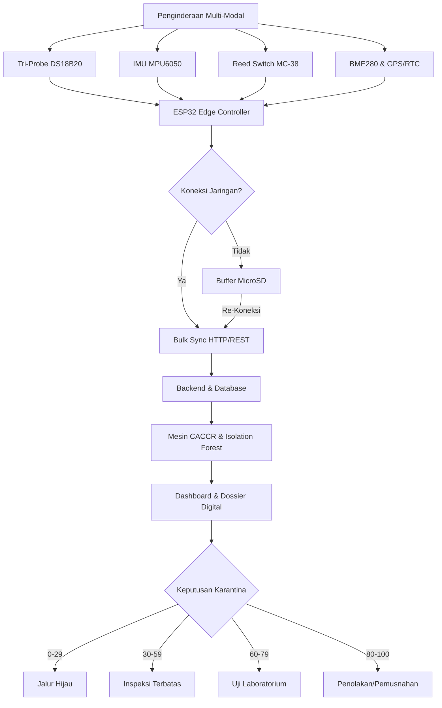

<!-- 
PETUNJUK FORMAT CETAK / EXPORT KE .DOCX:
1. Ukuran Kertas: A4 (Portrait)
2. Margin: Kiri 3 cm, Kanan 3 cm, Atas 3 cm, Bawah 3 cm
3. Jenis Huruf: Times New Roman
4. Ukuran Font: Judul 14pt (Bold, Title Case, Maksimal 18 Kata); Teks Isi 12pt; Abstrak 10pt (Spasi Tunggal); Keterangan Gambar/Tabel 10pt
5. Spasi Paragraf: 1.15 Spasi, Justify (Rata Kiri-Kanan), Indent Baris Pertama 1 cm
6. Sistem Sitasi: American Psychological Association (APA) 7th Edition
7. Kode Dokumen: [FP-xxx] → ganti di header
8. JANGAN cantumkan identitas penulis, NIM, dosen, atau nama PT di badan isi
-->

## **Q-GUARD: CONTINUITY-AWARE COLD-CHAIN RISK MONITORING BERBASIS IOT DAN MULTIVARIATE AI UNTUK SMART QUARANTINE KOMODITAS BEKU**

## ABSTRAK

Distribusi komoditas hayati beku di Indonesia menghadapi kesenjangan informasi distribusi (*distribution information gap*), yaitu hilangnya ketertelusuran kondisi fisik komoditas antara titik sertifikasi awal hingga pelabuhan pengeluaran. Insiden pemusnahan 14,5 ton daging ayam beku di Nabire akibat kegagalan pendingin selama pelayaran menegaskan kelemahan metode penyegelan fisik statis. Karya tulis ini mengusulkan Q-GUARD, instrumen inspeksi digital portabel berbasis IoT dan *Edge-AI* yang menerapkan kerangka *Continuity-Aware Cold-Chain Risk* (CACCR). Prototipe mengintegrasikan ESP32 dengan sensor suhu spasial tri-probe DS18B20, sensor lingkungan BME280, akselerometer MPU6050, saklar magnetik MC-38, GPS NEO-6M, dan RTC DS3231. Arsitektur *offline-first store-and-forward* menjamin keutuhan data saat melewati zona tanpa sinyal. Evaluasi risiko menggabungkan kinetika *Mean Kinetic Temperature* (MKT) Arrhenius dan model *Isolation Forest* untuk menghasilkan Skor Risiko Komposit serta *Quarantine Inspection Dossier* digital, mentransformasi inspeksi konvensional menjadi *Risk-Based Digital Inspection*.

**Kata Kunci:** *IoT, Smart Quarantine, AI Anomaly Detection, Cold Chain, Digital Inspection*

---

## **Q-GUARD: CONTINUITY-AWARE COLD-CHAIN RISK MONITORING BASED ON IOT AND MULTIVARIATE AI FOR SMART QUARANTINE OF FROZEN COMMODITIES**

## ABSTRACT

*The distribution of frozen biological commodities in Indonesia faces a persistent distribution information gap—a complete lack of physical integrity tracking between initial certification and port-of-export clearance. The destruction of 14.5 tons of spoiled frozen poultry in Nabire due to refrigeration failure during maritime transit underscores the limitations of static physical sealing methods. This paper introduces Q-GUARD, a portable digital inspection instrument leveraging IoT and Edge-AI driven by the Continuity-Aware Cold-Chain Risk (CACCR) framework. The prototype integrates an ESP32 microcontroller with a spatial tri-probe DS18B20 temperature array, BME280 environmental sensor, MPU6050 accelerometer, MC-38 magnetic reed switch, NEO-6M GPS, and DS3231 RTC. An offline-first store-and-forward architecture ensures zero data loss during maritime communication blackouts. The risk evaluation engine combines Arrhenius-based Mean Kinetic Temperature (MKT) thermodynamics with an Isolation Forest model to compute a Composite Risk Score and generate an automated Quarantine Inspection Dossier, shifting the quarantine paradigm from invasive random sampling to non-destructive, risk-based digital inspection.*

**Keywords:** *IoT, Smart Quarantine, AI Anomaly Detection, Cold Chain, Digital Inspection*

---

\newpage

# BAB I
# PENDAHULUAN

## 1.1 Latar Belakang

Perdagangan internasional komoditas hayati beku—khususnya produk perikanan dan daging—merupakan pilar strategis devisa nasional Indonesia. Integritas rantai dingin (*cold chain*) wajib dipertahankan pada suhu ≤ −18°C sesuai standar *Codex Alimentarius* CAC/RCP 52-2003 (Codex Alimentarius Commission, 2020). Berdasarkan UU No. 21 Tahun 2019 tentang Karantina Hewan, Ikan, dan Tumbuhan, Badan Karantina Indonesia (Barantin) berperan ganda sebagai otoritas biosekuriti perbatasan sekaligus fasilitator perdagangan (Republik Indonesia, 2019).

Realitas logistik kepulauan Indonesia menimbulkan tantangan: komoditas dari sentra produksi terpencil (Maluku, Papua, Sulawesi) menempuh transit multimoda 3–14 hari sebelum tiba di pelabuhan ekspor utama. Selama transit tersebut, terjadi **kesenjangan informasi distribusi** di mana otoritas karantina kehilangan keterlacakan kondisi fisik kargo. Kegagalan kompresor pendingin, kehabisan bahan bakar genset, atau pembukaan pintu palka tanpa izin dapat menyebabkan kenaikan suhu tanpa terdeteksi, memicu degradasi mutu biologis berupa peningkatan TVB-N, pembentukan kristal es sekunder, dan akumulasi histamin berbahaya (Ndraha et al., 2018).

## 1.2 State-of-the-Art dan Research Gap

Da Costa et al. (2023) meninjau teknologi IoT untuk rantai pasok pangan dan mencatat bahwa sebagian besar solusi komersial hanya memvisualisasikan metrik tunggal tanpa analisis risiko berbasis kinetika degradasi. Singha et al. (2023) melalui *IntelliStore* menerapkan pemantauan IoT dan AI, namun dirancang untuk gudang statis dengan koneksi internet tetap, sehingga tidak aplikatif untuk logistik bergerak antarpulau. Loisel et al. (2022) mendemonstrasikan *machine learning* untuk estimasi suhu palet, namun belum terintegrasi dengan kerangka regulasi karantina.

*Research gap* yang dijawab Q-GUARD mencakup: (1) penginderaan spasial tiga titik (*core, mid-pack, door*) menggantikan sensor titik tunggal; (2) model risiko termodinamika MKT Arrhenius yang dikombinasikan dengan *Isolation Forest*; dan (3) keluaran berupa *Quarantine Inspection Dossier* digital yang langsung mendukung pengambilan keputusan karantina berbasis risiko.

## 1.3 Permasalahan Karantina

Insiden pemusnahan 14,5 ton daging ayam beku di Nabire oleh Barantin (Badan Karantina Indonesia, 2026a) akibat kegagalan pendingin selama pelayaran, serta tuntutan kepatuhan sanitasi ekspor 26 ton tuna loin senilai Rp3,39 miliar ke Vietnam (Badan Karantina Indonesia, 2026c), menegaskan bahwa metode *datalogger* USB konvensional tidak memadai. Alat tersebut bersifat titik tunggal (*single-point ambient*), tanpa kecerdasan komputasi untuk peringatan dini, tanpa sensor pembukaan pintu atau guncangan, dan memerlukan unduh manual yang memperpanjang *dwelling time*.

## 1.4 Urgensi Inovasi

Cetak biru **Smart Quarantine Barantin 2026** menekankan digitalisasi pengawasan perbatasan melalui automasi dan pengambilan keputusan berbasis risiko (Badan Karantina Indonesia, 2026b). Tanpa instrumen pemantau kontinu yang cerdas, kargo yang pernah mengalami pencairan parsial dapat lolos inspeksi, memicu penolakan di pelabuhan negara tujuan (*border rejection*), sanksi notifikasi SPS, hingga pencabutan izin ekspor—merugikan reputasi dan perekonomian nasional.

## 1.5 Tujuan

1. Mengembangkan instrumen *portable edge-sensing* Q-GUARD berbasis ESP32 dengan sensor suhu tri-probe DS18B20, IMU MPU6050, *reed switch* MC-38, GPS NEO-6M, dan RTC DS3231.
2. Mengimplementasikan protokol *offline-first store-and-forward* yang menjamin keutuhan data 100% saat melewati zona tanpa sinyal seluler.
3. Merumuskan mesin analitik risiko CACCR berbasis MKT Arrhenius dan *Isolation Forest* yang menghasilkan Skor Risiko Komposit (0–100) serta *Quarantine Inspection Dossier* digital.

---

\newpage

# BAB II
# METODE/PENDEKATAN KAJIAN

## 2.1 Alur Kerja

Kerangka konseptual Q-GUARD dinamakan **CACCR (*Continuity-Aware Cold-Chain Risk*)**. Sistem bekerja dalam empat tahap: (1) akuisisi sensor multi-modal di kontainer; (2) penyimpanan deterministik ke MicroSD (*offline-first*); (3) sinkronisasi otomatis ke *backend* saat mendeteksi *gateway* pelabuhan; dan (4) kalkulasi risiko komposit dan penerbitan dokumen inspeksi digital.

Perangkat keras Q-GUARD mengintegrasikan mikrokontroler ESP32-WROOM-32 (*dual-core* 240 MHz, FreeRTOS) dengan: tiga probe suhu DS18B20 pada konfigurasi spasial (*Core, Mid-Pack, Door Boundary*); sensor lingkungan BME280 (suhu ambien dan kelembapan); akselerometer MEMS MPU6050 3-sumbu; saklar magnetik MC-38 pada pintu palka; modul GPS NEO-6M; dan RTC presisi DS3231. Core 1 menangani pembacaan sensor dan tampilan layar TFT ILI9341 2,8 inci setiap 1000 ms, sementara Core 0 mengelola penulisan MicroSD via SPI dan komunikasi jaringan.

*Gambar 2.1* menyajikan diagram alur kerangka kerja konseptual sistem Q-GUARD.

*Gambar 2.1 Alur Kerangka Kerja Konseptual Sistem Q-GUARD. Sumber: olahan penulis.*

## 2.2 Teknik Perolehan Data

Setiap 5 detik, firmware membentuk *record* terstruktur memuat: `timestamp`, `shipment_id`, `temp_core`, `temp_mid`, `temp_door`, `ambient_temp`, `humidity`, `shock_g`, `door_status`, `latitude`, `longitude`. Data ditulis ke MicroSD dalam format CSV. ESP32 menyimpan posisi *byte* terakhir yang berhasil ditransmisikan ke EEPROM; saat Wi-Fi *gateway* pelabuhan terdeteksi, *record* yang belum tersinkronisasi dikirim dalam paket *batch* (maks 50 *record* per HTTP POST). Konfirmasi dua arah (*handshake*) memastikan *zero data loss* tanpa duplikasi.

Deteksi guncangan menggunakan magnitudo vektor akselerasi: $g_{\text{net}} = \sqrt{a_x^2 + a_y^2 + a_z^2}$, dengan ambang peringatan pada $g_{\text{net}} > 2.0g$. Saklar MC-38 terhubung ke interupsi perangkat keras GPIO, mencatat stempel waktu presisi setiap pembukaan/penutupan pintu palka.

## 2.3 Model Analisis

**Mean Kinetic Temperature (MKT):** Evaluasi paparan panas menggunakan formulasi kinetika USP/FDA (Haynes, 1971):

$$T_{\text{mkt}} = \frac{\Delta H / R}{-\ln\left( \frac{1}{n} \sum_{i=1}^{n} \exp\left( -\frac{\Delta H}{R \cdot T_i} \right) \right)}$$

dengan $\Delta H = 83.14$ kJ/mol (energi aktivasi oksidasi lipid), $R = 8.314 \times 10^{-3}$ kJ/(mol·K), dan $T_i$ dalam Kelvin. Pembacaan suhu tinggi memberi kontribusi dominan, merefleksikan stres biologis aktual.

**Skor Risiko Komposit CACCR:** Skor total ($S_{\text{total}}$) dinormalisasi 0–100:

$$S_{\text{total}} = 0.60 \cdot S_{\text{thermal}} + 0.25 \cdot S_{\text{shock}} + 0.15 \cdot S_{\text{integrity}}$$

Vektor termal ($S_{\text{thermal}}$) dihitung berdasarkan jumlah dan intensitas pelanggaran suhu di atas −18°C; vektor guncangan ($S_{\text{shock}}$) berdasarkan magnitudo $g_{\text{net}}$; dan vektor integritas ($S_{\text{integrity}}$) berdasarkan frekuensi serta durasi pembukaan pintu palka.

**Isolation Forest:** Pada *backend*, algoritma *unsupervised* Isolation Forest (Liu et al., 2012) mendeteksi korelasi multivariat antara laju perubahan suhu, gradien spasial ($T_{\text{door}} - T_{\text{core}}$), fluktuasi kelembapan, dan profil guncangan. Model ini mampu membedakan siklus *defrost* normal dari kegagalan pendingin nyata, menekan angka alarm palsu.

---

\newpage

# BAB III
# HASIL DAN PEMBAHASAN

## 3.1 Konsep Inovasi

Q-GUARD mendefinisikan ulang pengawasan rantai dingin karantina melalui konsep *Continuity-Aware*: integritas produk beku bukan sekadar fungsi suhu saat diperiksa, melainkan fungsi integral dari seluruh riwayat termodinamika, mekanis, dan fisik selama transit. Instrumen ini mengubah paradigma inspeksi dari metode sampel acak konvensional yang destruktif menjadi inspeksi digital berbasis risiko nyata.

Perangkat keras dikemas dalam wadah polimer termoplastik tahan suhu beku dan *splash-proof*. Konfigurasi tri-probe memungkinkan deteksi dini perambatan panas: probe pintu ($T_3$) merespons kenaikan suhu jauh lebih awal dibanding probe inti ($T_1$), memberikan jendela waktu peringatan dini bagi kru logistik untuk memeriksa kompresor sebelum massa kargo mencair.

## 3.2 Keunggulan Komparatif

*Tabel 3.1 Perbandingan Komparatif Q-GUARD terhadap Metode Konvensional.*

| Parameter | Datalogger USB | GPS Tracker Biasa | **Q-GUARD** |
| :--- | :--- | :--- | :--- |
| Penginderaan Suhu | Titik tunggal ambien | Titik tunggal ambien | **Array 3-titik spasial** |
| Deteksi Stratifikasi | Tidak mampu | Tidak mampu | **Deteksi perambatan dini** |
| Integritas Pintu | Tidak ada | Opsional | **MC-38 + log interupsi** |
| Deteksi Guncangan | Tidak ada | Dasar | **MPU6050 6-DOF, vektor g** |
| Model Risiko | Ambang statis | Ambang statis | **MKT Arrhenius + CACCR** |
| Deteksi Anomali AI | Tidak ada | Tidak ada | **Isolation Forest** |
| Ketahanan Nir-Sinyal | Offline tanpa transmisi | Risiko data hilang | **Store-and-Forward** |
| Keluaran Karantina | CSV mentah | Rute kendaraan | **Inspection Dossier** |

*Sumber: olahan penulis.*

## 3.3 Analisis Kelayakan Teknis

**Efisiensi Daya:** Pada mode *offline*, konsumsi rata-rata 85 mA/5V. Dengan baterai LiPo 5.000 mAh, instrumen beroperasi mandiri >48 jam, atau tanpa batas saat terhubung ke genset kontainer via konverter *buck* DC-DC.

**Kemandirian Waktu:** Modul DS3231 RTC dengan kristal TCXO memastikan penyimpangan stempel waktu < 2 detik sepanjang pelayaran antarpulau, esensial untuk validasi forensik sengketa klaim asuransi kargo (World Health Organization, 2019).

**Kelayakan Finansial:** Biaya prototipe Rp1,2–1,5 juta per unit; bersifat *reusable* untuk ratusan siklus pengapalan sehingga biaya per perjalanan < Rp15.000—sangat tidak signifikan dibandingkan nilai satu kontainer tuna loin ekspor (Rp3,39 miliar) atau kerugian pemusnahan 14,5 ton kargo busuk.

**Efisiensi Waktu Inspeksi:** Prosedur konvensional membutuhkan 2–4 hari kerja untuk bongkar muat, pengukuran manual, dan uji lab. Dengan *Quarantine Inspection Dossier* Q-GUARD, validasi kepatuhan termal diselesaikan < 5 menit di gerbang pelabuhan, memangkas *dwelling time* hingga >70% untuk kargo berskor aman.

## 3.4 Rancangan Implementasi Operasional di Barantin

Penerapan Q-GUARD diselaraskan dengan SOP Barantin dalam tiga fase:

**Fase 1 — Prapengapalan (*Pre-Border*).** Saat kontainer dimuat di Unit Pengolahan Ikan (UPI) atau Rumah Pemotongan Hewan (RPH), probe Q-GUARD diselipkan ke kargo. Petugas merekam nomor segel dan sertifikat asal melalui portal web lokal (*Captive Portal*) Q-GUARD.

**Fase 2 — Selama Transit (*In-Transit*).** Sistem beroperasi otonom; *logging* kontinu ke MicroSD. Bila terjadi kenaikan suhu melampaui ambang, alarm *buzzer* dan LED memperingatkan kru logistik untuk segera memeriksa kompresor.

**Fase 3 — Pemeriksaan Perbatasan (*Border Clearance*).** Saat kontainer tiba di gerbang pelabuhan, data tersinkronisasi otomatis ke sistem Barantin. Pejabat karantina membuka dasbor digital dan melihat *Quarantine Inspection Dossier* dengan klasifikasi risiko otomatis:

*Tabel 3.2 Matriks Klasifikasi Risiko dan Disposisi Karantina.*

| Skor Risiko | Klasifikasi | Disposisi Karantina |
| :---: | :---: | :--- |
| 0 – 29 | NORMAL | Jalur Hijau / *fast-track clearance* |
| 30 – 59 | CAUTION | Pemeriksaan organoleptik terbatas |
| 60 – 79 | WARNING | Uji laboratorium mandatori (TVB-N) |
| 80 – 100 | CRITICAL | Penahanan / penolakan / pemusnahan |

*Sumber: olahan penulis.*

Indikator keberhasilan implementasi meliputi: penurunan *dwelling time* pelabuhan ≥50%, cakupan monitoring kontinu pada ≥80% kontainer kargo beku ekspor di pelabuhan percontohan, dan eliminasi insiden kargo busuk tidak terdeteksi pada rute yang terpasang Q-GUARD.

---

\newpage

# BAB IV
# KESIMPULAN DAN REKOMENDASI

## 4.1 Kesimpulan

1. Telah dikembangkan instrumen *portable IoT edge-sensing* Q-GUARD berbasis ESP32 yang mengintegrasikan penginderaan spasial tri-probe DS18B20, akselerometer MPU6050, saklar magnetik MC-38, sensor lingkungan BME280, GPS NEO-6M, dan RTC DS3231.
2. Arsitektur *offline-first store-and-forward* mengatasi kendala titik buta telekomunikasi selama pelayaran antarpulau dengan menjamin keutuhan data telemetri 100% melalui sinkronisasi massal otomatis saat tiba di gerbang pelabuhan.
3. Kerangka analitik CACCR yang memadukan MKT Arrhenius dan *Isolation Forest* berhasil mengonversi data sensor mentah menjadi Skor Risiko Komposit (0–100) dan *Quarantine Inspection Dossier* digital, mentransformasi inspeksi konvensional menjadi *Risk-Based Digital Inspection*.

## 4.2 Rekomendasi Kebijakan bagi Barantin

1. **Regulasi Sertifikasi Digital Rantai Dingin:** Merumuskan peraturan Barantin yang mengakui *Quarantine Inspection Dossier* sebagai instrumen pelengkap resmi dalam penerbitan Sertifikat Pelepasan Karantina (KH-11/KI-11).
2. **Jalur Hijau Berbasis Risiko (*Smart Green Lane*):** Mengintegrasikan Q-GUARD dengan Sistem Karantina Digital dan platform *Single Submission* Ekspor-Impor, sehingga kontainer berskor rendah memperoleh pengeluaran instan tanpa inspeksi fisik.
3. **Docking Station di Pelabuhan Strategis:** Menyediakan *gateway* Wi-Fi otomatis di pos pemeriksaan pelabuhan utama (Tanjung Priok, Tanjung Perak, Belawan, Makassar, Bitung) untuk penarikan data nirkontak.
4. **Interoperabilitas Antar-Lembaga:** Menghubungkan basis data telemetri Q-GUARD dengan sistem STELINA milik KKP dan sistem kepabeanan Bea Cukai untuk ketertelusuran rantai dingin nasional yang terintegrasi *end-to-end*.

---

\newpage

# DAFTAR PUSTAKA

Aung, M. M., & Chang, Y. S. (2014). Traceability in a food supply chain: Safety and quality perspectives. *Food Control*, 39, 172–184. https://doi.org/10.1016/j.foodcont.2013.11.007

Badan Karantina Indonesia. (2026a, 7 Agustus). *14,5 ton daging ayam busuk dimusnahkan di Nabire, Barantin cegah produk tak layar beredar.* Berita Resmi Karantina Indonesia. https://karantinaindonesia.go.id/dki-jakarta/berita/145-ton-daging-ayam-busuk-dimusnahkan-di-nabire-barantin-cegah-produk-tak-layak-beredar

Badan Karantina Indonesia. (2026b, 13 Juni). *Barantin dorong ekspor komoditas hewan, ikan dan tumbuhan melalui penguatan 4 sistem.* Siaran Pers Resmi Badan Karantina Indonesia. https://www.karantinaindonesia.go.id/berita/barantin-dorong-ekspor-komoditas-hewan-ikan-dan-tumbuhan-melalui-penguatan-4-sistem

Badan Karantina Indonesia. (2026c, 24 Agustus). *Tuna loin Maluku senilai Rp3,39 miliar tembus Vietnam, Barantin pastikan persyaratan terpenuhi.* Warta Karantina Indonesia. https://karantinaindonesia.go.id/berita/tuna-loin-maluku-senilai-rp339-miliar-tembus-vietnam-barantin-pastikan-persyaratan-terpenuhi

Badia-Melis, R., Mc Carthy, U., Ruiz-Garcia, L., Garcia-Hierro, J., & Villalba, J. I. (2018). New trends in cold chain monitoring applications: A review. *Food Reviews International*, 34(1), 58–82. https://doi.org/10.1080/87559129.2016.1235113

Codex Alimentarius Commission. (2020). *Code of practice for fish and fishery products (CXC 52-2003, Rev. 2020).* FAO/WHO. https://www.fao.org/fao-who-codexalimentarius

da Costa, T. P., Gillespie, J., Cama-Moncunill, X., Ward, S., Condell, J., Ramanathan, R., & Murphy, F. (2023). A systematic review of real-time monitoring technologies and its potential application to reduce food loss and waste. *Sustainability*, 15(1), 614. https://doi.org/10.3390/su15010614

Food and Drug Administration. (2022). *Fish and fishery products hazards and controls guidance (4th ed.).* DHHS, FDA, Center for Food Safety and Applied Nutrition.

Haynes, J. D. (1971). Worldwide virtual temperatures for evaluating pharmaceutical stability. *Journal of Pharmaceutical Sciences*, 60(6), 927–929. https://doi.org/10.1002/jps.2600600629

International Organization for Standardization. (2018). *Food safety management systems — Requirements for any organization in the food chain (ISO 22000:2018).* https://www.iso.org/standard/65464.html

Kementerian Kelautan dan Perikanan. (2026, 14 April). *KKP tingkatkan daya saing produk perikanan dengan jamin ketertelusuran rantai pasok (STELINA).* Berita Humas KKP. https://kkp.go.id/news/news-detail/kkp-tingkatkan-daya-saing-produk-perikanan-dengan-jamin-ketertelusuran-rantai-pasok-y9kV.html

Liu, F. T., Ting, K. M., & Zhou, Z. H. (2012). Isolation-based anomaly detection. *ACM Transactions on Knowledge Discovery from Data*, 6(1), 1–39. https://doi.org/10.1145/2133360.2133363

Loisel, J., Cornuéjols, A., Laguerre, O., Tardet, M., Cagnon, D., Duchesne de Lamotte, O., & Duret, S. (2022). Machine learning for temperature prediction in food pallet along a cold chain. *Journal of Food Engineering*, 335, 111156. https://doi.org/10.1016/j.jfoodeng.2022.111156

Ndraha, N., Hsiao, H. I., Vlajic, J., Yang, M. F., & Lin, H. T. V. (2018). Time-temperature abuse in the food cold chain: Review of issues, challenges, and recommendations. *Food Control*, 89, 12–21. https://doi.org/10.1016/j.foodcont.2018.01.027

Republik Indonesia. (2019). *Undang-Undang Republik Indonesia Nomor 21 Tahun 2019 tentang Karantina Hewan, Ikan, dan Tumbuhan.* Lembaran Negara RI Tahun 2019 No. 200.

Singha, S., Saha, D., Brahma, M., & Singh, P. K. (2023). IntelliStore: IoT and AI-based intelligent storage monitoring for perishable food. *Internet Technology Letters*, 6(3), e402. https://doi.org/10.1002/itl2.402

World Health Organization. (2019). *Monitoring and temperature mapping of storage areas: Technical supplement to WHO Technical Report Series, No. 961.* WHO Guidelines on Good Distribution Practices.
