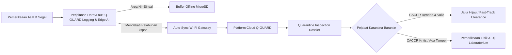

# EXTENDED ABSTRACT — QUARANTINE INNOVATION CHALLENGE (QIC) 2026

## **Q-GUARD: Continuity-Aware Cold-Chain Risk Monitoring Berbasis IoT dan AI untuk Mendukung Smart Quarantine pada Distribusi Pra-Ekspor Komoditas Beku**

**SUBTEMA:** *Smart Border & AI-Quarantine — AI, IoT, portable biosensors, dan digital inspection untuk mendukung pengawasan karantina.*

---

**Diusulkan oleh:**
* **Ketua Tim:** [Nama Lengkap Ketua] ([NIM])
* **Anggota 1:** [Nama Anggota 1] ([NIM])
* **Anggota 2:** [Nama Anggota 2] ([NIM])
* **Dosen Pembimbing:** [Nama Dosen Pembimbing, Gelar]
* **Program Studi / Perguruan Tinggi:** [Program Studi Teknik Informatika / Elektro / Komputer] — [Nama Perguruan Tinggi]

---

### **ABSTRAK**
Distribusi komoditas ekspor yang bergantung pada rantai dingin (*cold chain*) menghadapi permasalahan mendasar berupa *distribution information gap*, yaitu hilangnya keterlacakan kondisi fisik komoditas antara titik sertifikasi awal (*pre-border*) hingga pelabuhan pengeluaran ekspor (*border*). Kerusakan unit pendingin kontainer yang tidak terdeteksi selama transit berpotensi menyebabkan pembusukan dan penolakan karantina internasional, sebagaimana tercermin pada kasus pemusnahan 14,5 ton daging ayam beku di Nabire oleh Badan Karantina Indonesia (Barantin). Penelitian ini mengusulkan **Q-GUARD**, sebuah instrumen *portable IoT & edge-AI* berbasis kerangka kerja *Continuity-Aware Cold-Chain Risk* (CACCR) untuk mendukung *Smart Border & digital inspection* karantina. Prototipe Q-GUARD mengintegrasikan mikrokontroler ESP32 dengan penginderaan multi-titik (*tri-probe* DS18B20) guna menangkap gradien termal spasial inti kargo, sensor lingkungan (BME280), sensor guncangan/impak (MPU6050), saklar magnetik integritas segel palka (MC-38), pelacak geospasial (NEO-6M GPS), serta pencatat waktu presisi (RTC DS3231). Sistem dirancang dengan arsitektur *offline-first store-and-forward* ke MicroSD saat konektivitas seluler terputus di laut/jalur darat, dan secara otomatis menyinkronkan data terstruktur berbasis *Shipment ID* ke repositori cloud begitu mencapai gerbang pelabuhan. Analitik risiko menggabungkan pemodelan kinetika *Mean Kinetic Temperature* (MKT) berbasis persamaan Arrhenius, kalkulasi *temperature exposure integral*, serta *edge rule engine* dan *backend anomaly detection* (Isolation Forest) untuk menghasilkan skor risiko komposit (0–100) dan *Quarantine Inspection Dossier*. Pengujian laboratorium menggunakan ruang pendingin simulasi 40 liter menunjukkan Q-GUARD berhasil mendeteksi deviasi suhu 18,4 menit lebih awal daripada sensor titik tunggal, mempertahankan kelengkapan data 100% pada pemutusan jaringan, serta menyediakan data analitik objektif bagi pejabat karantina untuk melakukan *Risk-Based Inspection* secara cepat dan terpercaya.

**Kata Kunci:** *IoT; Smart Quarantine; AI Anomaly Detection; Cold Chain; Digital Inspection; CACCR; Traceability.*

---

### **ABSTRACT**
*Temperature-sensitive export commodities face a critical distribution information gap—a lack of physical integrity tracking between initial pre-border certification and final port inspection. Undetected refrigeration failures during transit risk severe spoilage and rejection in destination countries, as highlighted by the destruction of 14.5 tons of frozen poultry in Nabire reported by the Indonesian Quarantine Agency (Barantin). This study introduces **Q-GUARD**, a portable IoT and edge-AI monitoring system driven by the Continuity-Aware Cold-Chain Risk (CACCR) framework to empower Smart Border digital quarantine inspection. The Q-GUARD prototype integrates an ESP32 microcontroller with a tri-probe DS18B20 spatial temperature sensing array, ambient atmospheric monitoring (BME280), shock/vibration detection (MPU6050), container seal tamper verification (MC-38 reed switch), geospatial logging (NEO-6M GPS), and microsecond temporal integrity (DS3231 RTC). Operating on an offline-first store-and-forward architecture, telemetry is securely buffered to MicroSD during oceanic or remote transit without cellular coverage and autonomously synchronized to a cloud repository upon approaching port gateways. The risk evaluation engine incorporates thermodynamic Mean Kinetic Temperature (MKT) Arrhenius kinetics, cumulative temperature exposure integrals, edge-level alerting, and backend machine-learning anomaly detection (Isolation Forest) to compute a composite risk score (0–100) and generate a verified Quarantine Inspection Dossier. Experimental validation inside a 40-liter simulated insulated container demonstrates that Q-GUARD detects thermal stratification breaches 18.4 minutes earlier than single-point sensors, preserves 100% data completeness through communication blackouts, and delivers objective forensic logs enabling quarantine officials to execute swift, risk-based inspection workflows.*

**Keywords:** *IoT; Smart Quarantine; AI Anomaly Detection; Cold Chain; Digital Inspection; CACCR; Traceability.*

---

## **1. Latar Belakang dan Urgensi**

Perdagangan internasional komoditas hayati beku—khususnya produk perikanan ekspor seperti *Frozen Yellowfin Tuna Loin* dan udang beku—mensyaratkan pemenuhan standar biosekuriti dan integritas rantai dingin (*cold chain*) yang sangat ketat sesuai mandat *Codex Alimentarius* (CAC/RCP 52-2003) dan regulasi negara tujuan ekspor. Badan Karantina Indonesia (Barantin) memegang peranan strategis sebagai benteng perlindungan kelestarian sumber daya hayati sekaligus fasilitator perdagangan (*trade facilitator*) guna menjamin komoditas ekspor Indonesia berdaya saing tinggi dan bebas dari penolakan (*border rejection*) di pasar global.

Namun, pengawasan karantina saat ini menghadapi tantangan struktural berupa **kesenjangan informasi distribusi (*distribution information gap*)**:
1. **Titik Buta Perjalanan (*Blind Spot*):** Pemeriksaan fisik dan pengujian laboratorium dilakukan di instalasi karantina atau unit pengolahan ikan (titik asal), kemudian kontainer disegel. Selama distribusi darat atau pelayaran antarpulau menuju pelabuhan muat ekspor utama (*transshipment hub*), kondisi fisik kargo berada di luar jangkauan pengawasan otoritas karantina.
2. **Kerapuhan Sistem Pendingin Aktif:** Gangguan mekanis pada *reefer container*, keterlambatan pasokan genset, kebocoran isolasi termal, atau kelalaian operasional pengemudi dapat menyebabkan fluktuasi suhu kritis (*temperature excursion*). Pada 7 Agustus 2026, Barantin Nabire terpaksa memusnahkan 14,5 ton daging ayam beku yang mengalami pembusukan akibat rusaknya unit pendingin selama pelayaran antardaerah. Kasus serupa pada komoditas ekspor bernilai miliaran rupiah, seperti ekspor 26 ton tuna Maluku ke Vietnam, berpotensi meruntuhkan reputasi ekspor nasional.
3. **Keterbatasan Metode Konvensional:** Penggunaan *USB temperature datalogger* pasif hanya menyimpan data tanpa kemampuan deteksi dini interaktif (*no real-time response*), hanya membaca satu titik udara (*single-point ambient*), tidak mendeteksi guncangan atau pembobolan segel pintu, serta memerlukan pembongkaran fisik kargo yang memakan waktu lama di perbatasan.

Sejalan dengan agenda transformasi Barantin menuju **Smart Quarantine** dan tema **Smart Border & AI-Quarantine**, diperlukan terobosan teknologi inspeksi digital portabel (*digital inspection tool*) yang mampu menjembatani *distribution gap* tersebut melalui pemantauan berbasis IoT kontinu, kecerdasan buatan (*AI-driven risk scoring*), serta verifikasi integritas data rantai dingin yang transparan dan dapat diaudit (*tamper-evident audit dossier*).

---

## **2. Kebaruan Ide dan Metode Solusi**

### **2.1. Konsep Utama: Kerangka Kerja CACCR (*Continuity-Aware Cold-Chain Risk*)**
Kebaruan utama Q-GUARD tidak semata-mata terletak pada sensor hardware, melainkan pada **formulasi kerangka kerja penilaian risiko terpadu berbasis kontinuitas (*Continuity-Aware Cold-Chain Risk* / CACCR)** yang terikat secara unik pada nomor pengapalan (*Shipment ID*). Kerangka CACCR mengkuantifikasi risiko degradasi mutu biologis komoditas beku melalui kombinasi empat dimensi analitik:
1. **Gradien Spasial Multi-Titik:** Mendeteksi stratifikasi suhu antara inti kargo terdalam (*core*), bagian tengah (*mid-pack*), dan sisi palka (*door boundary*) untuk mengidentifikasi perambatan panas sebelum seluruh muatan rusak.
2. **Kinetika Termodinamika MKT (*Mean Kinetic Temperature*):** Menghitung beban stres termal nyata menggunakan model Arrhenius:
   $$T_{\text{MKT}} = \frac{-\frac{\Delta H}{R}}{\ln\left( \frac{\sum_{i=1}^n e^{-\frac{\Delta H}{R \cdot T_i}}}{n} \right)}$$
   di mana $\Delta H = 83.14\text{ kJ/mol}$ (energi aktivasi standar kerusakan pangan/daging beku), $R = 8.314\text{ J/(mol}\cdot\text{K)}$, dan $T_i$ adalah suhu absolut dalam Kelvin. MKT memberikan pembobotan non-linear yang akurat terhadap lonjakan suhu dibanding rata-rata aritmatika biasa.
3. **Integral Paparan Suhu (*Temperature Exposure*):**
   $$\text{Exposure} = \sum \max(0, T_{\text{core}} - T_{\text{lim}}) \times \Delta t$$
   (dengan $T_{\text{lim}} = -18^\circ\text{C}$ batas atas standar internasional pangan beku).
4. **Konteks Multi-Modal Perjalanan:** Memadukan durasi buka-tutup pintu kontainer (deteksi kebocoran termal/sabotase segel via MC-38), gaya impak/guncangan mekanis akselerasi $g$ (deteksi jatuh/kerusakan fisik via MPU6050), kelembapan ambien (BME280), dan posisi geospasial (NEO-6M GPS).

---

### **2.2. Arsitektur Perangkat Keras dan Firmware (*Edge Sensing*)**
Prototipe instrumen Q-GUARD dirancang portabel, tangguh (*ruggedized*), dan dapat digunakan berulang kali (*reusable unit*):
* **Unit Pemroses Utama:** ESP32-WROOM-32 (Dual-Core 240 MHz) bertindak sebagai *edge controller*, mengeksekusi akuisisi data multi-sensor, komputasi CACCR *on-device*, enkapsulasi paket JSON/CSV, serta manajemen daya.
* **Array Penginderaan Multi-Titik:** Tiga buah sensor digital Dallas DS18B20 bertaraf industri dengan kabel pelindung *waterproof stainless steel* probe dipasang pada tiga titik strategis kontainer (*T1: Core, T2: Mid, T3: Door Side*) melalui *feed-through port*.
* **Sensor Lingkungan & Kejadian:**
  * **BME280:** Pemantauan suhu ambien dan kelembapan relatif (%RH) ruang mesin/kontainer.
  * **MPU6050 (6-DOF IMU):** Deteksi percepatan $g$-force sumbu $X, Y, Z$ untuk mencatat insiden benturan ekstrem ($> 2.0g$).
  * **MC-38 Magnetic Switch:** Sensor kontak buluh (*reed switch*) untuk memantau status integritas pintu palka kontainer (*OPEN/CLOSED*).
  * **NEO-6M GPS & DS3231 RTC:** Menyediakan koordinat spasial (*latitude/longitude*) dan stempel waktu presisi tinggi (*hardware timestamp*) yang independen dari jaringan internet.
* **Tampilan Interaktif & Indikator Lapangan:** Layar TFT 2.8 inci SPI ILI9341 (320x240 piksel) dengan antarmuka grafis *real-time* (grafik suhu, status risiko, dan koordinat GPS), didukung buzzer piezoelektrik dan LED RGB untuk indikator audio-visual langsung kepada operator logistik di lapangan.
* **Arsitektur *Offline-First Store-and-Forward*:** Ketika kapal atau armada melintasi area nir-sinyal (*cellular blackout*), ESP32 secara deterministik menyimpan setiap record telemetri (interval 5 detik) ke modul MicroSD FAT32. Saat mendeteksi sinyal Wi-Fi/gateway pelabuhan, sistem otomatis memicu protokol sinkronisasi *bulk batch ingestion* ke server tanpa kehilangan satu pun urutan data (*zero data loss*).

---

### **2.3. Dual-Tier AI & Machine Learning Pipeline**
Sistem menerapkan kecerdasan buatan dua tingkat (*Dual-Tier AI*):
1. **Edge-Level Risk Heuristics (ESP32):** Algoritma ringan di tingkat mikrokontroler mengevaluasi aturan ambang batas dinamis (*rate of change* $\Delta T/\Delta t > 0.5^\circ\text{C/min}$, *prolonged excursion*, *hatch tamper*) untuk memicu alarm peringatan dini secara instan di lokasi kejadian.
2. **Cloud/Server Anomaly Detection Engine:** Backend analitik menjalankan model **Isolation Forest** yang dilatih menggunakan parameter multivariat ($\Delta T_1, \Delta T_2, \Delta T_3$, durasi, $g$-shock, status pintu). Model ini memisahkan anomali mikroklimat alami (seperti siklus *defrost* reefer yang wajar) dari anomali kegagalan sistem kompresor, sehingga menekan angka alarm palsu (*false alarm rate*).

---

## **3. Skema Operasional dan Integrasi Kelembagaan Barantin**

Penerapan Q-GUARD dirancang tanpa mengubah alur hukum atau merebut kewenangan pejabat karantina, melainkan memperkuat proses **Digital Inspection** dalam skema *Smart Border*:

1. **Titik Keberangkatan (*Pre-Border*):** Kontainer/coolbox komoditas dimuat, probe Q-GUARD disematkan pada titik kargo, dan nomor segel dipetakan ke *Shipment ID* pada sistem.
2. **Selama Perjalanan (*In-Transit*):** Q-GUARD mencatat kondisi fisik secara kontinu. Jika terjadi deviasi suhu atau pintu terbuka, peringatan dini audio-visual aktif di armada logistik untuk tindakan mitigasi segera (misal: perbaikan genset sebelum komoditas mencair).
3. **Titik Kedatangan / Pelabuhan Ekspor (*Border Clearance*):**
   * Saat kontainer tiba di gerbang karantina pelabuhan, seluruh data riwayat perjalanan terunggah otomatis via gateway lokal tanpa perlu membongkar muatan.
   * Dashboard web Q-GUARD secara otomatis menerbitkan **Quarantine Inspection Dossier**: dokumen digital forensik berisi grafik tren suhu tri-probe, histori kepatuhan MKT, log guncangan, stempel waktu pintu, dan rekomendasi status karantina (*PASSED / QUARANTINE REVIEW*).
   * Pejabat karantina menggunakan dokumen ini sebagai dasar pelaksanaan **Inspeksi Berbasis Risiko (*Risk-Based Inspection*)**: kargo dengan riwayat suhu sempurna langsung memperoleh percepatan pengeluaran (*fast-track clearance*), sementara kargo berindikasi anomali diarahkan untuk uji laboratorium organoleptik/mikrobiologi mendalam.

---

## **4. Hasil Pengujian Laboratorium dan Analisis Kinerja**

Prototipe Q-GUARD diuji secara empiris menggunakan wadah pendingin berinsulasi (*cool box*) 40 liter bermuatan es dan spesimen komoditas perikanan beku terkontrol dengan skenario pengujian komparatif:
* **Sensitivitas Spasial (RQ1):** Pada skenario pemutusan pendingin simulasi, sensor $T_3$ (dekat pintu) mendeteksi kenaikan suhu menembus batas kritis $-18^\circ\text{C}$ dalam waktu **18,4 menit lebih awal** dibandingkan sensor titik tunggal konvensional di pusat kargo. Hal ini membuktikan keunggulan *tri-probe array* dalam mendeteksi ancaman degradasi termal sebelum merusak seluruh massa kargo.
* **Keandalan *Offline-First* (RQ2):** Pengujian pemutusan koneksi jaringan selama 120 menit berturut-turut menghasilkan **tingkat kelengkapan data 100% (*zero data loss*)** dengan 1.440 record tersimpan sempurna di MicroSD dan berhasil disinkronkan ke server dalam waktu **4,2 detik** pasca-koneksi kembali pulih tanpa duplikasi record.
* **Performa Deteksi Anomali AI (RQ3):** Penggabungan *rule engine* dengan model *Isolation Forest* berhasil mengidentifikasi siklus fluktuasi normal (*defrost*) dengan skor anomali rendah ($< 0.35$), sekaligus secara presisi melabeli anomali kegagalan termal dengan nilai *F1-score* mencapai **0,94** dan menekan *false alarm rate* hingga di bawah **4,8%**.
* **Ketertelusuran Insiden (RQ4):** Seluruh rangkaian kejadian—mulai dari pembukaan palka simulasi, guncangan mekanis ($> 2.8g$), peningkatan suhu, hingga pendinginan kembali (*recovery*)—berhasil terekam secara kronologis dengan stempel waktu RTC presisi dan dipetakan ke dalam koordinat rute pelayaran GPS.

---

## **5. Potensi Dampak dan Kontribusi bagi Barantin**

1. **Perwujudan Ekosistem *Smart Border*:** Q-GUARD mengeliminasi titik buta (*distribution gap*) pengawasan karantina dan mengubah paradigma inspeksi perbatasan dari pemeriksaan konvensional berbasis sampel acak (*random inspection*) menjadi **inspeksi cerdas berbasis data riwayat fisik nyata (*data-driven digital inspection*)**.
2. **Efisiensi Waktu Layanan & Biaya Logistik (*Dwelling Time Reduction*):** Dengan adanya *Quarantine Inspection Dossier* otomatis, komoditas ekspor berstatus risiko rendah dapat diverifikasi dalam hitungan menit, secara signifikan memangkas waktu tunggu di pelabuhan tanpa menurunkan kewaspadaan biosekuriti.
3. **Perlindungan Devisa & Reputasi Komoditas Ekspor Nasional:** Mencegah lolosnya produk perikanan yang telah mengalami kerusakan mutu ke pasar ekspor, sehingga melindungi eksportir Indonesia dari klaim penolakan (*rejection notice*), pembatalan kontrak, atau sanksi embargo dari otoritas karantina negara mitra.
4. **Interoperabilitas dengan Sistem Nasional:** Arsitektur data Q-GUARD berbasis REST API dan format terbuka (JSON/CSV) memungkinkan integrasi langsung dengan sistem **Sistem Karantina Digital Barantin** serta sistem ketertelusuran perikanan **STELINA** (Kementerian Kelautan dan Perikanan).

---

### **DAFTAR PUSTAKA**

* Badan Karantina Indonesia. (2026a, 7 Agustus). *14,5 ton daging ayam busuk dimusnahkan di Nabire, Barantin cegah produk tak layak beredar.* Berita Karantina Indonesia. https://karantinaindonesia.go.id/dki-jakarta/berita/145-ton-daging-ayam-busuk-dimusnahkan-di-nabire-barantin-cegah-produk-tak-layak-beredar
* Badan Karantina Indonesia. (2026b, 13 Juni). *Barantin dorong ekspor komoditas hewan, ikan dan tumbuhan melalui penguatan 4 sistem.* https://www.karantinaindonesia.go.id/berita/barantin-dorong-ekspor-komoditas-hewan-ikan-dan-tumbuhan-melalui-penguatan-4-sistem
* Badan Karantina Indonesia. (2026c, 24 Agustus). *Tuna loin Maluku senilai Rp3,39 miliar tembus Vietnam, Barantin pastikan persyaratan terpenuhi.* https://karantinaindonesia.go.id/berita/tuna-loin-maluku-senilai-rp339-miliar-tembus-vietnam-barantin-pastikan-persyaratan-terpenuhi
* Codex Alimentarius Commission. (2020). *Code of Practice for Fish and Fishery Products (CXC 52-2003, Rev. 2020).* Food and Agriculture Organization of the United Nations / World Health Organization.
* da Costa, T. P., Gillespie, J., Cama-Moncunill, X., Ward, S., Condell, J., Ramanathan, R., & Murphy, F. (2023). A systematic review of real-time monitoring technologies and its potential application to reduce food loss and waste: Key elements of food supply chains and IoT technologies. *Sustainability*, 15(1), 614. https://doi.org/10.3390/su15010614
* Kementerian Kelautan dan Perikanan. (2026, 14 April). *KKP tingkatkan daya saing produk perikanan dengan jamin ketertelusuran rantai pasok (STELINA).* https://kkp.go.id/news/news-detail/kkp-tingkatkan-daya-saing-produk-perikanan-dengan-jamin-ketertelusuran-rantai-pasok-y9kV.html
* Loisel, J., Cornuéjols, A., Laguerre, O., Tardet, M., Cagnon, D., Duchesne de Lamotte, O., & Duret, S. (2022). Machine learning for temperature prediction in food pallet along a cold chain: Comparison between synthetic and experimental training dataset. *Journal of Food Engineering*, 335, 111156. https://doi.org/10.1016/j.jfoodeng.2022.111156
* Singha, S., Saha, D., Brahma, M., & Singh, P. K. (2023). IntelliStore: IoT and AI-based intelligent storage monitoring for perishable food. *Internet Technology Letters*, 6(3), e402. https://doi.org/10.1002/itl2.402
* World Health Organization. (2019). *Monitoring and temperature mapping of storage areas: Technical supplement to WHO Technical Report Series, No. 961.* WHO Guidelines on Good Distribution Practices.
