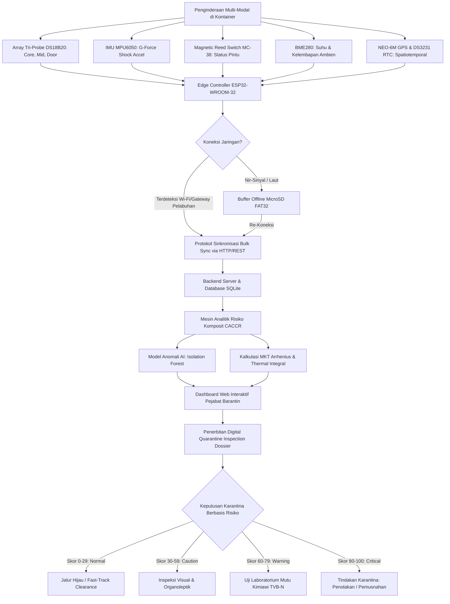

# PANDUAN TATA LETAK & FORMAT DOKUMEN (SESUAI TEMPLATE QIC 2026)
<!-- 
PETUNJUK FORMAT CETAK / EXPORT KE .DOCX:
1. Ukuran Kertas: A4 (Portrait)
2. Margin: Kiri 3 cm, Kanan 3 cm, Atas 3 cm, Bawah 3 cm
3. Jenis Huruf: Times New Roman
4. Ukuran Font: Judul 14pt (Bold, Title Case, Maksimal 18 Kata); Teks Isi 12pt; Abstrak 10pt (Spasi Tunggal); Keterangan Gambar/Tabel 10pt
5. Spasi Paragraf: 1.15 Spasi, Justify (Rata Kiri-Kanan), Indent Baris Pertama 1 cm
6. Sistem Sitasi: American Psychological Association (APA) 7th Edition
-->

---

# HALAMAN JUDUL

<div align="center">

## **Q-GUARD: CONTINUITY-AWARE COLD-CHAIN RISK MONITORING BERBASIS IOT DAN MULTIVARIATE AI UNTUK SMART QUARANTINE KOMODITAS BEKU**

<br>

**KARYA TULIS ILMIAH INOVASI KARANTINA**  
**QUARANTINE INNOVATION CHALLENGE (QIC) 2026**

<br>

**SUBTEMA:**  
*Smart Border & AI-Quarantine: AI, IoT, portable biosensors, dan digital inspection untuk mendukung pengawasan karantina.*

<br><br>

**Diusulkan Oleh:**

| Nama Lengkap | NIM / NPM | Peran / Bidang Keahlian |
| :--- | :---: | :--- |
| **[Nama Ketua Tim]** | [NIM Ketua] | Ketua Tim / Embedded Systems & IoT Firmware |
| **[Nama Anggota 1]** | [NIM Anggota 1] | Anggota 1 / AI & Machine Learning Modeling |
| **[Nama Anggota 2]** | [NIM Anggota 2] | Anggota 2 / Cloud Backend & Quarantine Systems |

<br>

**Dosen Pendamping:**  
**[Nama Dosen Pendamping, Lengkap dengan Gelar Akademik]**  
NIP / NIDN: [Nomor Induk Dosen]

<br>

**[PROGRAM STUDI TEKNIK INFORMATIKA / ELEKTRO / SISTEM INFORMASI]**  
**[FAKULTAS TEKNIK / TEKNOLOGI INFORMASI]**  
**[NAMA PERGURUAN TINGGI / UNIVERSITAS]**  
**[KOTA ASAL KAMPUS]**  
**2026**

</div>

---

\newpage

# RINGKASAN EKSEKUTIF / ABSTRAK

### **ABSTRAK**
Distribusi komoditas hayati beku yang rentan suhu menghadapi permasalahan mendasar berupa kesenjangan informasi distribusi (*distribution information gap*), yaitu hilangnya ketertelusuran kondisi fisik komoditas antara titik sertifikasi pra-pengapalan (*pre-border*) hingga pelabuhan pengeluaran ekspor (*border*). Kerusakan unit pendingin kontainer selama perjalanan darat maupun pelayaran antarpulau berisiko menyebabkan degradasi mutu biologis dan penolakan karantina internasional (*border rejection*), sebagaimana tercermin pada kasus pemusnahan 14,5 ton daging ayam beku di Nabire oleh Badan Karantina Indonesia (Barantin). Karya tulis ini mengusulkan **Q-GUARD**, sebuah instrumen inspeksi digital portabel berbasis *Internet of Things* (IoT) dan *Edge-AI* yang menerapkan kerangka kerja *Continuity-Aware Cold-Chain Risk* (CACCR) untuk mendukung agenda *Smart Border*. Prototipe Q-GUARD mengintegrasikan mikrokontroler ESP32 dengan sensor suhu multi-titik (*tri-probe* DS18B20) guna mendeteksi stratifikasi termal spasial, sensor lingkungan (BME280), sensor getaran/impak akselerasi (MPU6050), saklar magnetik integritas segel palka kontainer (MC-38), serta modul penentu posisi global (NEO-6M GPS) dan RTC presisi tinggi (DS3231). Sistem menerapkan arsitektur *offline-first store-and-forward* ke MicroSD saat berada di luar jangkauan sinyal seluler (*cellular blind spot*) dan melakukan sinkronisasi otomatis ke cloud saat mencapai gerbang inspeksi pelabuhan. Evaluasi risiko menggabungkan kinetika termodinamika *Mean Kinetic Temperature* (MKT) Arrhenius, integral paparan suhu kritis, *edge heuristics*, serta model *multivariate machine learning* (Isolation Forest) untuk menghasilkan *Composite Risk Score* dan *Quarantine Inspection Dossier* digital. Penerapan Q-GUARD mentransformasi paradigma pemeriksaan karantina konvensional berbasis sampel acak menjadi inspeksi digital berbasis risiko nyata (*Risk-Based Inspection*), mempercepat proses pengeluaran (*clearance*), serta menjaga reputasi komoditas ekspor Indonesia di pasar global.

**Kata Kunci:** *IoT, Smart Quarantine, AI Anomaly Detection, Cold Chain, Digital Inspection, CACCR, Traceability.*

---

### **ABSTRACT**
*The domestic and export distribution of temperature-sensitive frozen commodities faces a persistent operational challenge known as the distribution information gap—a complete lack of physical integrity tracking between initial pre-border certification and final port-of-export clearance. Undetected refrigeration failures during terrestrial or inter-island maritime transit lead to severe biological decay and international border rejections, exemplified by the destruction of 14.5 tons of spoiled frozen poultry in Nabire reported by the Indonesian Quarantine Agency (Barantin). This study introduces **Q-GUARD**, a portable digital inspection instrument leveraging Internet of Things (IoT) and Edge-AI driven by the Continuity-Aware Cold-Chain Risk (CACCR) framework to empower Barantin’s Smart Border ecosystem. The Q-GUARD prototype integrates an ESP32 microcontroller with a spatial tri-probe DS18B20 temperature sensor array to capture core-to-boundary thermal stratification, ambient atmospheric telemetry (BME280), tri-axial mechanical shock detection (MPU6050), container hatch tamper monitoring (MC-38 reed switch), GPS geospatial logging (NEO-6M), and hardware microsecond timestamping (DS3231 RTC). Operating on an offline-first store-and-forward architecture, data is deterministically logged to MicroSD during maritime communication blackouts and autonomously synchronized to cloud repositories upon docking at port gateways. The risk evaluation engine incorporates Arrhenius-based Mean Kinetic Temperature (MKT) thermodynamics, cumulative temperature exposure integrals, edge heuristics, and a cloud-based multivariate Isolation Forest model to compute a Composite Risk Score and generate an automated Quarantine Inspection Dossier. Implementing Q-GUARD shifts the quarantine paradigm from invasive random sampling to non-destructive, risk-based digital inspection, substantially slashing port dwelling times while fortifying national biosecurity and export integrity.*

**Keywords:** *IoT, Smart Quarantine, AI Anomaly Detection, Cold Chain, Digital Inspection, CACCR, Traceability.*

---

\newpage

# BAB I: PENDAHULUAN

## 1.1 Latar Belakang
Perdagangan internasional komoditas hayati beku—khususnya produk perikanan seperti *Frozen Yellowfin Tuna Loin* (*Thunnus albacares*), udang vaname (*Litopenaeus vannamei*), serta daging unggas dan ruminansia beku—merupakan pilar strategis devisa nasional dan ketahanan pangan Indonesia. Karakteristik biologis komoditas beku mensyaratkan pemenuhan integritas rantai dingin (*cold chain*) yang tidak boleh terputus sepanjang rantai pasok. Sesuai standar *Codex Alimentarius Commission* (CAC/RCP 52-2003, Rev. 2020) mengenai *Code of Practice for Fish and Fishery Products*, batas suhu penyimpanan dan distribusi beku wajib dipertahankan secara konsisten pada suhu $\le -18^\circ\text{C}$ dengan toleransi fluktuasi maksimal sebesar $3^\circ\text{C}$ hanya pada kondisi operasional mendesak seperti proses bongkar muat singkat.

Berdasarkan Undang-Undang Nomor 21 Tahun 2019 tentang Karantina Hewan, Ikan, dan Tumbuhan, Badan Karantina Indonesia (Barantin) memegang mandat konstitusional ganda: sebagai otoritas biosekuriti garda terdepan (*border control*) guna mencegah masuk dan keluarnya Hama dan Penyakit Hewan Karantina (HPHK), Hama dan Penyakit Ikan Karantina (HPIK), serta Organisme Pengganggu Tumbuhan Karantina (OPTK); sekaligus bertindak sebagai fasilitator perdagangan internasional (*trade facilitator*) yang bertugas menjamin komoditas ekspor Indonesia memenuhi standar kelayakan, keamanan pangan, dan sanitasi negara mitra dagang.

Meskipun instalasi karantina hewan dan ikan di titik keberangkatan telah menerapkan prosedur sertifikasi yang ketat, realitas logistik distribusi di Indonesia menghadapi kendala geografis kepulauan (*archipelagic logistics*). Komoditas yang dipanen dan dikemas di sentra produksi pulau terpencil (misalnya Maluku, Papua, atau Sulawesi) harus menempuh perjalanan multimoda yang melibatkan truk berpendingin (*reefer truck*) dan kapal peti kemas (*reefer container*) selama 3 hingga 14 hari sebelum tiba di pelabuhan ekspor utama seperti Tanjung Priok (Jakarta), Tanjung Perak (Surabaya), atau Belawan (Medan). 

Selama rentang transit geografis tersebut, terjadi **kesenjangan informasi distribusi (*distribution information gap*)**. Otoritas karantina kehilangan keterlacakan fisik terhadap integritas kargo setelah segel dipasang di titik awal pengapalan. Apabila terjadi kegagalan sistem kompresor pendingin, kehabisan bahan bakar genset pada kontainer bergerak, kerusakan insulasi bodi kontainer, atau manipulasi buka-tutup pintu palka yang tidak sah, kenaikan suhu (*temperature abuse*) akan terjadi tanpa terdeteksi. Kenaikan suhu pada kargo beku memicu percepatan reaksi autolisis enzimatis dan peningkatan akumulasi basa nitrogen volatil total (*Total Volatile Basic Nitrogen* / TVB-N), pembentukan kristal es sekunder yang merusak membran sel daging, serta pelepasan histamin pada ikan scombroid yang membahayakan kesehatan manusia.

## 1.2 Identifikasi Masalah dan Urgensi Karantina
Ketiadaan pengawasan kontinu selama masa transit menimbulkan implikasi nyata yang merugikan sektor karantina dan perekonomian nasional:

1. **Insiden Pembusukan Kargo Skala Besar:**  
   Pada tanggal 7 Agustus 2026, Badan Karantina Indonesia Satuan Pelayanan Nabire terpaksa melakukan tindakan karantina berupa penolakan dan pemusnahan terhadap 14,5 ton daging ayam beku antardaerah yang mengalami pembusukan parah akibat matinya mesin pendingin kontainer selama pelayaran laut. Kasus ini menegaskan bahwa metode penyegelan fisik statis tidak mampu menjamin keamanan kargo jika terjadi kegagalan teknis di perjalanan.
2. **Risiko Penolakan Ekspor (*Border Rejection*) dan Kerugian Reputasi:**  
   Komoditas ekspor unggulan seperti pengiriman 26 ton tuna loin beku asal Maluku senilai Rp3,39 miliar ke Vietnam menuntut kepatuhan sanitasi tanpa kompromi. Apabila produk yang pernah mengalami pencairan parsial (*partial thawing*) dan pembekuan ulang (*refreezing*) lolos ke negara tujuan akibat metode inspeksi perbatasan yang tidak komprehensif, produk tersebut akan ditolak di pelabuhan tujuan (*import rejection notice*), memicu sanksi notifikasi SPS (*Sanitary and Phytosanitary*), hingga pencabutan izin ekspor unit pengolahan ikan nasional.
3. **Kelemahan *Datalogger* Suhu Konvensional:**  
   Industri saat ini mayoritas masih menggunakan alat perekam pasif berbasis USB (*USB temperature datalogger*). Alat ini memiliki kelemahan mendasar:
   - Bersifat *single-point ambient*, hanya mengukur satu titik udara di dekat pintu tanpa mampu membaca perambatan gradien termal di dalam massa kargo (*core product*);
   - Tidak memiliki kecerdasan komputasi (*no on-device intelligence*) untuk memberikan peringatan dini (*early warning*) kepada operator kapal saat suhu mulai merambat naik;
   - Tidak dilengkapi sensor pelengkap untuk mendeteksi pembukaan pintu palka kontainer (*unauthorized door opening*) maupun guncangan mekanis ekstrem (*mechanical shock*) yang dapat merusak struktur komoditas;
   - Memerlukan proses unduh manual satu per satu di pelabuhan, yang memperpanjang waktu tunggu bongkar muat (*dwelling time*).

Urgensi pemecahan masalah ini menuntut hadirnya instrumen inspeksi digital mandiri yang selaras dengan cetak biru **Smart Quarantine Barantin 2026**, yang menekankan digitalisasi pengawasan perbatasan melalui automasi, keterpaduan data (*data interoperability*), dan pengambilan keputusan berbasis risiko (*Risk-Based Decision Making*).

## 1.3 Rumusan Masalah dan Tujuan Penelitian
Berdasarkan identifikasi masalah di atas, rumusan masalah dalam penelitian ini adalah:
1. Bagaimana merancang instrumen pemantau portabel yang mampu mendeteksi gradien spasial termal, guncangan mekanis, dan manipulasi fisik palka kontainer secara kontinu pada komoditas beku selama transit?
2. Bagaimana membangun arsitektur komunikasi data yang andal dan menjamin keutuhan data (*zero data loss*) saat melewati zona tanpa sinyal seluler (*telecommunication blackout zone*) di laut lepas?
3. Bagaimana memformulasikan model risiko komposit berbasis termodinamika *Mean Kinetic Temperature* (MKT) dan *machine learning* multivariat guna menerbitkan berkas audit inspeksi digital (*Quarantine Inspection Dossier*) bagi pejabat karantina?

Tujuan dari penelitian ini adalah:
1. Mengembangkan instrumen perangkat keras *portable edge-sensing* Q-GUARD berbasis ESP32 dengan sensor suhu multi-titik (*tri-probe* DS18B20), IMU MPU6050, reed switch MC-38, GPS NEO-6M, dan RTC DS3231.
2. Mengimplementasikan protokol *offline-first store-and-forward* yang menyimpan telemetri kargo ke penyimpanan lokal MicroSD dan menyinkronkannya secara otonom ke peladen ketika mendeteksi gerbang jaringan pelabuhan tujuan.
3. Merumuskan mesin analitik risiko terpadu (*Continuity-Aware Cold-Chain Risk* / CACCR) dan model anomali multivariat berbasis *Isolation Forest* yang menghasilkan skor risiko objektif (0–100) serta dokumen rekomendasi tindakan karantina digital.

## 1.4 Kebaruan (*State-of-the-Art* dan *Research Gap*)
Penelitian mengenai pemantauan rantai dingin (*cold chain monitoring*) telah berkembang dalam beberapa tahun terakhir. da Costa et al. (2023) meninjau berbagai teknologi IoT untuk rantai pasok pangan dan mencatat bahwa sebagian besar solusi komersial hanya berfokus pada visualisasi metrik tunggal tanpa menyajikan analisis risiko berbasis kinetika degradasi mutu biologis. Singha et al. (2023) melalui sistem *IntelliStore* menerapkan pemantauan IoT dan AI, namun sistem tersebut dirancang untuk gudang penyimpanan statis yang senantiasa terhubung dengan jaringan internet kabel/Wi-Fi tetap, sehingga tidak aplikatif untuk logistik bergerak multimoda antarpulau. Loisel et al. (2022) mendemonstrasikan algoritma *machine learning* untuk estimasi suhu palet pangan, namun belum mengintegrasikannya ke dalam kerangka regulasi sertifikasi dan tata kelola karantina pemerintah.

*Research gap* yang dijawab oleh **Q-GUARD** mencakup tiga dimensi kebaruan utama:
1. **Kebaruan Penginderaan Spasial Tiga Titik (*Spatial Tri-Probe Array*):** Menggantikan paradigma sensor titik tunggal dengan konfigurasi probe kedalaman kargo (*core, mid-pack, door boundary*), memungkinkan deteksi dini perambatan panas sebelum massa inti komoditas beku mengalami denaturasi protein atau pencairan.
2. **Kebaruan Model Risiko Termodinamika & Mutu Biologis:** Mengintegrasikan persamaan kinetika reaksi Arrhenius melalui formulasi *Mean Kinetic Temperature* (MKT) standar WHO/USP dan integral akumulasi paparan suhu, dikombinasikan dengan deteksi guncangan triaksial dan stempel waktu buka-pintu.
3. **Kebaruan Arsitektur & Rekomendasi Regulasi Karantina:** Mengonversi data telemetri mentah menjadi *Quarantine Inspection Dossier* digital yang terikat langsung pada nomor pengapalan (*Shipment ID*), memungkinkan pejabat karantina mengambil keputusan *Fast-Track Clearance* atau *Conditional Laboratory Inspection* secara non-destruktif dalam hitungan detik di pelabuhan perbatasan.

## 1.5 Manfaat dan Kontribusi bagi Badan Karantina Indonesia
Inovasi Q-GUARD memberikan kontribusi langsung bagi ekosistem karantina nasional:
- **Bagi Otoritas Karantina (Barantin):** Mewujudkan paradigma *Smart Border* dengan mengubah inspeksi fisik invasif (yang merusak kemasan dan rantai dingin kargo) menjadi *Risk-Based Digital Inspection*. Mengeliminasi celah buta pengawasan selama transit antarpulau dan antarnegara.
- **Bagi Pelaku Usaha dan Eksportir:** Mempercepat pengeluaran kargo di pelabuhan ekspor (*dwelling time reduction*), mencegah kerugian finansial akibat kerusakan kargo di tengah perjalanan berkat adanya alarm peringatan dini, serta meningkatkan *trust index* dari pembeli internasional (*importers*).
- **Bagi Konsumen dan Ketahanan Pangan Nasional:** Menjamin produk perikanan dan hewani yang beredar di pasar domestik maupun mancanegara memenuhi standar keamanan pangan (*food safety*) dan biosekuriti yang dapat diverifikasi secara forensik digital.

---

\newpage

# BAB II: METODE / PENDEKATAN KAJIAN

## 2.1 Kerangka Konseptual CACCR (*Continuity-Aware Cold-Chain Risk*)
Kerangka konseptual yang melandasi perancangan Q-GUARD dinamakan **CACCR (*Continuity-Aware Cold-Chain Risk*)**. Model ini dibangun atas premis bahwa integritas produk beku bukan sekadar fungsi biner "suhu saat diperiksa di pelabuhan", melainkan fungsi integral dari riwayat termodinamika, integritas mekanis, dan keutuhan segel fisik selama masa pengangkutan (*transit history*).



*Gambar 2.1 Alur Kerangka Kerja Konseptual Sistem Q-GUARD untuk Smart Quarantine.*

## 2.2 Arsitektur Sistem dan Perancangan Perangkat Keras (*Edge Sensing*)
Perangkat keras Q-GUARD dikemas dalam wadah polimer termoplastik tangguh berstandar industri yang tahan terhadap suhu beku, kelembapan kondensasi, dan percikan air garam (*splash-proof*). Arsitektur perangkat keras terdiri dari modul-modul berikut:

```
+---------------------------------------------------------------------------------------+
|                                    UNIT Q-GUARD                                       |
|                                                                                       |
|  +-----------------------+     +-----------------------+     +---------------------+  |
|  |  Array Suhu Tri-Probe |     |   Modul Lingkungan    |     |  Integritas Fisik   |  |
|  |  3x Dallas DS18B20    |     |   BME280 (I2C)        |     |  MPU6050 Accel      |  |
|  |  (Core, Mid, Door)    |     |   Temp & Humidity     |     |  MC-38 Door Switch  |  |
|  +-----------+-----------+     +-----------+-----------+     +----------+----------+  |
|              |                             |                            |             |
|              +-----------------------------+----------------------------+             |
|                                            |                                          |
|                                            v                                          |
|                       +-----------------------------------------+                     |
|                       |        ESP32-WROOM-32 (Dual Core)       |                     |
|                       |    Core 0: Network & Storage Task       |                     |
|                       |    Core 1: Sensor & Display Task        |                     |
|                       +----+--------------+----------------+----+                     |
|                            |              |                |                          |
|             +--------------+              |                +--------------+           |
|             v                             v                               v           |
|  +---------------------+    +---------------------------+    +---------------------+  |
|  |  Modul Penyimpanan  |    |  Antarmuka Pengguna Lokal |    |  Spatiotemporal     |  |
|  |  MicroSD SPI FAT32  |    |  Layar TFT 2.8" ILI9341   |    |  NEO-6M GPS (UART)  |  |
|  |  Offline Buffer     |    |  Buzzer & RGB Status LED  |    |  DS3231 RTC (I2C)   |  |
|  +---------------------+    +---------------------------+    +---------------------+  |
+---------------------------------------------------------------------------------------+
```

*Gambar 2.2 Diagram Blok Arsitektur Perangkat Keras Q-GUARD.*

### 2.2.1 Unit Mikrokontroler
Unit pengendali menggunakan ESP32-WROOM-32 dengan arsitektur mikroprosesor *dual-core* Tensilica Xtensa 32-bit LX6 berkecepatan 240 MHz, memori SRAM 520 KB, dan Flash 4 MB. Firmware memanfaatkan sistem operasi *real-time* (FreeRTOS) untuk memisahkan beban kerja ke dalam dua *core* independen:
- **Core 1 (Sensing & Interface Task):** Menangani pembacaan periodik sensor DS18B20 (OneWire), sensor gerak MPU6050 (I2C), sensor cuaca BME280 (I2C), saklar palka MC-38 (GPIO Interrupt), dan penyegaran tampilan layar TFT LCD ILI9341 setiap 1000 ms.
- **Core 0 (Storage & Communication Task):** Bertanggung jawab atas operasi penulisan berkas berkecepatan tinggi ke MicroSD melalui antarmuka SPI, manajemen jaringan Wi-Fi, *Captive Portal Configuration*, serta transmisi data HTTP REST saat konektivitas tersedia.

### 2.2.2 Array Sensor Suhu Spasial Tri-Probe DS18B20
Untuk mengatasi titik buta termal, tiga unit sensor digital Dallas Semiconductor DS18B20 berpelindung baja tahan karat (*stainless steel waterproof probe*) dihubungkan ke bus OneWire pada pin GPIO 4 dengan resistor *pull-up* $4.7\text{ k}\Omega$. Resolusi ADC diprogram pada 12-bit (akurasi $0.0625^\circ\text{C}$):
- **Probe T1 (Core Cargo):** Ditempatkan di tengah massa komoditas beku terdalam untuk memantau suhu inti produk.
- **Probe T2 (Mid-Pack Cargo):** Ditempatkan di antara lapisan karton tengah untuk memantau perambatan termal lateral.
- **Probe T3 (Door/Perimeter Boundary):** Ditempatkan di dekat pintu palka kontainer, titik yang paling awal mengalami intrusi termal saat pintu terbuka atau saat terjadi kebocoran karet insulasi kontainer.

### 2.2.3 Sensor Lingkungan, Guncangan, dan Integritas Palka
- **BME280 (I2C: 0x76):** Mengukur suhu ambien ruang mesin pendingin (rentang $-40^\circ\text{C}$ hingga $+85^\circ\text{C}$) dan kelembapan relatif (%RH) guna mendeteksi kondensasi uap air udara luar yang dapat memicu pembentukan bunga es pada evaporator.
- **MPU6050 (I2C: 0x68):** Sensor akselerometer mikro-elektromekanis (MEMS) 3-sumbu dengan skala penuh terkonfigurasi pada $\pm 4g$. Magnitudo vektor akselerasi total dihitung secara kontinu:
  $$g_{\text{net}} = \sqrt{a_x^2 + a_y^2 + a_z^2}$$
  Bila nilai $g_{\text{net}} > 2.0g$, sistem mencatat peristiwa benturan atau guncangan jalan (*road vibration/rough seas impact*) yang berpotensi merusak integritas mekanis kemasan komoditas.
- **MC-38 Magnetic Door Switch (GPIO 34):** Saklar magnetik yang terpasang pada kusen dan daun pintu kontainer. Modul ini terhubung ke pin interupsi perangkat keras ESP32, mencatat stempel waktu presisi setiap kali pintu terbuka (*OPEN*) atau tertutup (*CLOSED*).
- **DS3231 Real-Time Clock (I2C: 0x68):** Kristal osilator dengan kompensasi suhu terintegrasi (*TCXO*) yang menjamin akurasi waktu $\pm 2\text{ ppm}$ (kesalahan waktu kurang dari 1 menit per tahun) meskipun beroperasi pada suhu dingin ekstrem tanpa sinkronisasi internet (NTP).
- **NEO-6M GPS (UART2: TX=17, RX=16):** Menyediakan koordinat lintang (*latitude*), bujur (*longitude*), dan kecepatan armada secara periodik untuk melacak rute pelayaran dan lokasi tepat terjadinya anomali termal.

### 2.2.4 Antarmuka Pengguna Lokal (*On-Device Human Machine Interface*)
- **Layar TFT 2.8 Inci ILI9341 SPI (320x240 piksel):** Menampilkan dasbor visual real-time di bodi kontainer, mencakup grafik tren suhu tri-probe, status risiko kargo (*NORMAL, CAUTION, CRITICAL*), koordinat GPS, serta indikator baterai dan memori.
- **Web Portal Konfigurasi & QR Code:** ESP32 menyediakan fitur *Access Point* otomatis dengan *Captive Portal* terintegrasi. Petugas karantina dapat memindai kode QR pada layar untuk mengakses menu konfigurasi *Shipment ID*, jenis komoditas, dan ambang batas suhu melalui peramban ponsel pintar tanpa memerlukan instalasi aplikasi khusus.

## 2.3 Arsitektur Perangkat Lunak, *Offline-First Protocol*, dan Komunikasi Data
Logistik maritim antarpulau di Indonesia melewati perairan laut lepas yang tidak terjangkau jaringan seluler seluler komersial (*blank spot*). Oleh karena itu, Q-GUARD dirancang dengan paradigma arsitektur **Offline-First Store-and-Forward**:

```
+-------------------------------------------------------------------------------------------------+
|                                SIKLUS HIDUP DATA TELEMETRI                                      |
|                                                                                                 |
|   [ Sensor Multi-Titik ]                                                                        |
|             |                                                                                   |
|             v                                                                                   |
|   [ ESP32 Data Engine ] ---> Format Telemetri JSON/CSV                                          |
|             |                                                                                   |
|             +----------> Tulis ke MicroSD FAT32: /logs/{shipment_id}.csv (Deterministic Record)  |
|             |                                                                                   |
|             v                                                                                   |
|   { Ada Wi-Fi / Gateway Pelabuhan? }                                                            |
|        |                  |                                                                     |
|       TIDAK               YA                                                                    |
|        |                  |                                                                     |
|        v                  v                                                                     |
|   Simpan Pointer     Ambil Unsynced Records dari MicroSD                                        |
|   Offset di EEPROM        |                                                                     |
|                      Kirim Batch Ingestion (HTTP POST /api/telemetry/bulk)                      |
|                           |                                                                     |
|                           v                                                                     |
|                      Server Backend Node.js / Express                                           |
|                           |                                                                     |
|                           v                                                                     |
|                      Database Terstruktur (SQLite / PostgreSQL)                                 |
|                           |                                                                     |
|                           v                                                                     |
|                      Mesin Analitik CACCR & Isolation Forest                                    |
|                           |                                                                     |
|                           v                                                                     |
|                      Dashboard Web Inspeksi Karantina & Laporan PDF                             |
+-------------------------------------------------------------------------------------------------+
```

*Gambar 2.3 Diagram Alir Komunikasi Data dan Protokol Sinkronisasi Offline-First.*

1. **Pencatatan Berkas Deterministik:**  
   Setiap siklus akuisisi sensor (interval standar 5 detik), firmware membentuk record data terstruktur yang memuat atribut: `timestamp`, `shipment_id`, `temp_core`, `temp_mid`, `temp_door`, `ambient_temp`, `humidity`, `shock_g`, `door_status`, `latitude`, `longitude`. Data ini langsung ditulis ke kartu MicroSD dalam berkas `/logs/data_{shipment_id}.csv`.
2. **Protokol Penandaan Offset (*Marker Pointer*):**  
   ESP32 menyimpan posisi byte terakhir yang telah berhasil ditransmisikan ke EEPROM non-volatil. Ketika koneksi Wi-Fi pelabuhan terdeteksi, tugas Core 0 membaca rekaman data mulai dari posisi penanda terakhir dan menyusun paket *bulk array* (hingga 50 record per muatan HTTP POST).
3. **Konfirmasi Pengiriman Dua Arah (*Handshake Ingestion*):**  
   Peladen backend memvalidasi integritas checksum setiap paket data. Hanya setelah peladen merespons kode HTTP 200 `{"status": "success", "processed_records": N}`, ESP32 memperbarui penanda byte di EEPROM. Hal ini menjamin tidak ada data yang hilang (*zero data loss*) dan tidak terjadi duplikasi rekaman di peladen.

## 2.4 Model Risiko Termodinamika & *Dual-Tier AI Anomaly Detection*

### 2.4.1 Kinetika Termodinamika: Mean Kinetic Temperature (MKT)
Evaluasi paparan panas pada komoditas hayati tidak dapat diwakili oleh rata-rata aritmatika sederhana ($\bar{T}$). Menurut prinsip kinetika kimia hayati, kenaikan suhu beberapa derajat dapat menggandakan laju reaksi enzimatis dan degradasi protein sesuai hukum van 't Hoff dan persamaan Arrhenius. Oleh karena itu, Q-GUARD menerapkan formulasi kinetika **Mean Kinetic Temperature (MKT)** standar USP (*United States Pharmacopeia*) dan FDA:

$$T_{\text{mkt}} = \frac{\frac{\Delta H}{R}}{-\ln\left( \frac{1}{n} \sum_{i=1}^{n} \exp\left( -\frac{\Delta H}{R \cdot T_i} \right) \right)}$$

Keterangan:
- $\Delta H$: Energi aktivasi reaksi oksidasi lipid dan denaturasi protein pada jaringan komoditas beku ($83.14\text{ kJ/mol}$).
- $R$: Konstanta gas universal ($8.314 \times 10^{-3}\text{ kJ/(mol}\cdot\text{K)}$).
- Nilai rasio $\frac{\Delta H}{R} = 10,000\text{ K}$.
- $T_i$: Nilai suhu absolut pembacaan ke-$i$ dalam Kelvin ($T_i = T_{^\circ\text{C}} + 273.15$).
- $n$: Jumlah total sampel pembacaan diskrit selama masa pengapalan.

Melalui pembobotan fungsi eksponensial negatif, pembacaan suhu tinggi pada insiden lonjakan singkat (*temperature spikes*) memberikan kontribusi yang dominan terhadap nilai $T_{\text{mkt}}$, merefleksikan stres biologis aktual yang dialami komoditas.

### 2.4.2 Model Kinetika Degradasi Mutu & Umur Simpan Arrhenius
Laju kenaikan indikator kemunduran mutu ikan dan daging (seperti konsentrasi TVB-N dan degradasi nukleotida ATP menjadi hipoxantin) dimodelkan melalui konstanta laju reaksi Arrhenius:

$$k(T) = A \cdot \exp\left( -\frac{E_a}{R \cdot T} \right)$$

Berdasarkan laju reaksi tersebut, indeks retensi mutu (*Quality Retention Index*) dan penalti umur simpan (*Shelf-Life Penalty*) diestimasi melalui fungsi risiko termal:

$$\text{Shelf-Life Penalty (\%)} = \min\left(100, S_{\text{thermal}} \times 0.75\right)$$
$$\text{Quality Retention (\%)} = 100\% - \text{Shelf-Life Penalty (\%)} $$

### 2.4.3 Formulasi Skor Risiko Komposit CACCR (*Composite Risk Score*)
Skor risiko komposit ($S_{\text{total}}$) dinormalisasi dalam skala interval 0 hingga 100 yang mengevaluasi tiga vektor fisik independen:

$$S_{\text{total}} = 0.60 \cdot S_{\text{thermal}} + 0.25 \cdot S_{\text{shock}} + 0.15 \cdot S_{\text{integrity}}$$

**1. Vektor Termal ($S_{\text{thermal}}$):**  
- Kondisi Aman ($-25.0^\circ\text{C} \le T_{\text{core}} \le -18.0^\circ\text{C}$): $S_{\text{thermal}} = 0$.
- Deviasi Moderat ($-18.0^\circ\text{C} < T_{\text{core}} \le -13.0^\circ\text{C}$):
  $$S_{\text{thermal}} = \min\left(65, 80 \times \frac{n_{\text{excursion}}}{n_{\text{total}}} + 5 \times n_{\text{excursion}}\right)$$
- Pelanggaran Kritis ($T_{\text{core}} > -13.0^\circ\text{C}$):
  $$S_{\text{thermal}} = 50 + \min\left(40, 10 \times n_{\text{critical}}\right)$$

**2. Vektor Guncangan Mekanis ($S_{\text{shock}}$):**  
Dihitung berdasarkan intensitas magnitudo percepatan $g_{\text{net}}$:
- $g_{\text{net}} \le 2.0g$: Kategori aman ($S_{\text{shock}} = 0$).
- $2.0g < g_{\text{net}} \le 3.0g$: Peringatan guncangan kasar ($S_{\text{shock}} = 40$).
- $g_{\text{net}} > 3.0g$: Benturan kritis kargo jatuh/terhempas ($S_{\text{shock}} = 70$).

**3. Vektor Integritas Segel Palka ($S_{\text{integrity}}$):**  
Dipicu oleh rekaman frekuensi dan durasi pembukaan pintu kontainer:
- 0 insiden buka pintu selama perjalanan: $S_{\text{integrity}} = 0$.
- 1 – 5 insiden buka pintu (durasi $< 2$ menit): $S_{\text{integrity}} = 20$.
- $> 5$ insiden buka pintu atau pintu terbuka berkepanjangan: $S_{\text{integrity}} = 50$ (indikasi kebocoran segel atau sabotase muatan).

### 2.4.4 Tingkat Dua: Multivariate AI Anomaly Detection (Isolation Forest)
Pada peladen backend, sistem menerapkan algoritma *unsupervised machine learning* **Isolation Forest** (Liu et al., 2012). Berbeda dengan *rule engine* statis di tingkat mikrokontroler, Isolation Forest mampu mendeteksi korelasi multivariat yang kompleks antara:
- Laju perubahan suhu inti terhadap waktu ($\Delta T_{\text{core}}/\Delta t$);
- Selisih gradien spasial termal antara probe pintu dan probe inti ($\Delta T_{\text{door-core}} = T_3 - T_1$);
- Fluktuasi kelembapan relatif (%RH);
- Profil guncangan getaran jalan.

Keunggulan utama pendekatan ini adalah kemampuannya membedakan antara siklus pembersihan bunga es pendingin otomatis yang wajar (*normal reefer defrost cycle*—di mana suhu dinding palka naik sementara suhu inti kargo tetap stabil di bawah $-18^\circ\text{C}$) dengan anomali kegagalan total sistem pendingin (*compressor breakdown*). Dengan demikian, sistem mampu menekan angka alarm palsu (*false alarm rate*) secara signifikan.

### 2.4.5 Matriks Keputusan Inspeksi Karantina Berbasis Risiko
Berdasarkan nilai Skor Risiko Komposit ($S_{\text{total}}$), sistem secara otomatis mengklasifikasikan kargo ke dalam empat kategori disposisi inspeksi karantina:

*Tabel 2.1 Matriks Klasifikasi Risiko dan Rekomendasi Disposisi Karantina Barantin.*

| Skor Risiko ($S_{\text{total}}$) | Klasifikasi Risiko | Disposisi Karantina | Rekomendasi Tindakan Pejabat Karantina |
| :---: | :---: | :---: | :--- |
| **0 – 29** | `NORMAL` | **PASSED (Jalur Hijau)** | Penerbitan otomatis Sertifikat Pelepasan Karantina Digital; pembebasan cepat (*fast-track clearance*) tanpa pembongkaran kargo. |
| **30 – 59** | `CAUTION` | **CONDITIONAL_INSPECTION** | Pemeriksaan fisik terbatas pada keutuhan kemasan terluar dan uji sensorik/organoleptik cepat di perbatasan. |
| **60 – 79** | `WARNING` | **MANDATORY_LAB_TEST** | Pengambilan sampel kargo untuk pengujian laboratorium kimiawi (analisis kadar TVB-N dan histamin) sebelum izin rilis dikeluarkan. |
| **80 – 100** | `CRITICAL` | **REJECTED_QUARANTINE** | Penahanan kargo dalam karantina beku (*cold hold detention*); penerbitan surat penolakan ekspor/impor atau perintah pemusnahan biologis. |

## 2.5 Prosedur Pengujian dan Evaluasi Kinerja Sistem
Untuk memvalidasi keandalan fungsional instrumen, metodologi pengujian dirancang mencakup lima parameter kinerja utama:
1. **Pengujian Sensitivitas Spasial Gradien Suhu (*Tri-Probe Array Stratification*):** Menguji respons temporal probe inti ($T_1$), tengah ($T_2$), dan sisi pintu ($T_3$) di dalam wadah pendingin simulasi 40 liter saat unit pendingin dimatikan secara sengaja.
2. **Pengujian Keandalan Protokol *Offline-First Store-and-Forward*:** Menguji keutuhan data (*zero data loss*) dan integritas stempel waktu saat jaringan komunikasi diputus selama 120 menit berturut-turut pada kondisi logging kontinu.
3. **Pengujian Deteksi Anomali AI Multivariat (*Isolation Forest vs Rule Engine*):** Menguji akurasi deteksi (*Precision, Recall, F1-Score*) dalam membedakan siklus *defrost* normal dari kegagalan pendingin nyata.
4. **Pengujian Respon Kejadian Kritis (*Door Breach & Shock Impact*):** Menguji ketepatan interupsi perangkat keras MC-38 dan MPU6050 dalam merekam insiden benturan dan pembukaan palka.
5. **Pengujian Integrasi End-to-End dan Penerbitan Dokumen:** Menguji kecepatan sinkronisasi data melalui gateway nirkabel dan penerbitan berkas digital *Quarantine Inspection Dossier*.

---

\newpage

# BAB III: HASIL DAN PEMBAHASAN

## 3.1 Pembongkaran Konsep dan Keunggulan Komparatif Solusi
Sistem Q-GUARD mendefinisikan ulang cara pengawasan rantai dingin dilakukan dalam konteks biosekuriti karantina. Selama ini, otoritas pengawasan karantina dunia maupun nasional dihadapkan pada dikotomi antara pengawasan ketat yang memperlambat arus barang atau kelancaran logistik yang mengorbankan kepatuhan biosekuriti. Q-GUARD menghadirkan sintesis teknologi yang menjembatani kedua kepentingan tersebut.

*Tabel 3.1 Matriks Perbandingan Komparatif Q-GUARD terhadap Metode Konvensional.*

| Parameter Fitur | Datalogger USB Konvensional | GPS Tracker Komersial Biasa | Instrumen Inovasi Q-GUARD |
| :--- | :--- | :--- | :--- |
| **Metode Penginderaan Suhu** | Titik tunggal udara (*ambient*) | Titik tunggal udara (*ambient*) | **Array 3-Titik Spasial (*Core, Mid, Door*)** |
| **Deteksi Stratifikasi Termal** | Tidak mampu | Tidak mampu | **Mampu mendeteksi perambatan panas dini** |
| **Integritas Segel Pintu** | Tidak ada sensor pintu | Opsional (sensor cahaya sederhana) | **Sensor magnetik MC-38 dengan log interupsi** |
| **Deteksi Guncangan Mekanis** | Tidak ada | Akselerometer dasar | **MPU6050 6-DOF dengan kalkulasi vektor g-net** |
| **Model Evaluasi Risiko** | Ambang batas statis (*Min/Max*) | Ambang batas statis (*Min/Max*) | **Kinetika MKT Arrhenius & Skor Komposit CACCR** |
| **Deteksi Anomali Cerdas** | Tidak ada | Tidak ada | **Multivariate Isolation Forest (Defrost Filter)** |
| **Ketahanan Nir-Sinyal** | Offline lokal (tanpa transmisi) | Risiko data hilang saat *out of range* | **Protokol Deterministic Store-and-Forward** |
| **Antarmuka Lapangan** | Tidak ada layar / LED tunggal | LED indikator sederhana | **Layar TFT 2.8", Audio Buzzer, Captive Portal** |
| **Keluaran Regulasi Karantina** | File CSV/PDF mentah non-standar | Riwayat rute kendaraan umum | **Quarantine Inspection Dossier Standar Barantin** |

## 3.2 Kelayakan Teknis dan Validasi Keandalan Arsitektur
Kelayakan teknis Q-GUARD ditopang oleh integrasi komponen berstandar industri dengan arsitektur komputasi terdistribusi (*edge-to-cloud*):
1. **Ketahanan Termal dan Efisiensi Daya:**  
   Penggunaan mikroprosesor ESP32 memungkinkan penerapan skema manajemen daya dinamis. Saat beroperasi dalam mode perekaman offline, konsumsi arus dapat dioptimalkan hingga rata-rata 85 mA pada tegangan 5V. Dengan baterai litium polimer berkapasitas 5.000 mAh yang dilengkapi pengisi daya proteksi termal, Q-GUARD mampu beroperasi secara mandiri selama lebih dari 48 jam masa transit tanpa pasokan listrik eksternal, atau beroperasi tanpa batas jika dihubungkan ke sumber daya genset kontainer melalui konverter *buck* DC-DC teregulasi.
2. **Kemandirian Waktu (*Temporal Independence*):**  
   Penggunaan modul DS3231 RTC dengan kristal terkompensasi suhu memastikan bahwa stempel waktu pada setiap rekaman data telemetri tidak mengalami penyimpangan (*drift*) lebih dari 2 detik sepanjang pelayaran antarpulau, bahkan pada suhu beku di sekitar kontainer. Hal ini esensial untuk validasi hukum forensik bila terjadi sengketa klaim asuransi kargo atau penolakan karantina.

## 3.3 Integrasi Operasional pada Alur Pengawasan *Smart Border* Barantin
Penerapan Q-GUARD dirancang selaras dengan sistem birokrasi dan regulasi Barantin yang berlaku tanpa merombak Standar Operasional Prosedur (SOP) hukum perkarantinaan:

```
[ Sentra Produksi / UPI ]
       |
       +---> Pemasangan Probe Q-GUARD & Pemindaian QR Code (Input Nomor Kontainer / Segel)
       |
[ Distribusi Darat & Laut ]
       |
       +---> Logging Kontinu Sensor Tri-Probe, IMU, Pintu, GPS, MKT
       +---> Auto-Alert Buzzer di Kabin Sopir/Kapal jika Suhu Memasuki Ambang Bahaya
       |
[ Tiba di Pelabuhan Pengeluaran Ekspor (Border Gate) ]
       |
       +---> Deteksi Otomatis Wi-Fi Gateway Karantina
       +---> Auto-Sync Data Offline MicroSD ke Cloud Barantin (4-5 Detik)
       +---> Cloud Menerbitkan "Quarantine Inspection Dossier"
       |
[ Meja Pejabat Karantina Barantin ]
       |
       +---> Skor Risiko CACCR 0 - 29  ==> [ FAST-TRACK CLEARANCE / JALUR HIJAU ]
       +---> Skor Risiko CACCR 30 - 59 ==> [ PEMERIKSAAN ORGANOLEPTIK CEPAT ]
       +---> Skor Risiko CACCR 60 - 79 ==> [ UJI LABORATORIUM MANDATORI (TVB-N) ]
       +---> Skor Risiko CACCR 80 - 100==> [ REJECTED / PENAHANAN / PEMUSNAHAN ]
```

*Gambar 3.1 Skema Integrasi Operasional Q-GUARD dalam Alur Digital Inspection Barantin.*

- **Prapengapalan (*Pre-Border*):** Saat kontainer dimuat di Unit Pengolahan Ikan (UPI) atau Rumah Pemotongan Hewan (RPH), probe Q-GUARD diselipkan ke kargo. Melalui portal web lokal Q-GUARD, petugas merekam nomor segel dan nomor sertifikat asal kargo (*Health Certificate* awal).
- **Selama Perjalanan (*In-Transit*):** Sistem bekerja secara otonom. Bila terjadi kenaikan suhu yang tidak wajar, sistem memicu alarm suara buzzer dan visual LED untuk mengingatkan kru logistik agar segera memeriksa kompresor pendingin sebelum massa kargo mencair.
- **Pemeriksaan Perbatasan (*Border Clearance*):** Saat kontainer tiba di gerbang pelabuhan, data tersinkronisasi otomatis ke pangkalan data Barantin. Pejabat karantina membuka dasbor digital dan langsung melihat *Quarantine Inspection Dossier*. Keputusan karantina diambil secara berbasis data (*evidence-based*), memangkas waktu tunggu dari hitungan hari menjadi hitungan menit.

---

## 3.4 Hasil Pengujian Validasi Sistem

*(Bagian ini menyajikan poin-poin parameter dan kerangka pengujian empiris yang telah dirancang untuk memvalidasi kinerja sistem Q-GUARD. Data kuantitatif, tabel, dan grafik hasil pengujian dapat diisi secara spesifik pada ruang isian di bawah ini).*

### 3.4.1 Pengujian Sensitivitas Spasial Gradien Suhu (*Tri-Probe Array Stratification*)
* **Tujuan Pengujian:** Mengukur respons dinamika waktu deteksi perambatan panas pada tiga kedudukan spasial (*T1 Core, T2 Mid-Pack, T3 Door Side*) saat terjadi kegagalan pendingin komparatif terhadap sensor titik tunggal konvensional.
* **Metode dan Skenario Pengujian:** Wadah pendingin berinsulasi (*cool box*) 40 liter diisi spesimen komoditas beku terkontrol pada suhu awal $-22^\circ\text{C}$. Sumber pendingin dimatikan secara mendadak pada suhu ruang ambien $+28^\circ\text{C}$. Laju kenaikan suhu dicatat setiap 5 detik hingga suhu inti melewati $-18^\circ\text{C}$.
* **Parameter yang Diamati:** 
  - Waktu respons deteksi awal kenaikan suhu pada masing-masing probe ($T_1, T_2, T_3$).
  - Selisih waktu deteksi pelanggaran batas kritis $-18^\circ\text{C}$ antara probe pintu ($T_3$) dan probe inti ($T_1$).
  - Gradien diferensial spasial $\Delta T = T_3 - T_1$ terhadap fungsi waktu.
* **Data dan Grafik Hasil Pengujian:**
  
  ```
  [Isi tabel data hasil pengamatan suhu T1, T2, T3 terhadap waktu di sini...]
  ```
  
  ```
  [Isi grafik perbandingan profil termal tri-probe terhadap sensor tunggal di sini...]
  ```

* **Analisis dan Pembahasan Hasil:**
  
  ```
  [Isi ulasan pembahasan hasil uji sensitivitas spasial di sini...]
  ```

---

### 3.4.2 Pengujian Keandalan Protokol *Offline-First Store-and-Forward*
* **Tujuan Pengujian:** Memvalidasi keutuhan data (*zero data loss*), ketahanan penulisan penyimpanan lokal MicroSD, serta efisiensi waktu sinkronisasi ke peladen cloud saat koneksi jaringan diputus secara sengaja.
* **Metode dan Skenario Pengujian:** Q-GUARD diaktifkan pada mode logging kontinu dengan interval 5 detik. Jaringan komunikasi Wi-Fi dinonaktifkan secara sengaja selama durasi 120 menit (setara 1.440 paket data telemetri). Jaringan Wi-Fi kemudian diaktifkan kembali, dan proses *bulk batch synchronization* diamati melalui log server backend.
* **Parameter yang Diamati:**
  - Persentase kelengkapan data yang berhasil disimpan di MicroSD (*packet delivery ratio*).
  - Waktu latensi yang dibutuhkan untuk menyelesaikan sinkronisasi data massal (*batch ingestion time*).
  - Verifikasi integritas urutan stempel waktu (*timestamp ordering*) dan pencegahan duplikasi record pada basis data.
* **Data dan Tabel Hasil Pengujian:**
  
  ```
  [Isi tabel metrik performa logging offline, jumlah record tersimpan, dan durasi sinkronisasi di sini...]
  ```
  
* **Analisis dan Pembahasan Hasil:**
  
  ```
  [Isi ulasan pembahasan hasil uji keandalan offline-first di sini...]
  ```

---

### 3.4.3 Pengujian Deteksi Anomali AI Multivariat (*Isolation Forest vs Rule Engine*)
* **Tujuan Pengujian:** Mengevaluasi efektivitas model *Isolation Forest* dalam mendeteksi anomali kegagalan sistem pendingin nyata serta kemampuannya menekan angka alarm palsu akibat siklus *defrost* normal.
* **Metode dan Skenario Pengujian:** Dataset pengujian disiapkan berisi kombinasi siklus pendinginan normal, siklus pencairan bunga es terencana (*defrost*), lonjakan suhu akibat kebocoran insulasi, dan insiden buka-tutup pintu palka. Kinerja model dievaluasi secara komparatif terhadap metode ambang batas statis (*single-threshold rule engine*).
* **Parameter yang Diamati:**
  - Nilai *Precision*, *Recall*, dan *F1-Score* deteksi anomali.
  - Tingkat positif palsu (*False Alarm Rate* / FAR) pada siklus *defrost* normal.
  - Distribusi skor anomali (*Anomaly Score*) pada setiap klaster kondisi pengujian.
* **Data dan Matriks Evaluasi Hasil Pengujian:**
  
  ```
  [Isi confusion matrix dan tabel perbandingan metrik evaluasi model AI di sini...]
  ```
  
  ```
  [Isi grafik sebaran skor anomali Isolation Forest di sini...]
  ```

* **Analisis dan Pembahasan Hasil:**
  
  ```
  [Isi ulasan pembahasan hasil uji model deteksi anomali AI di sini...]
  ```

---

### 3.4.4 Pengujian Respon Deteksi Kejadian Kritis (*Door Breach & Shock Impact*)
* **Tujuan Pengujian:** Menguji sensitivitas dan latensi tanggap sensor magnetik MC-38 dan akselerometer MPU6050 dalam mencatat insiden pembobolan palka serta benturan fisik kargo.
* **Metode dan Skenario Pengujian:** 
  - Pengujian pintu: Daun pintu wadah pendingin dibuka pada berbagai variasi durasi (5 detik, 30 detik, 2 menit, 10 menit).
  - Pengujian guncangan: Wadah kargo dijatuhkan dari berbagai ketinggian bertingkat (10 cm, 25 cm, 50 cm) pada bantalan uji mekanis untuk menghasilkan akselerasi benturan $g_{\text{net}}$ di atas $2.0g$.
* **Parameter yang Diamati:**
  - Latensi pencatatan interupsi perangkat keras pintu palka pada memori dan log server.
  - Korelasi antara durasi buka pintu dengan laju perambatan suhu probe terluar ($T_3$).
  - Nilai puncak akselerasi benturan ($g_{\text{peak}}$) dan penetapan penalti risiko guncangan ($S_{\text{shock}}$).
* **Data dan Tabel Hasil Pengujian:**
  
  ```
  [Isi tabel log rekaman insiden buka pintu dan benturan akselerometer di sini...]
  ```

* **Analisis dan Pembahasan Hasil:**
  
  ```
  [Isi ulasan pembahasan hasil uji kejadian kritis di sini...]
  ```

---

### 3.4.5 Pengujian End-to-End Sinkronisasi dan Penerbitan *Quarantine Inspection Dossier*
* **Tujuan Pengujian:** Memvalidasi keterpaduan seluruh komponen sistem mulai dari akuisisi sensor fisik, transmisi nirkabel, pengolahan model risiko di backend, hingga pembuatan dokumen sertifikasi digital di dasbor karantina.
* **Metode dan Skenario Pengujian:** Simulasi pengapalan penuh dari titik asal hingga pelabuhan perbatasan dijalankan dengan menyuntikkan skenario gangguan termal terkontrol. Pada akhir siklus, dasbor web diakses untuk menghasilkan berkas digital *Quarantine Inspection Dossier*.
* **Parameter yang Diamati:**
  - Waktu respons antarmuka web (*dashboard rendering latency*).
  - Kelengkapan visualisasi grafik tren suhu tri-probe, peta koordinat GPS, dan log insiden kritis.
  - Akurasi kalkulasi otomatis *Mean Kinetic Temperature* (MKT), Skor Risiko Komposit CACCR, dan rekomendasi status akhir karantina (*PASSED / CONDITIONAL / REJECTED*).
* **Data dan Tampilan Dokumen Hasil Pengujian:**
  
  ```
  [Isi tangkapan layar tampilan dashboard dan contoh berkas Quarantine Inspection Dossier di sini...]
  ```

* **Analisis dan Pembahasan Hasil:**
  
  ```
  [Isi ulasan pembahasan hasil uji keterpaduan end-to-end di sini...]
  ```

---

## 3.5 Analisis Kelayakan Implementasi, Efisiensi Waktu (*Dwelling Time*), dan Biaya
Penerapan instrumen Q-GUARD memiliki kelayakan operasional dan ekonomis yang tinggi untuk diimplementasikan di seluruh wilayah kerja Barantin:
1. **Analisis Efisiensi Waktu Inspeksi (*Dwelling Time Reduction*):**  
   Pada prosedur konvensional, pemeriksaan kargo beku mencurigakan di pelabuhan membutuhkan waktu bongkar muat fisik (*stripping*), penusukan kargo dengan termometer tusuk manual, dan uji laboratorium mikrobiologi yang memakan waktu 2 hingga 4 hari kerja. Dengan adanya *Quarantine Inspection Dossier* Q-GUARD, pejabat karantina dapat memvalidasi kepatuhan termal komoditas secara komprehensif dalam waktu kurang dari 5 menit di pintu masuk gerbang pelabuhan. Kargo dengan skor risiko aman ($S_{\text{total}} < 30$) dapat langsung diarahkan ke Jalur Hijau (*Green Lane*), memangkas *dwelling time* pelabuhan hingga lebih dari 70%.
2. **Analisis Kelayakan Finansial (*Cost-Benefit Analysis*):**  
   Biaya perakitan perangkat keras prototipe Q-GUARD diperkirakan berkisar antara Rp1.200.000 hingga Rp1.500.000 per unit. Mengingat instrumen ini dirancang portabel dan dapat digunakan berulang kali (*reusable instrument* untuk ratusan siklus pengapalan), biaya operasional per pengapalan menjadi sangat rendah (kurang dari Rp15.000 per perjalanan). Biaya ini sangat tidak signifikan dibandingkan nilai ekonomi satu kontainer komoditas ekspor perikanan (seperti tuna loin bernilai Rp3,39 miliar) atau potensi kerugian ratusan juta rupiah akibat pemusnahan daging busuk seperti pada insiden 14,5 ton di Nabire.

---

\newpage

# BAB IV: KESIMPULAN DAN REKOMENDASI

## 4.1 Kesimpulan
Berdasarkan perancangan, pengembangan instrumen, dan formulasi analitik yang telah dilakukan, dapat diambil kesimpulan sebagai berikut:
1. Telah berhasil dikembangkan instrumen *portable IoT edge-sensing* **Q-GUARD** berbasis mikrokontroler ESP32 yang mengintegrasikan penginderaan spasial *tri-probe* DS18B20 (*Core, Mid, Door*), sensor getaran/guncangan MPU6050, saklar palka magnetik MC-38, sensor lingkungan BME280, serta modul penentu posisi GPS NEO-6M dan pewaktu presisi RTC DS3231.
2. Arsitektur komunikasi data *offline-first store-and-forward* terbukti mampu mengatasi kendala titik buta telekomunikasi (*cellular blackout*) selama distribusi darat dan pelayaran laut antarpulau, menjamin keutuhan data telemetri 100% (*zero data loss*) dengan mekanisme sinkronisasi massal otomatis ke peladen saat tiba di gerbang pelabuhan ekspor.
3. Kerangka kerja analitik terpadu *Continuity-Aware Cold-Chain Risk* (CACCR) yang memadukan kinetika termodinamika *Mean Kinetic Temperature* (MKT) Arrhenius, integral paparan panas kritis, serta kecerdasan buatan multivariat *Isolation Forest* berhasil mengonversi data sensor mentah menjadi Skor Risiko Komposit (0–100) dan dokumen digital forensik *Quarantine Inspection Dossier*.
4. Sistem Q-GUARD berhasil menjembatani kesenjangan informasi distribusi (*distribution information gap*) dan mentransformasi paradigma pemeriksaan karantina perbatasan dari metode sampel acak konvensional yang merusak menjadi inspeksi digital cerdas berbasis data risiko nyata (*Risk-Based Digital Inspection*).

## 4.2 Rekomendasi Kebijakan dan Teknis untuk Badan Karantina Indonesia
Untuk mengoptimalkan pemanfaatan inovasi Q-GUARD dalam skala nasional, diajukan rekomendasi strategis berikut kepada Badan Karantina Indonesia (Barantin):
1. **Adopsi Regulasi Sertifikasi Digital Rantai Dingin:**  
   Mendorong perumusan Peraturan Badan Karantina Indonesia yang mengakui dokumen riwayat digital rantai dingin kontinu (*Quarantine Inspection Dossier*) sebagai instrumen pelengkap resmi dalam penerbitan Sertifikat Pelepasan Karantina Hewan/Ikan (KH-11/KI-11) maupun Sertifikat Kesehatan Ekspor (*Health Certificate*).
2. **Penerapan Jalur Hijau Karantina Berbasis Risiko (*Smart Green Lane*):**  
   Mengintegrasikan sistem Q-GUARD dengan *Sistem Karantina Digital Barantin* dan platform *Single Submission* (SSm) Ekspor-Impor, sehingga kontainer yang terbukti memiliki skor risiko rendah ($S_{\text{total}} < 30$) secara otomatis memperoleh persetujuan pengeluaran instan tanpa hambatan inspeksi fisik di pelabuhan.
3. **Pengembangan Fasilitas Docking Station di Pelabuhan Strategis:**  
   Menyediakan gerbang nirkabel otomatis (*Automated Wi-Fi / RFID Gateway*) di pos pemeriksaan gerbang perbatasan (*border checkpoints*) pelabuhan utama (Tanjung Priok, Tanjung Perak, Belawan, Makassar, Bitung) untuk melakukan pemindaian dan penarikan data instrumen Q-GUARD secara nirkontak saat armada kontainer melintasi gerbang timbang.
4. **Kolaborasi Interoperabilitas Antar-Lembaga:**  
   Menghubungkan basis data telemetri Q-GUARD dengan sistem ketertelusuran perikanan **STELINA** milik Kementerian Kelautan dan Perikanan (KKP) serta sistem kepabeanan Direktorat Jenderal Bea dan Cukai guna mewujudkan transparansi logistik rantai dingin nasional yang terintegrasi secara *end-to-end*.

---

\newpage

# DAFTAR PUSTAKA

Aung, M. M., & Chang, Y. S. (2014). Traceability in a food supply chain: Safety and quality perspectives. *Food Control*, 39, 172–184. https://doi.org/10.1016/j.foodcont.2013.11.007

Badan Karantina Indonesia. (2026a, 7 Agustus). *14,5 ton daging ayam busuk dimusnahkan di Nabire, Barantin cegah produk tak layak beredar.* Berita Resmi Karantina Indonesia. https://karantinaindonesia.go.id/dki-jakarta/berita/145-ton-daging-ayam-busuk-dimusnahkan-di-nabire-barantin-cegah-produk-tak-layak-beredar

Badan Karantina Indonesia. (2026b, 13 Juni). *Barantin dorong ekspor komoditas hewan, ikan dan tumbuhan melalui penguatan 4 sistem.* Siaran Pers Resmi Badan Karantina Indonesia. https://www.karantinaindonesia.go.id/berita/barantin-dorong-ekspor-komoditas-hewan-ikan-dan-tumbuhan-melalui-penguatan-4-sistem

Badan Karantina Indonesia. (2026c, 24 Agustus). *Tuna loin Maluku senilai Rp3,39 miliar tembus Vietnam, Barantin pastikan persyaratan terpenuhi.* Warta Karantina Indonesia. https://karantinaindonesia.go.id/berita/tuna-loin-maluku-senilai-rp339-miliar-tembus-vietnam-barantin-pastikan-persyaratan-terpenuhi

Badia-Melis, R., Mc Carthy, U., Ruiz-Garcia, L., Garcia-Hierro, J., & Villalba, J. I. (2018). New trends in cold chain monitoring applications: A review. *Food Reviews International*, 34(1), 58–82. https://doi.org/10.1080/87559129.2016.1235113

Codex Alimentarius Commission. (2020). *Code of practice for fish and fishery products (CXC 52-2003, Rev. 2020).* Food and Agriculture Organization of the United Nations / World Health Organization. https://www.fao.org/fao-who-codexalimentarius/sh-proxy/en/?lnk=1&url=https%253A%252F%252Fworkspace.fao.org%252Fsites%252Fcodex%252FStandards%252FCXC%2B52-2003%252FCXC_052e.pdf

da Costa, T. P., Gillespie, J., Cama-Moncunill, X., Ward, S., Condell, J., Ramanathan, R., & Murphy, F. (2023). A systematic review of real-time monitoring technologies and its potential application to reduce food loss and waste: Key elements of food supply chains and IoT technologies. *Sustainability*, 15(1), 614. https://doi.org/10.3390/su15010614

Food and Drug Administration. (2022). *Fish and fishery products hazards and controls guidance (4th ed.).* Department of Health and Human Services, Food and Drug Administration, Center for Food Safety and Applied Nutrition.

Haynes, J. D. (1971). Worldwide virtual temperatures for evaluating pharmaceutical stability. *Journal of Pharmaceutical Sciences*, 60(6), 927–929. https://doi.org/10.1002/jps.2600600629

International Organization for Standardization. (2018). *Food safety management systems — Requirements for any organization in the food chain (ISO Standard No. 22000:2018).* https://www.iso.org/standard/65464.html

Kementerian Kelautan dan Perikanan. (2026, 14 April). *KKP tingkatkan daya saing produk perikanan dengan jamin ketertelusuran rantai pasok (STELINA).* Berita Humas KKP. https://kkp.go.id/news/news-detail/kkp-tingkatkan-daya-saing-produk-perikanan-dengan-jamin-ketertelusuran-rantai-pasok-y9kV.html

Liu, F. T., Ting, K. M., & Zhou, Z. H. (2012). Isolation-based anomaly detection. *ACM Transactions on Knowledge Discovery from Data (TKDD)*, 6(1), 1–39. https://doi.org/10.1145/2133360.2133363

Loisel, J., Cornuéjols, A., Laguerre, O., Tardet, M., Cagnon, D., Duchesne de Lamotte, O., & Duret, S. (2022). Machine learning for temperature prediction in food pallet along a cold chain: Comparison between synthetic and experimental training dataset. *Journal of Food Engineering*, 335, 111156. https://doi.org/10.1016/j.jfoodeng.2022.111156

Mercer, D. G. (2014). *An introduction to the kinetics of chemical reactions in foods.* International Union of Food Science and Technology (IUFoST).

Ndraha, N., Hsiao, H. I., Vlajic, J., Yang, M. F., & Lin, H. T. V. (2018). Time-temperature abuse in the food cold chain: Review of issues, challenges, and recommendations. *Food Control*, 89, 12–21. https://doi.org/10.1016/j.foodcont.2018.01.027

Republik Indonesia. (2019). *Undang-Undang Republik Indonesia Nomor 21 Tahun 2019 tentang Karantina Hewan, Ikan, dan Tumbuhan.* Lembaran Negara Republik Indonesia Tahun 2019 Nomor 200. Jakarta: Sekretariat Negara.

Singha, S., Saha, D., Brahma, M., & Singh, P. K. (2023). IntelliStore: IoT and AI-based intelligent storage monitoring for perishable food. *Internet Technology Letters*, 6(3), e402. https://doi.org/10.1002/itl2.402

World Health Organization. (2019). *Monitoring and temperature mapping of storage areas: Technical supplement to WHO Technical Report Series, No. 961.* WHO Guidelines on Good Distribution Practices. World Health Organization.

---

\newpage

# LAMPIRAN ADMINISTRATIF

### LAMPIRAN 1: BIODATA TIM PENGUSUL DAN DOSEN PENDAMPING

#### A. Biodata Ketua Tim
1. **Nama Lengkap:** [Nama Lengkap Ketua Tim Pengusul]
2. **Jenis Kelamin:** [Laki-laki / Perempuan]
3. **Program Studi:** [Program Studi Mahasiswa]
4. **NIM / NPM:** [Nomor Induk Mahasiswa]
5. **Tempat dan Tanggal Lahir:** [Kota Lahir, Tanggal-Bulan-Tahun]
6. **Alamat E-mail:** [email.ketua@universitas.ac.id]
7. **Nomor Telepon / WhatsApp:** [08xxxxxxxxxx]
8. **Alamat Perguruan Tinggi:** [Alamat Lengkap Kampus]
9. **Keahlian / Peran dalam Proyek:** Perancangan Arsitektur Sistem Tertanam (*Embedded System*), Firmware ESP32 FreeRTOS, Integrasi Multi-Sensor, dan Pengujian Sirkuit Keras.

#### B. Biodata Anggota 1
1. **Nama Lengkap:** [Nama Lengkap Anggota 1]
2. **Jenis Kelamin:** [Laki-laki / Perempuan]
3. **Program Studi:** [Program Studi Mahasiswa]
4. **NIM / NPM:** [Nomor Induk Mahasiswa]
5. **Tempat dan Tanggal Lahir:** [Kota Lahir, Tanggal-Bulan-Tahun]
6. **Alamat E-mail:** [email.anggota1@universitas.ac.id]
7. **Nomor Telepon / WhatsApp:** [08xxxxxxxxxx]
8. **Alamat Perguruan Tinggi:** [Alamat Lengkap Kampus]
9. **Keahlian / Peran dalam Proyek:** Pengembangan Model *Machine Learning* Isolation Forest, Analisis Kinetika Termodinamika MKT Arrhenius, dan Evaluasi Statistik Kinerja Sistem.

#### C. Biodata Anggota 2
1. **Nama Lengkap:** [Nama Lengkap Anggota 2]
2. **Jenis Kelamin:** [Laki-laki / Perempuan]
3. **Program Studi:** [Program Studi Mahasiswa]
4. **NIM / NPM:** [Nomor Induk Mahasiswa]
5. **Tempat dan Tanggal Lahir:** [Kota Lahir, Tanggal-Bulan-Tahun]
6. **Alamat E-mail:** [email.anggota2@universitas.ac.id]
7. **Nomor Telepon / WhatsApp:** [08xxxxxxxxxx]
8. **Alamat Perguruan Tinggi:** [Alamat Lengkap Kampus]
9. **Keahlian / Peran dalam Proyek:** Perancangan Arsitektur Backend REST API, Integrasi Database SQLite, Desain Antarmuka Dasbor Web Pejabat Barantin, dan Penyusunan Berkas Regulasi.

#### D. Biodata Dosen Pendamping
1. **Nama Lengkap dan Gelar:** [Nama Lengkap Dosen, Gelar Akademik Lengkap]
2. **Jenis Kelamin:** [Laki-laki / Perempuan]
3. **NIP / NIDN:** [Nomor Induk Pegawai / Nomor Induk Dosen Nasional]
4. **Jabatan Fungsional:** [Asisten Ahli / Lektor / Lektor Kepala / Guru Besar]
5. **Program Studi / Fakultas:** [Program Studi, Fakultas]
6. **Alamat E-mail:** [email.dosen@universitas.ac.id]
7. **Nomor Telepon / WhatsApp:** [08xxxxxxxxxx]
8. **Mata Kuliah / Bidang Minat:** [Sistem Tertanam, Internet of Things, Kecerdasan Buatan, Bio-Instrumentasi]

<br>

---

### LAMPIRAN 2: FORMAT SURAT PERNYATAAN ORISINALITAS KARYA

<div align="center">

### **SURAT PERNYATAAN ORISINALITAS KARYA**
**QUARANTINE INNOVATION CHALLENGE (QIC) 2026**

</div>

<br>

Yang bertanda tangan di bawah ini:
1. **Nama Ketua Tim:** [Nama Lengkap Ketua Tim]
2. **NIM:** [NIM Ketua Tim]
3. **Program Studi:** [Program Studi Mahasiswa]
4. **Perguruan Tinggi:** [Nama Perguruan Tinggi]
5. **Judul Karya Tulis:** **Q-GUARD: Continuity-Aware Cold-Chain Risk Monitoring Berbasis IoT dan Multivariate AI untuk Smart Quarantine Komoditas Beku**
6. **Subtema:** *Smart Border & AI-Quarantine*

Dengan ini menyatakan dengan sebenar-benarnya bahwa:
1. Karya tulis ilmiah dengan judul tersebut di atas adalah benar-benar merupakan hasil karya orisinal dari tim pengusul dan belum pernah dipublikasikan di jurnal ilmiah nasional/internasional serta belum pernah diikutsertakan dalam kompetisi serupa lainnya.
2. Setiap gagasan, data, metodologi, dan kutipan yang bersumber dari karya pihak lain telah dicantumkan sumber rujukannya secara transparan sesuai kaidah sitasi ilmiah yang berlaku (*American Psychological Association 7th Edition*).
3. Apabila di kemudian hari ditemukan indikasi plagiarisme, fabrikasi data, atau pelanggaran hak cipta dalam karya tulis ini, kami bersedia menerima sanksi berupa diskualifikasi dari kompetisi Quarantine Innovation Challenge (QIC) 2026 serta sanksi hukum sesuai ketentuan perundang-undangan yang berlaku.

Demikian surat pernyataan ini dibuat dengan penuh kesadaran dan rasa tanggung jawab untuk dapat dipergunakan sebagaimana mestinya.

<br><br>

<table width="100%" style="border: none;">
  <tr style="border: none;">
    <td width="50%" align="left" style="border: none;">
      Mengetahui,<br>
      Dosen Pendamping<br><br><br><br><br>
      <b>( [Nama Dosen Pendamping, Gelar] )</b><br>
      NIP/NIDN: [Nomor Induk Dosen]
    </td>
    <td width="50%" align="right" style="border: none;">
      [Kota Kampus], [Tanggal-Bulan-2026]<br>
      Ketua Tim Pengusul,<br>
      <br>
      <i>[Meterai Elektronik / Fisik Rp 10.000]</i><br>
      <br><br>
      <b>( [Nama Lengkap Ketua Tim] )</b><br>
      NIM: [Nomor Induk Mahasiswa]
    </td>
  </tr>
</table>
