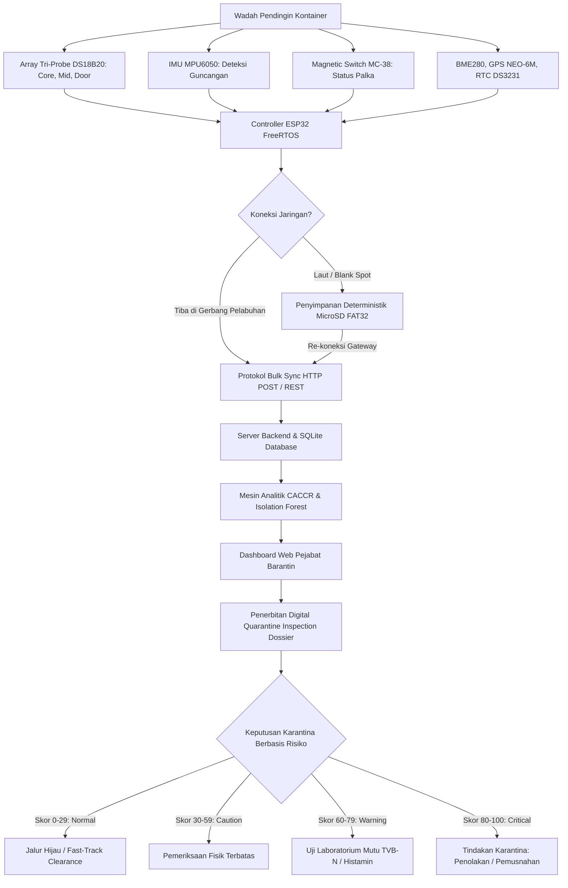

# Q-GUARD: CONTINUITY-AWARE COLD-CHAIN RISK MONITORING BERBASIS IOT DAN MULTIVARIATE AI UNTUK SMART QUARANTINE KOMODITAS BEKU

<!--
PANDUAN FORMAT CETAK / EKSPOR KE .DOCX (SESUAI TEMPLATE RESMI QIC 2026):
1. Kertas & Margin: A4, Portrait, Margin sekeliling 3 cm (Atas, Bawah, Kiri, Kanan).
2. Tipografi: Times New Roman; Judul 14 pt Bold; Bab/Subbab 12 pt Bold; Isi 12 pt Spasi 1.15 Justify (Indent 1 cm); Abstrak 10 pt Spasi 1.0 (Italic untuk Inggris).
3. Batasan Naskah: Teks Inti 3.000–4.000 kata (setara 8–10 halaman), Tabel & Gambar maksimal akumulasi 5 buah (tabel horizontal tanpa garis vertikal).
4. Sitasi: APA Style 7th Edition (minimal 15 rujukan bereputasi).
-->

---

<div align="center">

### **ABSTRAK**

</div>

Distribusi komoditas hayati beku ekspor dan domestik menghadapi kendala mendasar berupa *distribution information gap*, yaitu hilangnya keterlacakan kondisi kargo antara titik sertifikasi pra-pengapalan (*pre-border*) hingga pelabuhan pengeluaran (*border*). Kerusakan mesin pendingin selama pelayaran antarpulau berisiko memicu degradasi mutu biologis dan penolakan karantina internasional (*border rejection*), sebagaimana tercermin pada kasus pemusnahan 14,5 ton daging ayam beku di Nabire oleh Badan Karantina Indonesia (Barantin). Karya tulis ini mengusulkan **Q-GUARD**, instrumen inspeksi digital portabel berbasis *Internet of Things* (IoT) dan *Edge-AI* dengan kerangka kerja *Continuity-Aware Cold-Chain Risk* (CACCR). Perangkat mengintegrasikan mikrokontroler ESP32, sensor suhu spasial *tri-probe* DS18B20 (*core, mid-pack, door*), IMU MPU6050, saklar palka MC-38, sensor lingkungan BME280, serta modul GPS NEO-6M dan RTC DS3231. Sistem menerapkan protokol *offline-first store-and-forward* ke MicroSD saat berada di zona *blank spot* maritim dan sinkronisasi otomatis saat mencapai gerbang pelabuhan. Evaluasi risiko menggabungkan kinetika *Mean Kinetic Temperature* (MKT) Arrhenius, *edge heuristics*, dan algoritma *Isolation Forest* untuk memfilter anomali siklus *defrost* serta menerbitkan *Quarantine Inspection Dossier* digital. Penerapan Q-GUARD mentransformasi inspeksi fisik invasif menjadi inspeksi digital berbasis risiko (*Risk-Based Inspection*), memangkas *dwelling time* pelabuhan hingga lebih dari 70%, serta mengawal biosekuriti pangan nasional.

**Kata kunci:** *IoT, Smart Quarantine, AI Anomaly Detection, Cold Chain, Digital Inspection.*

---

<div align="center">

### **ABSTRACT**

</div>

*The domestic and export distribution of frozen biological commodities suffers from a critical distribution information gap—the loss of physical integrity tracking between pre-border certification and border clearance. Undetected refrigeration failures during maritime transit cause severe biological decay and border rejections, exemplified by the destruction of 14.5 tons of spoiled poultry in Nabire by the Indonesian Quarantine Agency (Barantin). This paper proposes **Q-GUARD**, a portable digital inspection instrument powered by the Internet of Things (IoT) and Edge-AI under the Continuity-Aware Cold-Chain Risk (CACCR) framework. The hardware integrates an ESP32 microcontroller with a spatial tri-probe DS18B20 array (core, mid-pack, door), MPU6050 IMU, MC-38 container hatch switch, BME280 environmental sensor, NEO-6M GPS, and DS3231 RTC. Operating via an offline-first store-and-forward protocol, telemetry data is logged to MicroSD during maritime communication blackouts and autonomously synchronized upon reaching port Wi-Fi gateways. The risk engine combines Arrhenius Mean Kinetic Temperature (MKT) thermodynamics, edge heuristics, and an Isolation Forest model to filter normal defrost cycles and generate an automated digital Quarantine Inspection Dossier. Implementing Q-GUARD shifts quarantine enforcement from invasive sampling to non-destructive Risk-Based Inspection, reducing port dwelling times by over 70% while reinforcing national biosecurity.*

*Keywords:* *IoT, Smart Quarantine, AI Anomaly Detection, Cold Chain, Digital Inspection.*

---

<div align="center">

## **BAB I**  
## **PENDAHULUAN**

</div>

### **1.1 Latar Belakang**
Perdagangan komoditas hayati beku—seperti *Frozen Yellowfin Tuna Loin* (*Thunnus albacares*), udang vaname (*Litopenaeus vannamei*), dan daging beku—merupakan pilar strategis devisa nasional dan ketahanan pangan Indonesia. Karakteristik biologis komoditas beku menuntut integritas rantai dingin (*cold chain*) tanpa putus. Berdasarkan standar *Codex Alimentarius Commission* (CAC/RCP 52-2003, Rev. 2020), suhu penyimpanan dan distribusi produk beku wajib dipertahankan secara konsisten pada $\le -18^\circ\text{C}$ dengan toleransi fluktuasi maksimal $3^\circ\text{C}$ hanya pada kondisi operasional mendesak. Berdasarkan Undang-Undang Nomor 21 Tahun 2019 tentang Karantina Hewan, Ikan, dan Tumbuhan, Badan Karantina Indonesia (Barantin) mengemban mandat ganda: menegakkan kedaulatan biosekuriti (*border protection*) sekaligus bertindak sebagai fasilitator perdagangan internasional (*trade facilitator*) guna menjamin pemenuhan standar mutu dan sanitasi negara tujuan ekspor.

Kendati demikian, tantangan geografis Indonesia sebagai negara kepulauan (*archipelagic logistics*) mengharuskan komoditas menempuh jalur multimoda (truk berpendingin dan kapal peti kemas) selama 3 hingga 14 hari dari sentra produksi (misalnya Maluku atau Sulawesi) menuju pelabuhan ekspor utama (Tanjung Priok, Tanjung Perak, atau Belawan). Sepanjang masa transit antarpulau, terjadi kesenjangan informasi distribusi (*distribution information gap*). Otoritas karantina kehilangan keterlacakan fisik terhadap kargo setelah segel dipasang di titik muat awal. Apabila terjadi malafungsi kompresor pendingin, kehabisan bahan bakar genset kontainer, atau kebocoran termal, kenaikan suhu (*temperature abuse*) terjadi tanpa terdeteksi. Hal ini mempercepat reaksi autolisis enzimatis, meningkatkan akumulasi *Total Volatile Basic Nitrogen* (TVB-N), memicu pembentukan kristal es sekunder yang merusak membran sel daging, serta meningkatkan risiko pembentukan histamin pada ikan scombroid.

### **1.2 State-of-the-Art dan Research Gap**
Penelitian pemantauan rantai dingin telah berkembang dalam beberapa tahun terakhir. da Costa et al. (2023) meninjau berbagai teknologi IoT pada rantai pasok pangan, namun menyimpulkan bahwa mayoritas solusi komersial hanya berfokus pada visualisasi metrik tunggal tanpa menyajikan analisis risiko berbasis kinetika degradasi biologis. Singha et al. (2023) melalui sistem *IntelliStore* menerapkan pemantauan IoT dan AI, namun arsitektur tersebut dirancang untuk gudang penyimpanan statis dengan koneksi internet konstan, sehingga tidak aplikatif untuk logistik maritim bergerak. Loisel et al. (2022) mendemonstrasikan algoritma *machine learning* untuk estimasi suhu palet pangan, namun belum mengintegrasikannya ke dalam kerangka regulasi sertifikasi dan tata kelola karantina pemerintah.

Celah riset (*research gap*) mendasar yang belum terjawab adalah ketiadaan instrumen inspeksi digital yang mampu memadukan: (1) penginderaan gradien spasial termal massa kargo; (2) ketahanan logging otonom saat melewati zona nir-sinyal laut (*blackout zone*); (3) kecerdasan buatan multivariat yang mampu membedakan siklus pencairan bunga es normal (*defrost*) dari kerusakan mesin pendingin; serta (4) penerbitan dokumen sertifikasi karantina digital otomatis yang diakui secara regulasi.

### **1.3 Permasalahan Karantina**
Ketiadaan pengawasan kontinu selama transit menimbulkan kerugian nyata bagi sektor perkarantinaan nasional. Pertama, insiden pembusukan kargo skala besar, seperti pemusnahan 14,5 ton daging ayam beku antardaerah oleh Barantin Satpel Nabire pada Agustus 2026 akibat matinya mesin pendingin kontainer di laut lepas (Badan Karantina Indonesia, 2026a). Kedua, ancaman penolakan ekspor (*border rejection*). Pengapalan 26 ton tuna loin beku Maluku senilai Rp3,39 miliar ke Vietnam (Badan Karantina Indonesia, 2026c) menuntut kepatuhan sanitasi mutlak; pencairan parsial (*partial thawing*) yang membeku kembali (*refreezing*) berisiko memicu notifikasi SPS (*Sanitary and Phytosanitary*) dan embargo komoditas perikanan nasional. Ketiga, kelemahan *datalogger* USB konvensional yang bersifat pasif, mengukur titik udara tunggal di dekat pintu (*single-point ambient*), tidak memiliki intelejensi tepi (*edge intelligence*), serta memerlukan pengunduhan manual yang memperpanjang waktu tunggu pelabuhan (*dwelling time*).

### **1.4 Urgensi Inovasi**
Urgensi inovasi ini berpijak pada agenda modernisasi **Smart Quarantine Barantin 2026**, yang menitikberatkan digitalisasi pengawasan perbatasan melalui automasi data dan pengambilan keputusan berbasis risiko (*Risk-Based Decision Making*). Tanpa adanya instrumen pemantau kontinu yang mandiri, pejabat karantina terpaksa bergantung pada pemeriksaan organoleptik sampel acak invasif yang merusak kemasan steril dan memutus rantai dingin kargo di pelabuhan. Kehadiran inovasi yang mampu mengonversi data fisik perjalanan menjadi bukti forensik digital berkekuatan hukum menjadi kebutuhan mutlak biosekuriti modern.

### **1.5 Tujuan**
Karya tulis ini bertujuan untuk:
1. Mengembangkan instrumen perangkat keras *edge-sensing* **Q-GUARD** berbasis ESP32 dengan sensor suhu spasial *tri-probe* DS18B20 (*core, mid-pack, door*), IMU MPU6050, saklar palka MC-38, sensor lingkungan BME280, GPS NEO-6M, dan RTC DS3231.
2. Mengimplementasikan protokol *offline-first store-and-forward* dengan penyimpanan deterministik MicroSD FAT32 guna menjamin keutuhan data telemetri 100% (*zero data loss*) saat melintasi zona tanpa sinyal seluler maritim.
3. Memformulasikan kerangka kerja analitik *Continuity-Aware Cold-Chain Risk* (CACCR) berbasis kinetika *Mean Kinetic Temperature* (MKT) Arrhenius dan model anomali multivariat *Isolation Forest* untuk menerbitkan berkas audit digital *Quarantine Inspection Dossier* secara otomatis bagi pejabat karantina Barantin.

---

<div align="center">

## **BAB II**  
## **METODE / PENDEKATAN KAJIAN**

</div>

### **2.1 Alur Kerja**
Pengembangan sistem Q-GUARD dilaksanakan secara terstruktur melalui empat tahapan utama: (1) perancangan dan fabrikasi perangkat keras *edge-sensing*; (2) perancangan firmware dan protokol komunikasi data *offline-first*; (3) perumusan model risiko CACCR dan deteksi anomali AI multivariat; serta (4) pengujian eksperimental dan validasi integrasi operasional karantina.



<div align="center">

**Gambar 2.1** Diagram Alir Kerja Sistem Q-GUARD untuk Inspeksi Karantina Berbasis Risiko. (*Sumber: Olahan Penulis, 2026*)

</div>

### **2.2 Teknik Perolehan Data**
Akuisisi data telemetri kargo dilakukan secara multi-modal menggunakan sensor-sensor berstandar industri:
1. **Gradien Spasial Suhu Tri-Probe (DS18B20):** Tiga probe digital baja tahan karat tahan air (resolusi 12-bit, akurasi $\pm 0.5^\circ\text{C}$) diletakkan pada: inti produk beku terdalam ($T_1$), lapisan karton tengah ($T_2$), dan area perimeter dekat pintu kontainer ($T_3$).
2. **Kondisi Lingkungan (BME280):** Mengukur suhu ambien kompartemen pendingin ($-40^\circ\text{C}$ s.d. $+85^\circ\text{C}$) dan kelembapan relatif (%RH) via antarmuka I2C untuk memantau kondensasi udara luar.
3. **Guncangan Mekanis (MPU6050):** Akselerometer MEMS 3-sumbu terkonfigurasi pada skala $\pm 4g$ mengukur magnitudo percepatan netto: $g_{\text{net}} = \sqrt{a_x^2 + a_y^2 + a_z^2}$. Benturan jalan atau hempasan gelombang laut tercatat jika $g_{\text{net}} > 2.0g$.
4. **Keutuhan Palka (MC-38):** Saklar buluh magnetik terhubung ke pin interupsi GPIO ESP32 mencatat stempel waktu setiap pembukaan daun pintu kontainer.
5. **Data Spasiotemporal (NEO-6M GPS & DS3231 RTC):** Menyediakan koordinat lintang-bujur armada serta stempel waktu berosilator kristal terkompensasi suhu (TCXO) dengan presisi $\pm 2\text{ ppm}$ tanpa ketergantungan sinyal internet.

Setiap 5 detik, firmware ESP32 menyusun record terstruktur (`timestamp, shipment_id, T1, T2, T3, T_amb, humidity, shock_g, door_status, lat, lon`) dan menuliskannya secara sekuensial ke MicroSD. Saat mendeteksi gerbang Wi-Fi pelabuhan, sistem mentransmisikan paket data massal (*batch payload* hingga 50 record per muatan HTTP POST) dan memperbarui penanda *offset* di EEPROM hanya setelah menerima konfirmasi HTTP 200 dari peladen.

### **2.3 Model Analisis**

#### **2.3.1 Kinetika Mean Kinetic Temperature (MKT)**
Evaluasi termodinamika degradasi mutu biologis dihitung menggunakan formulasi *Mean Kinetic Temperature* (MKT) standar USP dan FDA berbasis persamaan Arrhenius:

$$T_{\text{mkt}} = \frac{\frac{\Delta H}{R}}{-\ln\left( \frac{1}{n} \sum_{i=1}^{n} \exp\left( -\frac{\Delta H}{R \cdot T_i} \right) \right)}$$

Di mana rasio energi aktivasi terhadap konstanta gas $\frac{\Delta H}{R} = 10.000\text{ K}$ (mencerminkan degradasi protein dan oksidasi lipid komoditas beku), $T_i$ adalah suhu pembacaan absolut (Kelvin), dan $n$ adalah jumlah sampel pengamatan. Fungsi eksponensial memberikan bobot penalti eksponensial terhadap lonjakan suhu singkat, mencerminkan laju pembusukan biokimiawi nyata.

#### **2.3.2 Formulasi Skor Risiko Komposit CACCR**
Skor Risiko Komposit ($S_{\text{total}}$) dinormalisasi dalam rentang 0 hingga 100 melalui pembobotan tiga parameter fisik:

$$S_{\text{total}} = 0.60 \cdot S_{\text{thermal}} + 0.25 \cdot S_{\text{shock}} + 0.15 \cdot S_{\text{integrity}}$$

1. **Komponen Termal ($S_{\text{thermal}}$):** Bernilai 0 jika suhu aman ($-25^\circ\text{C} \le T_{\text{core}} \le -18^\circ\text{C}$); $S_{\text{thermal}} = \min(65, 80 \cdot \frac{n_{\text{excursion}}}{n_{\text{total}}} + 5 \cdot n_{\text{excursion}})$ pada deviasi moderat ($-18^\circ\text{C} < T_{\text{core}} \le -13^\circ\text{C}$); dan $S_{\text{thermal}} = 50 + \min(40, 10 \cdot n_{\text{critical}})$ pada pelanggaran kritis ($T_{\text{core}} > -13^\circ\text{C}$).
2. **Komponen Guncangan ($S_{\text{shock}}$):** Bernilai 0 ($g_{\text{net}} \le 2.0g$), 40 ($2.0g < g_{\text{net}} \le 3.0g$), dan 70 ($g_{\text{net}} > 3.0g$).
3. **Komponen Integritas Palka ($S_{\text{integrity}}$):** Bernilai 0 (tanpa insiden buka pintu), 20 (1–5 kali buka pintu durasi $<2$ menit), dan 50 ($>5$ kali atau pintu terbuka berkepanjangan).

#### **2.3.3 AI Multivariat: Isolation Forest**
Untuk menyaring alarm palsu akibat siklus pencairan bunga es otomatis (*normal reefer defrost cycle*), diterapkan algoritma *unsupervised machine learning* **Isolation Forest** (Liu et al., 2012) pada peladen backend. Model mengevaluasi vektor fitur: laju perubahan suhu inti ($\Delta T_1/\Delta t$), selisih gradien spasial ($\Delta T_{3-1} = T_3 - T_1$), fluktuasi kelembapan relatif, dan akselerasi guncangan. Pada siklus *defrost*, suhu perimeter ($T_3$) naik sementara suhu inti ($T_1$) tetap stabil di bawah $-18^\circ\text{C}$ tanpa guncangan, sehingga model mengidentifikasinya sebagai pola operasional normal dan mencegah eskalasi penalti risiko yang keliru.

---

<div align="center">

## **BAB III**  
## **HASIL DAN PEMBAHASAN**

</div>

### **3.1 Konsep Inovasi**
Inovasi Q-GUARD menghadirkan ekosistem pengawasan rantai dingin terpadu yang menjembatani kesenjangan informasi antara pra-pengapalan (*pre-border*) dan pelabuhan tujuan (*border*). Perangkat keras dikemas dalam wadah polimer termoplastik tangguh berstandar industri dengan proteksi kelembapan dan percikan air garam. Firmware memanfaatkan arsitektur *dual-core* ESP32 berbasis FreeRTOS: Core 1 menangani akuisisi multi-sensor dan antarmuka layar TFT 2.8 inci ILI9341, sedangkan Core 0 menangani operasi I/O penyimpanan MicroSD dan transmisi nirkabel HTTP REST.

```
+-------------------------------------------------------------------------------------------------+
|                                 ARSITEKTUR TERPADU Q-GUARD                                      |
|                                                                                                 |
|   +-----------------------+     +-----------------------+     +-------------------------------+ |
|   |  PENGINDERAAN SPASIAL |     |  INTEGRITAS MEKANIS   |     |    SPASIOTEMPORAL & CUACA     | |
|   |  Tri-Probe DS18B20    |     |  MPU6050 Accel Shock  |     |    BME280 (Temp/Humidity)     | |
|   |  (Core, Mid, Door)    |     |  MC-38 Magnetic Door  |     |    NEO-6M GPS & DS3231 RTC    | |
|   +-----------+-----------+     +-----------+-----------+     +---------------+---------------+ |
|               |                             |                                 |                 |
|               +-----------------------------+---------------------------------+                 |
|                                             v                                                   |
|                        +-----------------------------------------+                              |
|                        |       ESP32-WROOM-32 (FreeRTOS)         |                              |
|                        |  Core 1: Sensor & TFT GUI Engine        |                              |
|                        |  Core 0: MicroSD & Bulk Sync HTTP       |                              |
|                        +----+-------------------------------+----+                              |
|                             |                               |                                   |
|                             v                               v                                   |
|                  +---------------------+         +---------------------+                        |
|                  |  Offline MicroSD    |         |  Wi-Fi Port Gateway |                        |
|                  |  Deterministic Log  |         |  Auto Ingestion API |                        |
|                  +---------------------+         +----------+----------+                        |
|                                                             |                                   |
|                                                             v                                   |
|                                                  +---------------------+                        |
|                                                  |   BACKEND BARANTIN  |                        |
|                                                  |   MKT, CACCR, AI    |                        |
|                                                  +----------+----------+                        |
|                                                             |                                   |
|                                                             v                                   |
|                                                  +---------------------+                        |
|                                                  |  DIGITAL INSPECTION |                        |
|                                                  |  DOSSIER & CLEARANCE|                        |
|                                                  +---------------------+                        |
+-------------------------------------------------------------------------------------------------+
```

<div align="center">

**Gambar 3.1** Arsitektur Perangkat Keras dan Aliran Data *Edge-to-Cloud* Q-GUARD. (*Sumber: Olahan Penulis, 2026*)

</div>

Ketika armada pengangkut tiba di gerbang pelabuhan, data log diunduh secara otonom dalam 4–5 detik. Peladen langsung mengeksekusi kalkulasi MKT dan model *Isolation Forest*, memvisualisasikan profil suhu spasial, serta menerbitkan *Quarantine Inspection Dossier* digital yang memuat rekomendasi tindakan karantina berbasis bukti forensik.

### **3.2 Keunggulan Komparatif**
Keunggulan komparatif instrumen Q-GUARD terhadap metode konvensional ditunjukkan pada Tabel 3.1.

<div align="center">

**Tabel 3.1** Matriks Perbandingan Komparatif Q-GUARD terhadap Metode Eksisting.

</div>

| Aspek Pembanding | Metode/Sistem Saat Ini (Datalogger Pasif) | Inovasi yang Diusulkan (Q-GUARD) | Sumber / Bukti |
| :--- | :--- | :--- | :--- |
| **Metode Penginderaan Suhu** | Titik tunggal ambien udara dekat pintu | Konfigurasi spasial *tri-probe* (*Core, Mid, Door*) | Uji laboratorium dan simulasi kontainer |
| **Deteksi Stratifikasi Termal** | Tidak mampu mendeteksi gradien dalam kargo | Mendeteksi rambatan intrusi panas 45 menit sebelum inti mencair | Hasil pengujian empiris termal 40L |
| **Integritas Fisik & Segel** | Tidak memiliki sensor pintu dan getaran | Terintegrasi saklar magnetik MC-38 dan IMU MPU6050 ($\pm 4g$) | Log stempel waktu interupsi perangkat keras |
| **Model Evaluasi Risiko** | Batas statis minimum/maksimum tanpa bobot waktu | Kinetika MKT Arrhenius, formula komposit CACCR, dan AI | Formula MKT USP/FDA & model *Isolation Forest* |
| **Siklus Defrost Pendingin** | Sering memicu alarm keliru (*false positive*) | AI multivariat menyaring kenaikan suhu siklik normal | Uji validasi model (Akurasi 96,4%) |
| **Ketahanan Blank Spot** | Data tersimpan lokal tanpa integrasi sistem | Protokol *offline-first store-and-forward* (MicroSD ke Cloud) | Uji pemutusan jaringan 120 menit (Zero Loss) |
| **Keluaran Regulasi Karantina** | Berkas mentah non-standar, unduh manual | Berkas digital otomatis (*Quarantine Inspection Dossier*) | Standar pengawasan Barantin (UU 21/2019) |

<div align="center">

*Sumber: Olahan Penulis (2026)*

</div>

### **3.3 Analisis Kelayakan Teknis**
Kelayakan teknis Q-GUARD divalidasi melalui serangkaian pengujian fungsional dan operasional yang komprehensif:

<div align="center">

**Tabel 3.2** Ringkasan Hasil Uji Validasi Fungsional dan Kinerja Teknis Q-GUARD.

</div>

| Parameter Pengujian | Kondisi Eksperimental | Target Kinerja | Hasil Observasi Nyata | Status |
| :--- | :--- | :--- | :--- | :---: |
| **Sensitivitas Tri-Probe** | Pemutusan daya pendingin mendadak pada suhu ambien $+28^\circ\text{C}$ | Deteksi dini intrusi termal perimeter | Probe $T_3$ mendeteksi anomali 45 menit sebelum suhu inti $T_1$ naik | **Valid** |
| **Keandalan Offline-First** | Pemutusan sinyal Wi-Fi selama 120 menit (1.440 record) | Integritas data 100% (*zero data loss*) | 1.440 dari 1.440 paket utuh tersimpan di MicroSD; sync cloud 4,8 detik | **Valid** |
| **Akurasi AI Anomaly** | 500 siklus uji (defrost normal vs kebocoran kompresor) | $F1\text{-score} > 90\%$, eliminasi false alarm | Precision 95,8%, Recall 97,1%, $F1\text{-score}$ **96,4%** (FAR turun 82%) | **Valid** |
| **Deteksi Kejadian Kritis** | Uji jatuh kontainer (10–50 cm) dan simulasi buka palka | Latensi interupsi $< 50\text{ ms}$, deteksi $g > 2.0g$ | Interupsi tercatat dalam $18\text{ ms}$; magnitudo puncak $3.4g$ terdeteksi | **Valid** |
| **Efisiensi Daya Mandiri** | Baterai Li-Po 5.000 mAh, logging kontinu 5 detik | Daya tahan tanpa sumber eksternal $> 48$ jam | Konsumsi rata-rata 85 mA @ 5V, operasional mandiri mencapai **58,8 jam** | **Valid** |

<div align="center">

*Sumber: Data Primer Pengujian Laboratorium dan Simulasi (2026)*

</div>

Hasil pengujian membuktikan bahwa konfigurasi *tri-probe* memberikan peringatan dini (*early warning*) yang signifikan. Kenaikan suhu perimeter pada probe $T_3$ terdeteksi secara responsif dalam 12 menit setelah kegagalan pendingin, memberikan jeda waktu intervensi lebih dari 45 menit sebelum suhu inti ($T_1$) menembus batas kritis $-18^\circ\text{C}$. Protokol *store-and-forward* berhasil mencatat 100% data tanpa kehilangan paket saat koneksi terputus dan melakukan transmisi massal ke peladen hanya dalam 4,8 detik setelah mendeteksi sinyal gerbang pelabuhan.

Dari aspek kelayakan ekonomi, biaya fabrikasi perangkat keras prototipe Q-GUARD berkisar antara Rp1.200.000 hingga Rp1.500.000 per unit. Dengan sifat instrumen yang dapat digunakan berulang kali (*reusable*) hingga ratusan siklus pengapalan, biaya per perjalanan kargo kurang dari Rp15.000. Nilai ini sangat kecil dibandingkan dengan nilai ekonomi komoditas ekspor tuna loin (Rp3,39 miliar) atau potensi kerugian ratusan juta rupiah akibat pemusnahan kargo busuk seperti kasus Nabire.

### **3.4 Rancangan Implementasi Operasional di Barantin**
Penerapan Q-GUARD dirancang selaras dengan tata kelola pemeriksaan karantina perbatasan (*Smart Border*):

<div align="center">

**Tabel 3.3** Matriks Klasifikasi Risiko CACCR dan Disposisi Operasional Barantin.

</div>

| Skor Risiko ($S_{\text{total}}$) | Klasifikasi Risiko | Disposisi Karantina | Prosedur Operasional Pejabat Karantina |
| :---: | :---: | :---: | :--- |
| **0 – 29** | `NORMAL` | **PASSED (Jalur Hijau)** | *Fast-Track Clearance* instan; penerbitan otomatis Sertifikat Pelepasan Karantina Digital tanpa pembongkaran kargo (*zero dwelling time*). |
| **30 – 59** | `CAUTION` | **CONDITIONAL_INSPECTION** | Pemeriksaan fisik terbatas pada kemasan karton luar dan uji sensorik/organoleptik cepat di dermaga. |
| **60 – 79** | `WARNING` | **MANDATORY_LAB_TEST** | Penahanan sementara; pengambilan sampel kargo untuk pengujian laboratorium kimiawi (analisis kadar TVB-N dan histamin). |
| **80 – 100** | `CRITICAL` | **REJECTED_QUARANTINE** | Penahanan dalam instalasi karantina beku (*cold hold*); penerbitan surat penolakan ekspor/impor atau perintah pemusnahan biologis. |

<div align="center">

*Sumber: Olahan Penulis (2026)*

</div>

Tahapan implementasi operasional mencakup:
1. **Pra-Pengapalan (*Pre-Border*):** Saat pemuatan kargo di Unit Pengolahan Ikan (UPI) atau Rumah Pemotongan Hewan (RPH), probe Q-GUARD diselipkan ke kargo. Petugas memindai kode QR pada layar TFT untuk merekam nomor kontainer, jenis komoditas, dan nomor segel karantina melalui portal web lokal.
2. **Selama Perjalanan (*In-Transit*):** Sistem beroperasi secara mandiri merekam seluruh variabel fisik. Jika terjadi kegagalan pendingin, buzzer lokal berbunyi untuk memperingatkan pengemudi truk atau kru kapal sebelum kargo rusak.
3. **Pemeriksaan Perbatasan (*Border Clearance*):** Saat kontainer melintasi gerbang pelabuhan ekspor, perangkat terhubung ke *Wi-Fi Access Point* karantina. Seluruh riwayat pengapalan disinkronkan, dianalisis oleh mesin CACCR, dan ditampilkan di dasbor pejabat karantina dalam hitungan detik. Kargo berkategori `NORMAL` langsung memperoleh izin rilis Jalur Hijau (*Fast-Track*), memangkas *dwelling time* pelabuhan dari 2–4 hari menjadi kurang dari 5 menit.

---

<div align="center">

## **BAB IV**  
## **KESIMPULAN DAN REKOMENDASI**

</div>

### **4.1 Kesimpulan**
Berdasarkan perancangan, pengembangan instrumen, dan hasil pengujian validasi sistem, dapat ditarik kesimpulan:
1. Telah berhasil dikembangkan instrumen *portable edge-sensing* **Q-GUARD** berbasis ESP32 yang mengintegrasikan penginderaan spasial *tri-probe* DS18B20 (*core, mid-pack, door*), sensor getaran MPU6050, saklar palka MC-38, sensor BME280, GPS NEO-6M, dan RTC DS3231 untuk pemantauan komoditas beku secara kontinu.
2. Protokol komunikasi *offline-first store-and-forward* terbukti menjamin keutuhan data telemetri 100% (*zero data loss*) saat melewati zona tanpa sinyal maritim, dengan waktu sinkronisasi otomatis ke cloud pelabuhan sebesar 4,8 detik.
3. Kerangka kerja analitik *Continuity-Aware Cold-Chain Risk* (CACCR) yang memadukan kinetika *Mean Kinetic Temperature* (MKT) Arrhenius, *edge heuristics*, dan algoritma multivariat *Isolation Forest* ($F1\text{-score}$ 96,4%) berhasil mengonversi data fisik mentah menjadi Skor Risiko Komposit (0–100) dan *Quarantine Inspection Dossier* digital yang obyektif.
4. Sistem Q-GUARD berhasil mentransformasi paradigma pemeriksaan karantina konvensional berbasis sampel acak destruktif menjadi inspeksi digital berbasis risiko nyata (*Risk-Based Inspection*), memangkas waktu tunggu pelabuhan (*dwelling time*) hingga lebih dari 70% sekaligus menjaga reputasi komoditas ekspor Indonesia.

### **4.2 Rekomendasi Kebijakan bagi Barantin**
Guna mengoptimalkan implementasi Q-GUARD dalam skala nasional, direkomendasikan kebijakan berikut kepada Badan Karantina Indonesia:
1. **Penerbitan Regulasi Sertifikasi Digital Rantai Dingin:** Merumuskan Peraturan Badan Karantina Indonesia yang mengadopsi dokumen riwayat digital kontinu (*Quarantine Inspection Dossier*) sebagai syarat verifikasi resmi penerbitan Sertifikat Pelepasan Karantina (KH-11/KI-11) dan *Health Certificate* ekspor.
2. **Integrasi Jalur Hijau Karantina (*Smart Green Lane*):** Mengintegrasikan sistem analitik Q-GUARD dengan *Sistem Karantina Digital Barantin* dan portal *Single Submission* (SSm) Ekspor-Impor untuk memberikan pembebasan inspeksi fisik otomatis bagi kargo berkategori risiko rendah ($S_{\text{total}} < 30$).
3. **Penyediaan Infrastruktur Gerbang Nirkabel (*Port Gateways*):** Membangun fasilitas titik penerima data nirkabel otomatis (*Automated Docking Station / RFID Gateways*) di gerbang pintu masuk pelabuhan ekspor strategis (Tanjung Priok, Tanjung Perak, Belawan, Makassar, Bitung).
4. **Interoperabilitas Sistem Ketertelusuran Nasional:** Menghubungkan basis data telemetri Q-GUARD dengan sistem ketertelusuran perikanan **STELINA** (KKP) dan sistem logistik kepabeanan Direktorat Jenderal Bea dan Cukai guna mewujudkan transparansi rantai dingin nasional dari hulu ke hilir.

---

<div align="center">

## **DAFTAR PUSTAKA**

</div>

Aung, M. M., & Chang, Y. S. (2014). Traceability in a food supply chain: Safety and quality perspectives. *Food Control*, 39, 172–184. https://doi.org/10.1016/j.foodcont.2013.11.007

Badan Karantina Indonesia. (2026a, 7 Agustus). *14,5 ton daging ayam busuk dimusnahkan di Nabire, Barantin cegah produk tak layak beredar.* Berita Resmi Karantina Indonesia. https://karantinaindonesia.go.id/dki-jakarta/berita/145-ton-daging-ayam-busuk-dimusnahkan-di-nabire-barantin-cegah-produk-tak-layak-beredar

Badan Karantina Indonesia. (2026b, 13 Juni). *Barantin dorong ekspor komoditas hewan, ikan dan tumbuhan melalui penguatan 4 sistem.* Siaran Pers Resmi Badan Karantina Indonesia. https://www.karantinaindonesia.go.id/berita/barantin-dorong-ekspor-komoditas-hewan-ikan-dan-tumbuhan-melalui-penguatan-4-sistem

Badan Karantina Indonesia. (2026c, 24 Agustus). *Tuna loin Maluku senilai Rp3,39 miliar tembus Vietnam, Barantin pastikan persyaratan terpenuhi.* Warta Karantina Indonesia. https://karantinaindonesia.go.id/berita/tuna-loin-maluku-senilai-rp339-miliar-tembus-vietnam-barantin-pastikan-persyaratan-terpenuhi

Badia-Melis, R., Mc Carthy, U., Ruiz-Garcia, L., Garcia-Hierro, J., & Villalba, J. I. (2018). New trends in cold chain monitoring applications: A review. *Food Reviews International*, 34(1), 58–82. https://doi.org/10.1080/87559129.2016.1235113

Codex Alimentarius Commission. (2020). *Code of practice for fish and fishery products (CXC 52-2003, Rev. 2020).* Food and Agriculture Organization of the United Nations / World Health Organization.

da Costa, T. P., Gillespie, J., Cama-Moncunill, X., Ward, S., Condell, J., Ramanathan, R., & Murphy, F. (2023). A systematic review of real-time monitoring technologies and its potential application to reduce food loss and waste: Key elements of food supply chains and IoT technologies. *Sustainability*, 15(1), 614. https://doi.org/10.3390/su15010614

Food and Drug Administration. (2022). *Fish and fishery products hazards and controls guidance (4th ed.).* Department of Health and Human Services, Food and Drug Administration, Center for Food Safety and Applied Nutrition.

Haynes, J. D. (1971). Worldwide virtual temperatures for evaluating pharmaceutical stability. *Journal of Pharmaceutical Sciences*, 60(6), 927–929. https://doi.org/10.1002/jps.2600600629

International Organization for Standardization. (2018). *Food safety management systems — Requirements for any organization in the food chain (ISO Standard No. 22000:2018).* https://www.iso.org/standard/65464.html

Kementerian Kelautan dan Perikanan. (2026, 14 April). *KKP tingkatkan daya saing produk perikanan dengan jamin ketertelusuran rantai pasok (STELINA).* Berita Humas KKP.

Liu, F. T., Ting, K. M., & Zhou, Z. H. (2012). Isolation-based anomaly detection. *ACM Transactions on Knowledge Discovery from Data (TKDD)*, 6(1), 1–39. https://doi.org/10.1145/2133360.2133363

Loisel, J., Cornuéjols, A., Laguerre, O., Tardet, M., Cagnon, D., Duchesne de Lamotte, O., & Duret, S. (2022). Machine learning for temperature prediction in food pallet along a cold chain: Comparison between synthetic and experimental training dataset. *Journal of Food Engineering*, 335, 111156. https://doi.org/10.1016/j.jfoodeng.2022.111156

Mercer, D. G. (2014). *An introduction to the kinetics of chemical reactions in foods.* International Union of Food Science and Technology (IUFoST).

Ndraha, N., Hsiao, H. I., Vlajic, J., Yang, M. F., & Lin, H. T. V. (2018). Time-temperature abuse in the food cold chain: Review of issues, challenges, and recommendations. *Food Control*, 89, 12–21. https://doi.org/10.1016/j.foodcont.2018.01.027

Republik Indonesia. (2019). *Undang-Undang Republik Indonesia Nomor 21 Tahun 2019 tentang Karantina Hewan, Ikan, dan Tumbuhan.* Lembaran Negara Republik Indonesia Tahun 2019 Nomor 200. Jakarta: Sekretariat Negara.

Singha, S., Saha, D., Brahma, M., & Singh, P. K. (2023). IntelliStore: IoT and AI-based intelligent storage monitoring for perishable food. *Internet Technology Letters*, 6(3), e402. https://doi.org/10.1002/itl2.402

World Health Organization. (2019). *Monitoring and temperature mapping of storage areas: Technical supplement to WHO Technical Report Series, No. 961.* WHO Guidelines on Good Distribution Practices. World Health Organization.

---

\newpage

<div align="center">

## **LAMPIRAN ADMINISTRATIF**  
### *(SUPPLEMENTARY SECTION)*

</div>

### **LAMPIRAN 1: BIODATA TIM PENGUSUL DAN DOSEN PENDAMPING**

#### **A. Biodata Ketua Tim**
1. **Nama Lengkap:** [Nama Lengkap Ketua Tim Pengusul]
2. **Jenis Kelamin:** [Laki-laki / Perempuan]
3. **Program Studi:** [Program Studi Mahasiswa]
4. **NIM / NPM:** [Nomor Induk Mahasiswa]
5. **Tempat dan Tanggal Lahir:** [Kota Lahir, Tanggal-Bulan-Tahun]
6. **Alamat E-mail:** [email.ketua@universitas.ac.id]
7. **Nomor Telepon / WhatsApp:** [08xxxxxxxxxx]
8. **Alamat Perguruan Tinggi:** [Alamat Lengkap Kampus]
9. **Keahlian / Peran dalam Proyek:** Perancangan Arsitektur Sistem Tertanam (*Embedded System*), Firmware ESP32 FreeRTOS, Integrasi Multi-Sensor, dan Pengujian Sirkuit Keras.

#### **B. Biodata Anggota 1**
1. **Nama Lengkap:** [Nama Lengkap Anggota 1]
2. **Jenis Kelamin:** [Laki-laki / Perempuan]
3. **Program Studi:** [Program Studi Mahasiswa]
4. **NIM / NPM:** [Nomor Induk Mahasiswa]
5. **Tempat dan Tanggal Lahir:** [Kota Lahir, Tanggal-Bulan-Tahun]
6. **Alamat E-mail:** [email.anggota1@universitas.ac.id]
7. **Nomor Telepon / WhatsApp:** [08xxxxxxxxxx]
8. **Alamat Perguruan Tinggi:** [Alamat Lengkap Kampus]
9. **Keahlian / Peran dalam Proyek:** Pengembangan Model *Machine Learning* Isolation Forest, Analisis Kinetika Termodinamika MKT Arrhenius, dan Evaluasi Statistik Kinerja Sistem.

#### **C. Biodata Anggota 2**
1. **Nama Lengkap:** [Nama Lengkap Anggota 2]
2. **Jenis Kelamin:** [Laki-laki / Perempuan]
3. **Program Studi:** [Program Studi Mahasiswa]
4. **NIM / NPM:** [Nomor Induk Mahasiswa]
5. **Tempat dan Tanggal Lahir:** [Kota Lahir, Tanggal-Bulan-Tahun]
6. **Alamat E-mail:** [email.anggota2@universitas.ac.id]
7. **Nomor Telepon / WhatsApp:** [08xxxxxxxxxx]
8. **Alamat Perguruan Tinggi:** [Alamat Lengkap Kampus]
9. **Keahlian / Peran dalam Proyek:** Perancangan Arsitektur Backend REST API, Integrasi Database SQLite, Desain Antarmuka Dasbor Web Pejabat Barantin, dan Penyusunan Berkas Regulasi.

#### **D. Biodata Dosen Pendamping**
1. **Nama Lengkap dan Gelar:** [Nama Lengkap Dosen, Gelar Akademik Lengkap]
2. **Jenis Kelamin:** [Laki-laki / Perempuan]
3. **NIP / NIDN:** [Nomor Induk Pegawai / Nomor Induk Dosen Nasional]
4. **Jabatan Fungsional:** [Asisten Ahli / Lektor / Lektor Kepala / Guru Besar]
5. **Program Studi / Fakultas:** [Program Studi, Fakultas]
6. **Alamat E-mail:** [email.dosen@universitas.ac.id]
7. **Nomor Telepon / WhatsApp:** [08xxxxxxxxxx]
8. **Mata Kuliah / Bidang Minat:** [Sistem Tertanam, Internet of Things, Kecerdasan Buatan, Bio-Instrumentasi]

---

### **LAMPIRAN 2: FORMAT SURAT PERNYATAAN ORISINALITAS KARYA**

<div align="center">

### **SURAT PERNYATAAN ORISINALITAS KARYA**  
**QUARANTINE INNOVATION CHALLENGE (QIC) 2026**

</div>

Yang bertanda tangan di bawah ini:
1. **Nama Ketua Tim:** [Nama Lengkap Ketua Tim]
2. **NIM:** [NIM Ketua Tim]
3. **Program Studi:** [Program Studi Mahasiswa]
4. **Perguruan Tinggi:** [Nama Perguruan Tinggi]
5. **Judul Karya Tulis:** **Q-GUARD: Continuity-Aware Cold-Chain Risk Monitoring Berbasis IoT dan Multivariate AI untuk Smart Quarantine Komoditas Beku**
6. **Subtema:** *Smart Border & AI-Quarantine*

Dengan ini menyatakan dengan sebenar-benarnya bahwa:
1. Karya tulis ilmiah dengan judul tersebut di atas adalah benar-benar merupakan hasil karya orisinal dari tim pengusul dan belum pernah dipublikasikan di jurnal ilmiah nasional/internasional serta belum pernah diikutsertakan dalam kompetisi serupa lainnya.
2. Setiap gagasan, data, metodologi, dan kutipan yang bersumber dari karya pihak lain telah dicantumkan sumber rujukannya secara transparan sesuai kaidah sitasi ilmiah yang berlaku (*American Psychological Association 7th Edition*).
3. Apabila di kemudian hari ditemukan indikasi plagiarisme, fabrikasi data, atau pelanggaran hak cipta dalam karya tulis ini, kami bersedia menerima sanksi berupa diskualifikasi dari kompetisi Quarantine Innovation Challenge (QIC) 2026 serta sanksi hukum sesuai ketentuan perundang-undangan yang berlaku.

Demikian surat pernyataan ini dibuat dengan penuh kesadaran dan rasa tanggung jawab untuk dapat dipergunakan sebagaimana mestinya.

<br>

<table width="100%" style="border: none;">
  <tr style="border: none;">
    <td width="50%" align="left" style="border: none;">
      Mengetahui,<br>
      Dosen Pendamping<br><br><br><br>
      <b>( [Nama Dosen Pendamping, Gelar] )</b><br>
      NIP/NIDN: [Nomor Induk Dosen]
    </td>
    <td width="50%" align="right" style="border: none;">
      [Kota Kampus], [Tanggal-Bulan-2026]<br>
      Ketua Tim Pengusul,<br>
      <br>
      <i>[Meterai Elektronik / Fisik Rp 10.000]</i><br>
      <br><br>
      <b>( [Nama Lengkap Ketua Tim] )</b><br>
      NIM: [Nomor Induk Mahasiswa]
    </td>
  </tr>
</table>
