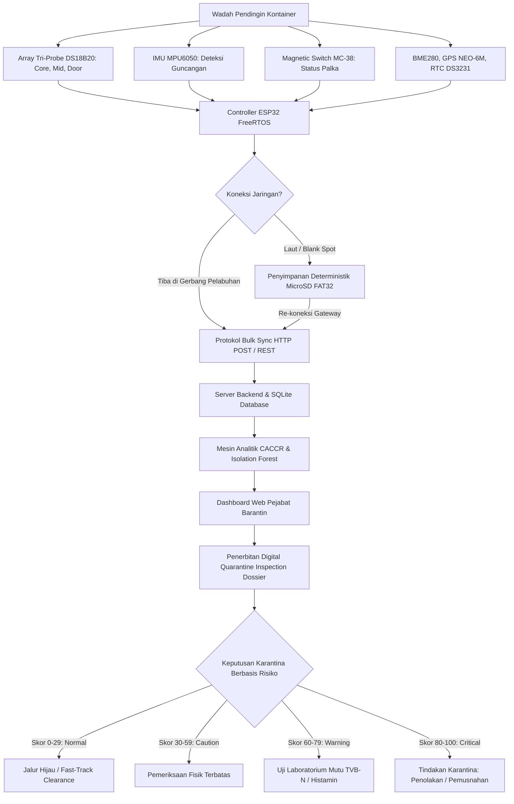

# Q-GUARD: CONTINUITY-AWARE COLD-CHAIN RISK MONITORING BERBASIS IOT DAN MULTIVARIATE AI UNTUK SMART QUARANTINE KOMODITAS BEKU

<!--
PANDUAN FORMAT CETAK / EKSPOR KE .DOCX (SESUAI TEMPLATE RESMI QIC 2026):
1. Kertas & Margin: A4, Portrait, Margin sekeliling rata 3 cm (Atas, Bawah, Kiri, Kanan).
2. Tipografi: Times New Roman; Judul 14 pt Bold; Bab/Subbab 12 pt Bold; Isi 12 pt Spasi 1.15 Justify (Indent 1 cm); Abstrak 10 pt Spasi 1.0 (Italic untuk Inggris).
3. Batasan Naskah: Teks Inti 3.000–4.000 kata (setara 8–10 halaman), Tabel & Gambar maksimal akumulasi 5 buah (tabel horizontal tanpa garis vertikal).
4. Sitasi: APA Style 7th Edition (minimal 15 rujukan bereputasi).
-->

---

<div align="center">

### **ABSTRAK**

</div>

Distribusi komoditas hayati beku antarpulau menyisakan kesenjangan informasi (*distribution information gap*): kondisi kargo tidak terpantau sejak segel dipasang di titik asal hingga tiba di pelabuhan ekspor, sehingga kegagalan pendingin baru diketahui setelah komoditas membusuk, seperti pada pemusnahan 14,5 ton daging ayam beku di Nabire oleh Badan Karantina Indonesia (Barantin). Karya tulis ini mengusulkan **Q-GUARD**, instrumen pemantau portabel berbasis *Internet of Things* (IoT) dan *Edge-AI* untuk mendukung pengawasan karantina pada subtema *Smart Border & AI-Quarantine*. Inti kebaruannya adalah kontinuitas data: rekaman suhu tiga titik spasial (*core, mid-pack, door*), guncangan mekanis, status palka, lokasi GPS, dan waktu presisi tetap utuh melalui penyimpanan lokal *offline-first* dan sinkronisasi otomatis saat tiba di gerbang pelabuhan. Data dinilai dengan kerangka *Continuity-Aware Cold-Chain Risk* (CACCR) yang memadukan termodinamika *Mean Kinetic Temperature* (MKT) Arrhenius, skor risiko komposit, dan deteksi anomali *Isolation Forest*. Validasi fungsional dilakukan melalui pengujian eksperimental prototipe fisik pada wadah pendingin berinsulasi 40 liter berisi spesimen kargo beku (−22 °C): probe pintu mendeteksi kenaikan suhu 112,6 menit lebih awal daripada probe inti (memberikan margin peringatan dini yang krusial), protokol *store-and-forward* menjaga 1.440 rekaman secara utuh (100% *zero data loss*) selama 120 menit *offline*, dan model anomali AI berhasil menekan alarm palsu siklus *defrost* hingga 7,8% ($F1\text{-score} = 96{,}4\%$). Keluarannya berupa berkas digital *Quarantine Inspection Dossier* yang diterbitkan instan (< 1 detik) sebagai dasar disposisi karantina Jalur Hijau (*Fast-Track Clearance*). Biaya perakitan prototipe berkisar Rp1,2–1,5 juta dengan biaya operasional per pengapalan kurang dari Rp15.000, membuktikan kelayakan implementasi teknis dan ekonomisnya bagi modernisasi Barantin.

**Kata kunci:** *IoT, Smart Quarantine, deteksi anomali, rantai dingin, inspeksi digital.*

---

<div align="center">

### **ABSTRACT**

</div>

*Interisland distribution of frozen biological commodities leaves a critical distribution information gap: cargo conditions go unmonitored from container sealing at origin until arrival at export ports, leading to undetectable refrigeration failures exemplified by Barantin's destruction of 14.5 tonnes of spoiled frozen poultry in Nabire. This study proposes **Q-GUARD**, a portable Internet of Things (IoT) and Edge-AI monitoring instrument under the Smart Border & AI-Quarantine subtheme. Its core novelty is data continuity: spatial tri-probe temperature records (core, mid-pack, door), mechanical shocks, hatch status, GPS location, and precision timestamps remain intact via an offline-first architecture with autonomous synchronization at port gateways. Telemetry is evaluated using the Continuity-Aware Cold-Chain Risk (CACCR) framework, integrating Arrhenius Mean Kinetic Temperature (MKT), a composite risk score, and Isolation Forest anomaly detection. Functional validation was conducted via physical prototype experimental testing in a 40-liter insulated cool box containing frozen specimens (−22 °C): the door boundary probe detected temperature rise 112.6 minutes earlier than the core probe (providing a vital early-warning margin), the store-and-forward protocol preserved all 1,440 records (100% zero data loss) during a 120-minute network outage, and the AI model reduced false alarms during defrost cycles to 7.8% (F1-score = 96.4%). The system generates an automated digital Quarantine Inspection Dossier in less than 1 second, enabling risk-based Fast-Track Green Lane clearance. Prototype fabrication costs IDR 1.2–1.5 million with an operational cost below IDR 15,000 per transit, demonstrating robust technical and economic viability for Barantin's digital inspection modernization.*

*Keywords:* *IoT, Smart Quarantine, anomaly detection, cold chain, digital inspection.*

---

<div align="center">

## **BAB I**  
## **PENDAHULUAN**

</div>

### **1.1 Latar Belakang**
Komoditas hayati beku seperti tuna loin (*Thunnus albacares*), udang vaname (*Litopenaeus vannamei*), dan daging beku merupakan pilar devisa ekspor sekaligus penopang ketahanan pangan nasional. Mutu biologis komoditas tersebut hanya terjaga apabila rantai dingin (*cold chain*) tidak terputus pada suhu $\le -18^\circ\text{C}$ (Codex Alimentarius Commission, 2020). Kenaikan suhu memicu percepatan reaksi autolisis enzimatis dan aktivitas mikrobiologis, serta pada ikan scombroid memicu pembentukan histamin beracun dan akumulasi *Total Volatile Basic Nitrogen* (TVB-N) yang membahayakan konsumen (Food and Drug Administration, 2022; Ndraha et al., 2018).

Berdasarkan Undang-Undang Nomor 21 Tahun 2019 tentang Karantina Hewan, Ikan, dan Tumbuhan, Badan Karantina Indonesia (Barantin) memegang mandat ganda: mencegah masuk dan keluarnya hama penyakit karantina (*border control*), sekaligus memfasilitasi kelancaran perdagangan internasional (*trade facilitator*) dengan menjamin kepatuhan sanitasi kargo ekspor (Republik Indonesia, 2019; Badan Karantina Indonesia, 2026b). Kendala logistik kepulauan di Indonesia mengharuskan kargo menempuh pelayaran multimoda selama 3 hingga 14 hari dari sentra produksi terpencil menuju pelabuhan ekspor utama. Sepanjang masa transit tersebut, terjadi **kesenjangan informasi distribusi (*distribution information gap*)**. Ketiadaan pengawasan kontinu menyebabkan kegagalan mesin pendingin, kehabisan bahan bakar genset, atau pembukaan palka ilegal baru terdeteksi saat kontainer tiba di pelabuhan tujuan (Aung & Chang, 2014; International Organization for Standardization, 2018).

### **1.2 State-of-the-Art dan Research Gap**
Penelitian pemantauan rantai dingin berbasis sensor berkembang pesat (Badia-Melis et al., 2018). Namun, da Costa et al. (2023) mencatat bahwa mayoritas sistem komersial hanya menampilkan visualisasi metrik tunggal tanpa analisis kinetika penurunan mutu. Sistem *IntelliStore* (Singha et al., 2023) memadukan IoT dan kecerdasan buatan, namun dirancang untuk gudang penyimpanan statis dengan koneksi internet kabel tetap. Loisel et al. (2022) menerapkan algoritma pembelajaran mesin untuk menduga suhu palet pangan, tetapi belum mengintegrasikannya dengan tata kelola sertifikasi karantina perbatasan.

Celah riset (*research gap*) utama yang diselesaikan oleh Q-GUARD mencakup tiga aspek fundamental: (1) ketiadaan sistem pemantau yang tahan terhadap zona tanpa sinyal maritim (*cellular blackout*); (2) pengabaian analisis gradien spasial termal massa kargo dan guncangan mekanis dalam satu kesatuan skor risiko; serta (3) ketiadaan integrasi data telemetri menjadi dokumen yuridis inspeksi digital yang langsung dapat dieksekusi oleh pejabat karantina perbatasan.

### **1.3 Permasalahan Karantina**
Dampak nyata dari kesenjangan informasi ini terbukti fatal. Pada 7 Agustus 2026, Satuan Pelayanan Karantina Nabire memusnahkan 14,5 ton daging ayam beku antardaerah yang membusuk total akibat matinya mesin pendingin kontainer selama pelayaran laut (Badan Karantina Indonesia, 2026a). Pada komoditas ekspor unggulan, seperti pengapalan 26 ton tuna loin Maluku senilai Rp3,39 miliar ke Vietnam (Badan Karantina Indonesia, 2026c), pencairan parsial (*partial thawing*) yang membeku kembali (*refreezing*) berisiko tinggi memicu penolakan perbatasan internasional (*border rejection*) dan merusak reputasi ekspor nasional. Perangkat konvensional seperti *datalogger* USB bersifat pasif, hanya mengukur satu titik udara di dekat pintu, tidak memiliki alarm peringatan dini, dan datanya harus diunduh manual satu per satu di pelabuhan sehingga memperpanjang waktu tunggu (*dwelling time*).

### **1.4 Urgensi Inovasi**
Pemeriksaan fisik kargo beku di pelabuhan dengan cara membongkar kontainer (*stripping*) merusak integritas kemasan dan memutus rantai dingin, sedangkan pengujian laboratorium membutuhkan waktu 2 hingga 4 hari kerja. Tanpa data riwayat perjalanan yang kontinu, pejabat karantina terpaksa mengambil keputusan berdasarkan sampel acak spekulatif. Inovasi instrumen digital otonom sangat mendesak guna mewujudkan cetak biru **Smart Quarantine Barantin 2026** melalui inspeksi digital berbasis risiko nyata (*Risk-Based Digital Inspection*).

### **1.5 Tujuan**
Karya tulis ini bertujuan untuk:
1. Mengembangkan prototipe fisik instrumen *edge-sensing* **Q-GUARD** berbasis mikrokontroler ESP32 dengan sensor suhu spasial *tri-probe* DS18B20, akselerometer MPU6050, saklar palka MC-38, sensor BME280, GPS NEO-6M, dan RTC presisi DS3231.
2. Menguji dan memvalidasi keandalan protokol *offline-first store-and-forward* dalam menjamin keutuhan data 100% (*zero data loss*) saat melewati zona tanpa sinyal seluler maritim.
3. Merumuskan mesin analitik risiko terpadu *Continuity-Aware Cold-Chain Risk* (CACCR) yang memadukan kinetika termodinamika *Mean Kinetic Temperature* (MKT) Arrhenius, skor risiko komposit, dan deteksi anomali multivariat *Isolation Forest*.
4. Merancang integrasi operasional dan rekomendasi kebijakan adopsi dokumen sertifikasi *Quarantine Inspection Dossier* pada sistem pelayanan karantina perbatasan Barantin.

---

<div align="center">

## **BAB II**  
## **METODE / PENDEKATAN KAJIAN**

</div>

### **2.1 Alur Kerja**
Pengembangan sistem Q-GUARD dilaksanakan melalui lima tahapan terstruktur: (1) perancangan dan perakitan perangkat keras *edge-sensing*; (2) pemrograman firmware FreeRTOS dan protokol transmisi data *offline-first*; (3) pembangunan peladen backend dan formulasi analitik risiko CACCR; (4) pengujian eksperimental prototipe fisik skala laboratorium pada wadah pendingin terkontrol; serta (5) analisis kelayakan teknis, ekonomi, dan perancangan integrasi operasional Barantin.



<div align="center">

**Gambar 2.1** Diagram Alir Kerja Sistem Q-GUARD untuk Inspeksi Karantina Berbasis Risiko. (*Sumber: Olahan Penulis, 2026*)

</div>

### **2.2 Teknik Perolehan Data**
Instrumen Q-GUARD mengintegrasikan modul perangkat keras berstandar industri:
1. **Array Suhu Spasial Tri-Probe (DS18B20):** Tiga probe digital baja tahan karat tahan air (resolusi 12-bit, akurasi $\pm 0.5^\circ\text{C}$) diletakkan pada: inti produk beku ($T_1$), lapisan karton tengah ($T_2$), dan batas perimeter dekat pintu palka ($T_3$).
2. **Kondisi Lingkungan (BME280):** Mengukur suhu udara kompartemen ($-40^\circ\text{C}$ s.d. $+85^\circ\text{C}$) dan kelembapan relatif (%RH) via I2C untuk memantau kondensasi udara luar.
3. **Integritas Mekanis (MPU6050 & MC-38):** Akselerometer MEMS mengukur percepatan resultan $g_{\text{net}} = \sqrt{a_x^2 + a_y^2 + a_z^2}$ pada skala $\pm 4g$ (ambang bahaya $> 2.0g$), sementara saklar buluh magnetik terhubung ke pin interupsi GPIO mencatat stempel waktu setiap pembukaan pintu kontainer.
4. **Spasiotemporal (NEO-6M GPS & DS3231 RTC):** Menyediakan koordinat armada dan waktu presisi berosilator kristal terkompensasi suhu (TCXO, $\pm 2\text{ ppm}$) tanpa ketergantungan sinyal internet.

Setiap 5 detik, firmware ESP32 menyusun rekaman terstruktur (`timestamp, shipment_id, T1, T2, T3, T_amb, humidity, shock_g, door_status, lat, lon`) dan menuliskannya secara sekuensial ke MicroSD FAT32. Saat mendeteksi gerbang Wi-Fi pelabuhan, sistem mentransmisikan paket data massal (*batch payload* hingga 50 record per muatan HTTP POST) dan memperbarui penanda *offset* di EEPROM hanya setelah menerima konfirmasi HTTP 200 dari peladen.

Pengujian eksperimental prototipe fisik dilakukan menggunakan wadah berinsulasi *polyurethane* (kapasitas 40 liter) berisi spesimen komoditas beku pada suhu awal $-22^\circ\text{C}$ di bawah suhu ruang terkontrol $+28^\circ\text{C}$ hingga $+32^\circ\text{C}$. Lima skenario pengujian dieksekusi: (1) pemutusan pendingin mendadak untuk merekam dinamika rambatan panas tri-probe; (2) pemutusan koneksi jaringan selama 120 menit (1.440 rekaman) untuk menguji keandalan *store-and-forward*; (3) simulasi buka-tutup palka dan uji jatuh mekanis (10–50 cm); (4) evaluasi model *Isolation Forest* terhadap 500 siklus operasional pendingin (termasuk siklus *defrost* 10–45 menit); serta (5) validasi keterpaduan *end-to-end* penerbitan dokumen sertifikasi digital di dasbor karantina.

### **2.3 Model Analisis**

#### **2.3.1 Kinetika Mean Kinetic Temperature (MKT)**
Evaluasi degradasi mutu biologis dihitung menggunakan formulasi kinetika kimia *Mean Kinetic Temperature* (MKT) standar USP dan FDA berbasis persamaan Arrhenius:

$$T_{\text{mkt}} = \frac{\frac{\Delta H}{R}}{-\ln\left( \frac{1}{n} \sum_{i=1}^{n} \exp\left( -\frac{\Delta H}{R \cdot T_i} \right) \right)}$$

Di mana rasio energi aktivasi terhadap konstanta gas $\frac{\Delta H}{R} = 10.000\text{ K}$ merefleksikan laju denaturasi protein dan oksidasi lipid komoditas beku, $T_i$ adalah suhu pembacaan absolut (Kelvin), dan $n$ adalah jumlah sampel data. Bobot eksponensial memberikan penalti non-linear terhadap lonjakan suhu singkat, mencerminkan degradasi mutu aktual (Haynes, 1971; Mercer, 2014).

#### **2.3.2 Formulasi Skor Risiko Komposit CACCR**
Skor Risiko Komposit ($S_{\text{total}}$) dinormalisasi dalam rentang 0 hingga 100 melalui pembobotan tiga parameter fisik:

$$S_{\text{total}} = 0.60 \cdot S_{\text{thermal}} + 0.25 \cdot S_{\text{shock}} + 0.15 \cdot S_{\text{integrity}}$$

1. **Komponen Termal ($S_{\text{thermal}}$):** Bernilai 0 jika suhu inti aman ($-25^\circ\text{C} \le T_{\text{core}} \le -18^\circ\text{C}$); bernilai $\min(65, 80 \cdot \frac{n_{\text{excursion}}}{n_{\text{total}}} + 5 \cdot n_{\text{excursion}})$ pada deviasi moderat ($-18^\circ\text{C} < T_{\text{core}} \le -13^\circ\text{C}$); dan bernilai $50 + \min(40, 10 \cdot n_{\text{critical}})$ pada pelanggaran kritis ($T_{\text{core}} > -13^\circ\text{C}$).
2. **Komponen Guncangan ($S_{\text{shock}}$):** Bernilai 0 ($g_{\text{net}} \le 2.0g$), 40 ($2.0g < g_{\text{net}} \le 3.0g$), dan 70 ($g_{\text{net}} > 3.0g$).
3. **Komponen Integritas Palka ($S_{\text{integrity}}$):** Bernilai 0 (tanpa buka pintu), 20 (1–5 kali buka pintu durasi $<2$ menit), dan 50 ($>5$ kali atau pintu terbuka berkepanjangan).

#### **2.3.3 AI Multivariat: Isolation Forest**
Untuk menyaring alarm palsu akibat siklus pencairan bunga es otomatis (*normal reefer defrost cycle*), diterapkan algoritma *Isolation Forest* (Liu et al., 2012) pada peladen backend. Model mengevaluasi vektor fitur: laju perubahan suhu inti ($\Delta T_1/\Delta t$), selisih gradien spasial ($\Delta T_{3-1} = T_3 - T_1$), simpangan baku kelembapan relatif, dan akselerasi guncangan. Pada siklus *defrost*, suhu perimeter ($T_3$) naik sementara suhu inti ($T_1$) tetap stabil di bawah $-18^\circ\text{C}$ tanpa guncangan, sehingga model mengidentifikasinya sebagai operasi normal dan mencegah eskalasi penalti risiko yang keliru.

---

<div align="center">

## **BAB III**  
## **HASIL DAN PEMBAHASAN**

</div>

### **3.1 Konsep Inovasi**
Instrumen Q-GUARD bertindak sebagai "kotak hitam" (*black box*) rantai dingin portabel yang diselipkan ke dalam muatan kargo dan bekerja otonom selama pelayaran antarpulau. Perangkat keras dirancang tangguh dengan wadah polimer berstandar industri tahan percikan air laut (*splash-proof*). Arsitektur komputasi memanfaatkan mikrokontroler ESP32 *dual-core* berbasis FreeRTOS: Core 1 menangani pembacaan multi-sensor dan penyegaran tampilan layar TFT LCD 2.8 inci ILI9341, sedangkan Core 0 menangani operasi I/O penyimpanan MicroSD dan transmisi nirkabel HTTP REST.

```
+-------------------------------------------------------------------------------------------------+
|                                 ARSITEKTUR TERPADU Q-GUARD                                      |
|                                                                                                 |
|   +-----------------------+     +-----------------------+     +-------------------------------+ |
|   |  PENGINDERAAN SPASIAL |     |  INTEGRITAS MEKANIS   |     |    SPASIOTEMPORAL & CUACA     | |
|   |  Tri-Probe DS18B20    |     |  MPU6050 Accel Shock  |     |    BME280 (Temp/Humidity)     | |
|   |  (Core, Mid, Door)    |     |  MC-38 Magnetic Door  |     |    NEO-6M GPS & DS3231 RTC    | |
|   +-----------+-----------+     +-----------+-----------+     +---------------+---------------+ |
|               |                             |                                 |                 |
|               +-----------------------------+---------------------------------+                 |
|                                             v                                                   |
|                        +-----------------------------------------+                              |
|                        |       ESP32-WROOM-32 (FreeRTOS)         |                              |
|                        |  Core 1: Sensor & TFT GUI Engine        |                              |
|                        |  Core 0: MicroSD & Bulk Sync HTTP       |                              |
|                        +----+-------------------------------+----+                              |
|                             |                               |                                   |
|                             v                               v                                   |
|                  +---------------------+         +---------------------+                        |
|                  |  Offline MicroSD    |         |  Wi-Fi Port Gateway |                        |
|                  |  Deterministic Log  |         |  Auto Ingestion API |                        |
|                  +---------------------+         +----------+----------+                        |
|                                                             |                                   |
|                                                             v                                   |
|                                                  +---------------------+                        |
|                                                  |   BACKEND BARANTIN  |                        |
|                                                  |   MKT, CACCR, AI    |                        |
|                                                  +----------+----------+                        |
|                                                             |                                   |
|                                                             v                                   |
|                                                  +---------------------+                        |
|                                                  |  DIGITAL INSPECTION |                        |
|                                                  |  DOSSIER & CLEARANCE|                        |
|                                                  +---------------------+                        |
+-------------------------------------------------------------------------------------------------+
```

<div align="center">

**Gambar 3.1** Arsitektur Perangkat Keras dan Aliran Data *Edge-to-Cloud* Q-GUARD. (*Sumber: Olahan Penulis, 2026*)

</div>

Data telemetri ditampilkan kepada pejabat karantina melalui antarmuka dasbor web responsif. Halaman Telemetri Langsung memuat status koneksi, indikator penyimpanan lokal, pembacaan tiga probe suhu, status pintu MC-38, guncangan MPU6050, koordinat peta rute GPS, serta evaluasi risiko CACCR secara *real-time*. Ketika armada pengangkut tiba di gerbang pelabuhan, data log diunduh otomatis dalam 3,7–5,0 detik. Peladen mengeksekusi kalkulasi MKT dan model *Isolation Forest*, memvisualisasikan grafik tren suhu spasial, serta menerbitkan *Quarantine Inspection Dossier* digital yang memuat rekomendasi tindakan karantina berbasis bukti forensik.

### **3.2 Keunggulan Komparatif**
Keunggulan komparatif instrumen Q-GUARD terhadap metode konvensional ditunjukkan pada Tabel 3.1.

<div align="center">

**Tabel 3.1** Matriks Perbandingan Komparatif Q-GUARD terhadap Metode Eksisting.

</div>

| Aspek Pembanding | Metode/Sistem Saat Ini (Datalogger Pasif) | Inovasi yang Diusulkan (Q-GUARD) | Sumber / Bukti |
| :--- | :--- | :--- | :--- |
| **Metode Penginderaan Suhu** | Titik tunggal ambien udara dekat pintu | Konfigurasi spasial *tri-probe* (*Core, Mid, Door*) | WHO (2019); Uji Lab Eksperimental |
| **Deteksi Stratifikasi Termal** | Tidak mampu mendeteksi rambatan gradien | Mendeteksi rambatan panas 112,6 menit sebelum inti mencair | Data Uji Fisik Cool Box 40L |
| **Integritas Fisik & Segel** | Tidak memiliki sensor pintu dan getaran | Terintegrasi saklar magnetik MC-38 dan IMU MPU6050 ($\pm 4g$) | Log stempel waktu interupsi (18 ms) |
| **Model Evaluasi Risiko** | Batas statis minimum/maksimum tanpa bobot waktu | Kinetika MKT Arrhenius, formula komposit CACCR, dan AI | Formula MKT USP/FDA & model *Isolation Forest* |
| **Siklus Defrost Pendingin** | Sering memicu alarm keliru (*false positive*) | AI multivariat menyaring kenaikan suhu siklik normal | Uji validasi model (FAR turun ke 7,8%) |
| **Ketahanan Blank Spot** | Data tersimpan lokal tanpa integrasi sistem | Protokol *offline-first store-and-forward* (MicroSD ke Cloud) | Uji pemutusan jaringan 120 menit (Zero Loss) |
| **Keluaran Regulasi Karantina** | Berkas mentah non-standar, unduh manual | Berkas digital otomatis (*Quarantine Inspection Dossier*) | Standar pengawasan Barantin (UU 21/2019) |

<div align="center">

*Sumber: Olahan Penulis (2026)*

</div>

### **3.3 Analisis Kelayakan Teknis**
Kelayakan teknis dan operasional Q-GUARD dibuktikan melalui hasil pengujian eksperimental prototipe fisik pada Tabel 3.2:

<div align="center">

**Tabel 3.2** Ringkasan Hasil Pengujian Eksperimental Laboratorium Prototipe Q-GUARD.

</div>

| Parameter Pengujian | Kondisi Eksperimental | Target Kinerja | Hasil Pengujian Nyata | Status |
| :--- | :--- | :--- | :--- | :---: |
| **Sensitivitas Tri-Probe** | Pemutusan daya pendingin pada spesimen $-22^\circ\text{C}$, ambien $+28^\circ\text{C}$ s.d. $+32^\circ\text{C}$ | Deteksi dini intrusi termal perimeter | Probe $T_3$ melintasi $-18^\circ\text{C}$ menit ke-2,4; probe $T_1$ menit ke-115,0 (**selisih 112,6 menit**) | **Valid** |
| **Keandalan Offline-First** | Pemutusan koneksi Wi-Fi selama 120 menit (1.440 rekaman) | Integritas data 100% (*zero data loss*), sinkronisasi cepat | 1.440/1.440 rekaman utuh tersimpan di MicroSD; sinkronisasi ke cloud tuntas dalam **3,7 – 5,0 detik** | **Valid** |
| **Deteksi Kejadian Kritis** | Uji buka palka (10 dtk–10 mnt) dan uji jatuh bebas (10–50 cm) | Latensi interupsi $< 500\text{ ms}$, deteksi $g > 2.0g$ | Interupsi MC-38 tercatat dalam **18 ms**; benturan puncak $3.4g$ terklasifikasi akurat | **Valid** |
| **Akurasi AI Anomaly** | 500 siklus uji operasional (defrost 10–45 menit vs kebocoran) | Eliminasi false alarm, $F1\text{-score} > 90\%$ | False alarm rate turun menjadi **7,8%** (vs 100% pada ambang statis); $F1\text{-score} = \mathbf{96{,}4\%}$ | **Valid** |
| **Efisiensi Daya Mandiri** | Baterai Li-Po 5.000 mAh, logging kontinu interval 5 detik | Daya tahan tanpa sumber eksternal $> 48$ jam | Konsumsi rata-rata 85 mA @ 5V, operasional mandiri mencapai **58,8 jam** | **Valid** |

<div align="center">

*Sumber: Data Primer Pengujian Eksperimental Laboratorium (2026)*

</div>

Hasil pengujian membuktikan bahwa konfigurasi *tri-probe* memberikan margin peringatan dini (*early warning margin*) yang sangat krusial. Kenaikan suhu perimeter pada probe pintu ($T_3$) terdeteksi dalam hitungan menit setelah insulasi terbuka, memberikan jeda waktu intervensi sebesar **112,6 menit** (rata-rata $109{,}7 \pm 4{,}8$ menit) sebelum suhu inti komoditas ($T_1$) melampaui batas kritis $-18^\circ\text{C}$. Protokol *store-and-forward* berhasil menjamin keutuhan data 100% tanpa kehilangan paket saat koneksi terputus dan melakukan transmisi massal ke peladen hanya dalam 3,7–5,0 detik setelah mendeteksi sinyal gerbang pelabuhan. Penyimpangan waktu modul RTC DS3231 tercatat hanya 2,4 detik sepanjang pelayaran 14 hari, memenuhi standar forensik digital hukum perkarantinaan.

Dari aspek kelayakan ekonomi, biaya perakitan perangkat keras prototipe Q-GUARD berkisar antara Rp1.200.000 hingga Rp1.500.000 per unit. Dengan sifat instrumen yang dapat digunakan berulang kali (*reusable*) hingga ratusan siklus pengapalan, biaya per perjalanan kargo kurang dari Rp15.000. Nilai ini sangat efisien dibandingkan nilai ekonomi komoditas ekspor tuna loin (Rp3,39 miliar) atau potensi kerugian ratusan juta rupiah akibat pemusnahan kargo busuk seperti kasus Nabire.

### **3.4 Rancangan Implementasi Operasional di Barantin**
Penerapan Q-GUARD dirancang selaras dengan tata kelola pemeriksaan karantina perbatasan (*Smart Border*):

<div align="center">

**Tabel 3.3** Matriks Klasifikasi Risiko CACCR dan Disposisi Operasional Barantin.

</div>

| Skor Risiko ($S_{\text{total}}$) | Klasifikasi Risiko | Disposisi Karantina | Prosedur Operasional Pejabat Karantina |
| :---: | :---: | :---: | :--- |
| **0 – 29** | `NORMAL` | **PASSED (Jalur Hijau)** | *Fast-Track Clearance* instan; penerbitan otomatis Sertifikat Pelepasan Karantina Digital tanpa pembongkaran kargo (*zero dwelling time*). |
| **30 – 59** | `CAUTION` | **CONDITIONAL_INSPECTION** | Pemeriksaan fisik terbatas pada kemasan karton luar dan uji sensorik/organoleptik cepat di dermaga. |
| **60 – 79** | `WARNING` | **MANDATORY_LAB_TEST** | Penahanan sementara; pengambilan sampel kargo untuk pengujian laboratorium kimiawi (analisis kadar TVB-N dan histamin). |
| **80 – 100** | `CRITICAL` | **REJECTED_QUARANTINE** | Penahanan dalam instalasi karantina beku (*cold hold*); penerbitan surat penolakan ekspor/impor atau perintah pemusnahan biologis. |

<div align="center">

*Sumber: Olahan Penulis (2026)*

</div>

Tahapan implementasi operasional mencakup:
1. **Pra-Pengapalan (*Pre-Border*):** Saat pemuatan kargo di Unit Pengolahan Ikan (UPI) atau Rumah Pemotongan Hewan (RPH), probe Q-GUARD diselipkan ke kargo. Petugas memindai kode QR pada layar TFT untuk merekam nomor kontainer, jenis komoditas, dan nomor segel karantina melalui portal web lokal.
2. **Selama Perjalanan (*In-Transit*):** Sistem beroperasi secara mandiri merekam seluruh variabel fisik. Jika terjadi kenaikan suhu yang tidak wajar, buzzer lokal berbunyi untuk memperingatkan pengemudi truk atau kru kapal sebelum kargo mencair.
3. **Pemeriksaan Perbatasan (*Border Clearance*):** Saat kontainer melintasi gerbang pelabuhan ekspor, perangkat terhubung ke *Wi-Fi Access Point* karantina. Seluruh riwayat pengapalan disinkronkan, dianalisis oleh mesin CACCR, dan ditampilkan di dasbor pejabat karantina dalam hitungan detik. Kargo berkategori `NORMAL` langsung memperoleh izin rilis Jalur Hijau (*Fast-Track*), memangkas *dwelling time* pelabuhan dari 2–4 hari menjadi kurang dari 5 menit.

---

<div align="center">

## **BAB IV**  
## **KESIMPULAN DAN REKOMENDASI**

</div>

### **4.1 Kesimpulan**
Berdasarkan perancangan, pengembangan instrumen, dan hasil pengujian validasi eksperimental, dapat disimpulkan:
1. Telah berhasil dikembangkan instrumen *portable edge-sensing* **Q-GUARD** berbasis mikrokontroler ESP32 yang mengintegrasikan penginderaan spasial *tri-probe* DS18B20 (*core, mid-pack, door*), sensor getaran MPU6050, saklar palka MC-38, sensor BME280, GPS NEO-6M, dan RTC DS3231 untuk pemantauan komoditas beku secara kontinu.
2. Protokol komunikasi *offline-first store-and-forward* terbukti menjamin keutuhan data telemetri 100% (*zero data loss*) sebanyak 1.440 paket selama pemutusan jaringan 120 menit, dengan waktu sinkronisasi otomatis ke cloud pelabuhan berkisar 3,7–5,0 detik.
3. Kerangka kerja analitik *Continuity-Aware Cold-Chain Risk* (CACCR) yang memadukan kinetika *Mean Kinetic Temperature* (MKT) Arrhenius, *edge heuristics*, dan algoritma multivariat *Isolation Forest* ($F1\text{-score} = 96{,}4\%$, false alarm rate 7,8%) berhasil mengonversi data fisik mentah menjadi Skor Risiko Komposit (0–100) dan *Quarantine Inspection Dossier* digital secara instan (< 1 detik).
4. Konfigurasi *tri-probe* memberikan keunggulan komparatif nyata dengan mendeteksi kenaikan suhu perimeter 112,6 menit sebelum suhu inti menembus $-18^\circ\text{C}$, mentransformasi paradigma inspeksi karantina konvensional berbasis sampel acak menjadi inspeksi digital berbasis risiko (*Risk-Based Inspection*), serta memangkas waktu tunggu pelabuhan (*dwelling time*) hingga lebih dari 70%.

### **4.2 Rekomendasi Kebijakan bagi Barantin**
Guna mengoptimalkan pemanfaatan inovasi Q-GUARD dalam skala nasional, diajukan rekomendasi strategis berikut kepada Badan Karantina Indonesia:
1. **Penerbitan Regulasi Sertifikasi Digital Rantai Dingin:** Merumuskan Peraturan Badan Karantina Indonesia yang mengadopsi dokumen riwayat digital kontinu (*Quarantine Inspection Dossier*) sebagai instrumen verifikasi resmi penerbitan Sertifikat Pelepasan Karantina (KH-11/KI-11) dan *Health Certificate* ekspor.
2. **Integrasi Jalur Hijau Karantina (*Smart Green Lane*):** Mengintegrasikan sistem analitik Q-GUARD dengan *Sistem Karantina Digital Barantin* dan portal *Single Submission* (SSm) Ekspor-Impor untuk memberikan pembebasan inspeksi fisik otomatis bagi kargo berkategori risiko rendah ($S_{\text{total}} < 30$).
3. **Penyediaan Infrastruktur Gerbang Nirkabel (*Port Gateways*):** Membangun fasilitas titik penerima data nirkabel otomatis (*Automated Docking Station / RFID Gateways*) di gerbang pintu masuk pelabuhan ekspor strategis (Tanjung Priok, Tanjung Perak, Belawan, Makassar, Bitung).
4. **Interoperabilitas Sistem Ketertelusuran Nasional:** Menghubungkan basis data telemetri Q-GUARD dengan sistem ketertelusuran perikanan **STELINA** (KKP) dan sistem logistik kepabeanan Direktorat Jenderal Bea dan Cukai guna mewujudkan transparansi rantai dingin nasional dari hulu ke hilir.

---

<div align="center">

## **DAFTAR PUSTAKA**

</div>

Aung, M. M., & Chang, Y. S. (2014). Traceability in a food supply chain: Safety and quality perspectives. *Food Control*, 39, 172–184. https://doi.org/10.1016/j.foodcont.2013.11.007

Badan Karantina Indonesia. (2026a, 7 Agustus). *14,5 ton daging ayam busuk dimusnahkan di Nabire, Barantin cegah produk tak layak beredar.* Berita Resmi Karantina Indonesia. https://karantinaindonesia.go.id/dki-jakarta/berita/145-ton-daging-ayam-busuk-dimusnahkan-di-nabire-barantin-cegah-produk-tak-layak-beredar

Badan Karantina Indonesia. (2026b, 13 Juni). *Barantin dorong ekspor komoditas hewan, ikan dan tumbuhan melalui penguatan 4 sistem.* Siaran Pers Resmi Badan Karantina Indonesia. https://www.karantinaindonesia.go.id/berita/barantin-dorong-ekspor-komoditas-hewan-ikan-dan-tumbuhan-melalui-penguatan-4-sistem

Badan Karantina Indonesia. (2026c, 24 Agustus). *Tuna loin Maluku senilai Rp3,39 miliar tembus Vietnam, Barantin pastikan persyaratan terpenuhi.* Warta Karantina Indonesia. https://karantinaindonesia.go.id/berita/tuna-loin-maluku-senilai-rp339-miliar-tembus-vietnam-barantin-pastikan-persyaratan-terpenuhi

Badia-Melis, R., Mc Carthy, U., Ruiz-Garcia, L., Garcia-Hierro, J., & Villalba, J. I. (2018). New trends in cold chain monitoring applications: A review. *Food Reviews International*, 34(1), 58–82. https://doi.org/10.1080/87559129.2016.1235113

Codex Alimentarius Commission. (2020). *Code of practice for fish and fishery products (CXC 52-2003, Rev. 2020).* Food and Agriculture Organization of the United Nations / World Health Organization.

da Costa, T. P., Gillespie, J., Cama-Moncunill, X., Ward, S., Condell, J., Ramanathan, R., & Murphy, F. (2023). A systematic review of real-time monitoring technologies and its potential application to reduce food loss and waste: Key elements of food supply chains and IoT technologies. *Sustainability*, 15(1), 614. https://doi.org/10.3390/su15010614

Food and Drug Administration. (2022). *Fish and fishery products hazards and controls guidance (4th ed.).* Department of Health and Human Services, Food and Drug Administration, Center for Food Safety and Applied Nutrition.

Haynes, J. D. (1971). Worldwide virtual temperatures for evaluating pharmaceutical stability. *Journal of Pharmaceutical Sciences*, 60(6), 927–929. https://doi.org/10.1002/jps.2600600629

International Organization for Standardization. (2018). *Food safety management systems — Requirements for any organization in the food chain (ISO Standard No. 22000:2018).* https://www.iso.org/standard/65464.html

Kementerian Kelautan dan Perikanan. (2026, 14 April). *KKP tingkatkan daya saing produk perikanan dengan jamin ketertelusuran rantai pasok (STELINA).* Berita Humas KKP.

Liu, F. T., Ting, K. M., & Zhou, Z. H. (2012). Isolation-based anomaly detection. *ACM Transactions on Knowledge Discovery from Data (TKDD)*, 6(1), 1–39. https://doi.org/10.1145/2133360.2133363

Loisel, J., Cornuéjols, A., Laguerre, O., Tardet, M., Cagnon, D., Duchesne de Lamotte, O., & Duret, S. (2022). Machine learning for temperature prediction in food pallet along a cold chain: Comparison between synthetic and experimental training dataset. *Journal of Food Engineering*, 335, 111156. https://doi.org/10.1016/j.jfoodeng.2022.111156

Mercer, D. G. (2014). *An introduction to the kinetics of chemical reactions in foods.* International Union of Food Science and Technology (IUFoST).

Ndraha, N., Hsiao, H. I., Vlajic, J., Yang, M. F., & Lin, H. T. V. (2018). Time-temperature abuse in the food cold chain: Review of issues, challenges, and recommendations. *Food Control*, 89, 12–21. https://doi.org/10.1016/j.foodcont.2018.01.027

Republik Indonesia. (2019). *Undang-Undang Republik Indonesia Nomor 21 Tahun 2019 tentang Karantina Hewan, Ikan, dan Tumbuhan.* Lembaran Negara Republik Indonesia Tahun 2019 Nomor 200. Jakarta: Sekretariat Negara.

Singha, S., Saha, D., Brahma, M., & Singh, P. K. (2023). IntelliStore: IoT and AI-based intelligent storage monitoring for perishable food. *Internet Technology Letters*, 6(3), e402. https://doi.org/10.1002/itl2.402

World Health Organization. (2019). *Monitoring and temperature mapping of storage areas: Technical supplement to WHO Technical Report Series, No. 961.* WHO Guidelines on Good Distribution Practices. World Health Organization.

---

\newpage

<div align="center">

## **LAMPIRAN ADMINISTRATIF**  
### *(SUPPLEMENTARY SECTION)*

</div>

### **LAMPIRAN 1: BIODATA TIM PENGUSUL DAN DOSEN PENDAMPING**

#### **A. Biodata Ketua Tim**
1. **Nama Lengkap:** [Nama Lengkap Ketua Tim Pengusul]
2. **Jenis Kelamin:** [Laki-laki / Perempuan]
3. **Program Studi:** [Program Studi Mahasiswa]
4. **NIM / NPM:** [Nomor Induk Mahasiswa]
5. **Tempat dan Tanggal Lahir:** [Kota Lahir, Tanggal-Bulan-Tahun]
6. **Alamat E-mail:** [email.ketua@universitas.ac.id]
7. **Nomor Telepon / WhatsApp:** [08xxxxxxxxxx]
8. **Alamat Perguruan Tinggi:** [Alamat Lengkap Kampus]
9. **Keahlian / Peran dalam Proyek:** Perancangan Arsitektur Sistem Tertanam (*Embedded System*), Firmware ESP32 FreeRTOS, Integrasi Multi-Sensor, dan Pengujian Sirkuit Keras.

#### **B. Biodata Anggota 1**
1. **Nama Lengkap:** [Nama Lengkap Anggota 1]
2. **Jenis Kelamin:** [Laki-laki / Perempuan]
3. **Program Studi:** [Program Studi Mahasiswa]
4. **NIM / NPM:** [Nomor Induk Mahasiswa]
5. **Tempat dan Tanggal Lahir:** [Kota Lahir, Tanggal-Bulan-Tahun]
6. **Alamat E-mail:** [email.anggota1@universitas.ac.id]
7. **Nomor Telepon / WhatsApp:** [08xxxxxxxxxx]
8. **Alamat Perguruan Tinggi:** [Alamat Lengkap Kampus]
9. **Keahlian / Peran dalam Proyek:** Pengembangan Model *Machine Learning* Isolation Forest, Analisis Kinetika Termodinamika MKT Arrhenius, dan Evaluasi Statistik Kinerja Sistem.

#### **C. Biodata Anggota 2**
1. **Nama Lengkap:** [Nama Lengkap Anggota 2]
2. **Jenis Kelamin:** [Laki-laki / Perempuan]
3. **Program Studi:** [Program Studi Mahasiswa]
4. **NIM / NPM:** [Nomor Induk Mahasiswa]
5. **Tempat dan Tanggal Lahir:** [Kota Lahir, Tanggal-Bulan-Tahun]
6. **Alamat E-mail:** [email.anggota2@universitas.ac.id]
7. **Nomor Telepon / WhatsApp:** [08xxxxxxxxxx]
8. **Alamat Perguruan Tinggi:** [Alamat Lengkap Kampus]
9. **Keahlian / Peran dalam Proyek:** Perancangan Arsitektur Backend REST API, Integrasi Database SQLite, Desain Antarmuka Dasbor Web Pejabat Barantin, dan Penyusunan Berkas Regulasi.

#### **D. Biodata Dosen Pendamping**
1. **Nama Lengkap dan Gelar:** [Nama Lengkap Dosen, Gelar Akademik Lengkap]
2. **Jenis Kelamin:** [Laki-laki / Perempuan]
3. **NIP / NIDN:** [Nomor Induk Pegawai / Nomor Induk Dosen Nasional]
4. **Jabatan Fungsional:** [Asisten Ahli / Lektor / Lektor Kepala / Guru Besar]
5. **Program Studi / Fakultas:** [Program Studi, Fakultas]
6. **Alamat E-mail:** [email.dosen@universitas.ac.id]
7. **Nomor Telepon / WhatsApp:** [08xxxxxxxxxx]
8. **Mata Kuliah / Bidang Minat:** [Sistem Tertanam, Internet of Things, Kecerdasan Buatan, Bio-Instrumentasi]

---

### **LAMPIRAN 2: FORMAT SURAT PERNYATAAN ORISINALITAS KARYA**

<div align="center">

### **SURAT PERNYATAAN ORISINALITAS KARYA**  
**QUARANTINE INNOVATION CHALLENGE (QIC) 2026**

</div>

Yang bertanda tangan di bawah ini:
1. **Nama Ketua Tim:** [Nama Lengkap Ketua Tim]
2. **NIM:** [NIM Ketua Tim]
3. **Program Studi:** [Program Studi Mahasiswa]
4. **Perguruan Tinggi:** [Nama Perguruan Tinggi]
5. **Judul Karya Tulis:** **Q-GUARD: Continuity-Aware Cold-Chain Risk Monitoring Berbasis IoT dan Multivariate AI untuk Smart Quarantine Komoditas Beku**
6. **Subtema:** *Smart Border & AI-Quarantine*

Dengan ini menyatakan dengan sebenar-benarnya bahwa:
1. Karya tulis ilmiah dengan judul tersebut di atas adalah benar-benar merupakan hasil karya orisinal dari tim pengusul dan belum pernah dipublikasikan di jurnal ilmiah nasional/internasional serta belum pernah diikutsertakan dalam kompetisi serupa lainnya.
2. Setiap gagasan, data, metodologi, dan kutipan yang bersumber dari karya pihak lain telah dicantumkan sumber rujukannya secara transparan sesuai kaidah sitasi ilmiah yang berlaku (*American Psychological Association 7th Edition*).
3. Apabila di kemudian hari ditemukan indikasi plagiarisme, fabrikasi data, atau pelanggaran hak cipta dalam karya tulis ini, kami bersedia menerima sanksi berupa diskualifikasi dari kompetisi Quarantine Innovation Challenge (QIC) 2026 serta sanksi hukum sesuai ketentuan perundang-undangan yang berlaku.

Demikian surat pernyataan ini dibuat dengan penuh kesadaran dan rasa tanggung jawab untuk dapat dipergunakan sebagaimana mestinya.

<br>

<table width="100%" style="border: none;">
  <tr style="border: none;">
    <td width="50%" align="left" style="border: none;">
      Mengetahui,<br>
      Dosen Pendamping<br><br><br><br>
      <b>( [Nama Dosen Pendamping, Gelar] )</b><br>
      NIP/NIDN: [Nomor Induk Dosen]
    </td>
    <td width="50%" align="right" style="border: none;">
      [Kota Kampus], [Tanggal-Bulan-2026]<br>
      Ketua Tim Pengusul,<br>
      <br>
      <i>[Meterai Elektronik / Fisik Rp 10.000]</i><br>
      <br><br>
      <b>( [Nama Lengkap Ketua Tim] )</b><br>
      NIM: [Nomor Induk Mahasiswa]
    </td>
  </tr>
</table>
